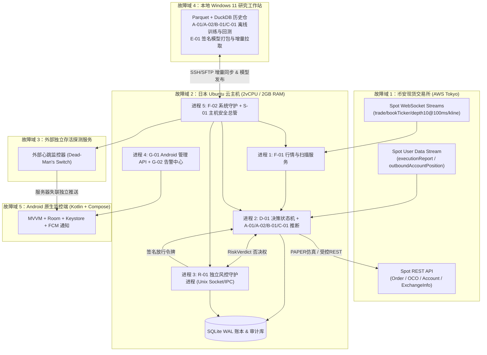
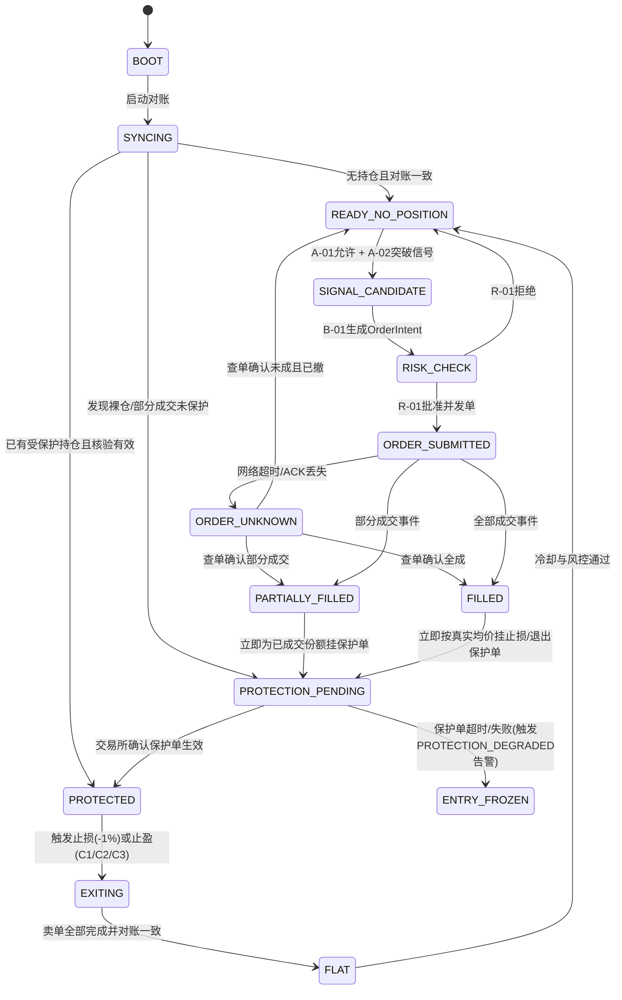

# MASTER-PLAN｜SUI-Quant V1.0 总体工程规划

> **状态**：`APPROVED_BASELINE_FOR_P0`｜**日期**：2026-10-31｜**适用范围**：仅限币安现货 `SUIUSDT` 向上突破交易（`BTCUSDT` 仅作环境特征），严格禁止 `LIVE` 默认开启。

---

## 01 任务理解与范围边界（引用设计文档章节）

- **业务边界（§0.1, §8.1）**：唯一交易标的为币安现货 `SUIUSDT`；只做向上放量突破、上涨趋势延续/二次放量；不做抄底、下跌加仓、做空、杠杆、借贷、合约或其他币种。`BTCUSDT` 仅作市场状态（A-01）与急跌风险过滤，禁止下单。`Stock-G` 完全不在本项目范围内。
- **止损与退出边界（§4.2, §6.1, §6.2）**：统一止损触发线为真实成交加权买入均价下跌 1%（`stop_trigger = actual_fill_weighted_entry_price * Decimal("0.99")`），1% 是触发阈值而非净亏损绝对上限；公平回测比较 C1（扣费净收益 +1.5% 全额止盈）、C2（上涨分批 3–4 档 + 追踪）、C3（自适应状态混合）。
- **环境与授权边界（§0.1, §15, §16）**：系统默认模式严格锁定为 `RESEARCH` 或 `PAPER`，严禁初始化为 `LIVE`。任何模型（A-01/A-02/B-01/C-01）不得直接下单，必须经 `D-01` 单一状态机入口与 `R-01` 独立风控审查。

---

## 02 仓库/运行环境现状（只读事实，明确哪些无法验证）

### 2.1 已实测验证事实（2026-10-31 只读探测）
1. **本地 Windows 11 研究机**：
   - CPU：`13th Gen Intel Core i5-13400F`（10 核 / 16 线程）
   - RAM：`15.72 GiB`
   - GPU：`NVIDIA GeForce RTX 5060`
   - 磁盘（`D:\`）：总容量 `931.51 GiB`，剩余可用 `620.37 GiB`
   - 软件栈：`Python 3.11.5`、`git 2.55.0.windows.3`
2. **日本 Ubuntu 云服务器（`<JAPAN_CLOUD_IP_REDACTED>`）**：
   - OS：`Ubuntu 26.04.1 LTS (Linux 7.0.0-30-generic x86_64)`
   - CPU：`2 vCPU`（`Intel Xeon Platinum 8255C @ 2.50GHz`）
   - RAM：`1962 MiB`（当前可用约 `1451 MiB`），Swap `2047 MiB`
   - 磁盘：`/` 总计 `49 GB`，可用 `41 GB`（已用 14%）
   - 时钟同步：`chronyd` Stratum 3，系统时钟偏差 `+0.000006391s`（约 6.4 微秒）
   - 到币安现货公网延迟：`https://api.binance.com/api/v3/ping` 实测往返延迟 `15.65 ms ~ 28.24 ms`；`stream.binance.com:9443` TLS 握手延迟 `15.58 ms`。
3. **币安现货公开接口实测事实（`GET /api/v3/exchangeInfo`）**：
   - `SUIUSDT` 与 `BTCUSDT` 状态均为 `TRADING`，支持 `LIMIT`、`LIMIT_MAKER`、`MARKET`、`STOP_LOSS`、`STOP_LOSS_LIMIT`、`TAKE_PROFIT`、`TAKE_PROFIT_LIMIT`，且 `ocoAllowed=True`、`otoAllowed=True`、`allowTrailingStop=True`、`cancelReplaceAllowed=True`。
   - `SUIUSDT` 关键过滤器：`tickSize = 0.00010000`、`stepSize = 0.10000000`（`minQty = 0.1`）、`minNotional = 5.00000000`、`MAX_NUM_ALGO_ORDERS = 5`、`MAX_NUM_ORDERS = 200`、`MAX_NUM_ORDER_LISTS = 20`。

### 2.2 当前无法验证的事项（需用户后续提供只读/测试凭据或进入对应阶段）
- **具体账户费率與 VIP 等级**：需账户级 `/api/v3/account` 或 `/api/v3/tradeFee` 查询，当前未录入任何 API Key（符合 P0 零密钥原则）。
- **账户级 OCO/OTOCO 锁仓细节与部分成交行为**：需在 P4/P5 阶段结合 Binance Spot Testnet 或沙盒仿真验证。
- **2vCPU/2GB 连续 72 小时真实负载水位**：需在 P2/P6 阶段运行真实 WebSocket 流压测确认。

---

## 03 方案及依赖图（含数据合同和关键失败模式）

### 3.1 端到端系统组件、进程与故障域图



### 3.2 事实源（Source of Truth）界定
| 数据流/状态 | 唯一事实源 | 本地缓存/派生状态处理原则 |
|---|---|---|
| 市场成交与盘口 | 币安现货 WebSocket + REST 校对 | 断线期间盘口不可凭空插值，标记 `DATA_UNHEALTHY` |
| 订单状态与成交均价 | 币安 `executionReport` + REST `/api/v3/order` | 超时进入 `ORDER_UNKNOWN`，必先按 `clientOrderId` 查单对账 |
| 账户可用余额与持仓 | 币安 `/api/v3/account` + 资产事件 | 重启或对账不一致时立即 `ENTRY_FROZEN`，以交易所余额重建账本 |
| 风控准入与限额 | `R-01` 独立风控进程 + 冻结配置 | `R-01` 心跳失联或配置哈希不匹配时，默认拒绝一切新增风险 |

### 3.3 D-01 交易与保护状态机


> 任何状态在收到 `R-01` 风控熔断或 `S-01` 安全事件时可立即转入 `ENTRY_FROZEN` 或 `SECURITY_LOCKDOWN`（冻结新开仓，但保留已有持仓的受控保护退出通道）。

---

## 04 待变更目录/文件清单（P0–P8 总体单仓结构）

```text
D:\OBR-SUI\
├── .gitignore
├── README.md
├── pyproject.toml
├── PHASE_HANDOFF.md
├── docs/
│   ├── SUI-Quant_V1_总体技术设计方案.md
│   ├── SUI-Quant_V1_Plan模式分阶段开发Prompts.md
│   ├── MASTER_PLAN.md
│   ├── P0_PLAN.md
│   ├── API_CAPABILITY_MATRIX.md
│   ├── THREAT_MODEL.md
│   ├── REQUIREMENTS_TRACEABILITY_MATRIX.md
│   └── adr/
│       ├── ADR-001-monorepo-and-fault-domains.md
│       ├── ADR-002-decimal-clock-and-contracts.md
│       ├── ADR-003-environment-isolation-and-live-gate.md
│       └── ADR-004-key-governance-and-redaction.md
├── src/
│   └── sui_quant/
│       ├── __init__.py
│       ├── contracts.py          # §7.1 十大标准跨模块数据契约 (严格Decimal/UTC)
│       ├── config.py             # R-01 风险配置Schema、环境闸门(RESEARCH/PAPER/LIVE)
│       ├── state_machine.py      # D-01 状态码枚举与合法状态迁移契约
│       ├── exchange_rules.py     # SUIUSDT/BTCUSDT 交易对精度与过滤器校验器
│       ├── security/
│       │   ├── __init__.py
│       │   └── redaction.py      # 日志与异常敏感信息脱敏器
│       └── utils/
│           ├── __init__.py
│           ├── clock.py          # UTC 与 monotonic_ns 双时钟工具
│           └── ids.py            # 幂等 clientOrderId 与事件ID生成器
└── tests/
    └── test_p0_contracts_and_gates.py
```

---

## 05 逐步实现计划（P0–P8 阶段依赖与资源预算）

| 阶段 | 前置依赖 | 核心交付 | 云端内存预算 (2GB 总量) | 门禁要求 |
|---|---|---|---|---|
| **P0** | MASTER-PLAN | ADR、契约、风控 Schema、环境硬闸门、API 能力矩阵、威胁模型、单元测试 | 0 MB（仅只读探测） | 单元测试 100% 通过，零实盘通路 |
| **P1** | P0 | `F-02` systemd 守护、业务心跳、`S-01` 安全巡检、外部失联探测 | ≤ 80 MB | 故障注入（kill -9/卡死/篡改）恢复通过 |
| **P2** | P1 | `F-01` 实时采集、质量标志、SQLite WAL、Windows Parquet/DuckDB 增量同步 | ≤ 350 MB | 断网重连、乱序去重、72h 内存无泄漏 |
| **P3** | P2 | `A-01` 状态分类、`A-02` 三障碍标签与校准概率模型、滚动样本外验证 | 离线在 Windows 运行 | 零未来函数泄漏、Brier/校准曲线达标 |
| **P4** | P2, P3 | `B-01` 盘口模拟限价执行、`D-01` 状态机、`R-01` 独立风控与账本对账 | ≤ 250 MB | PAPER 模式注入未知订单/部分成交对账通过 |
| **P5** | P3, P4 | `C-01` 三退出策略（C1/C2/C3）两层公平对照回测、保护单占用验证 | ≤ 150 MB | C1/C2/C3 同入场同费用对照报告完成 |
| **P6** | P4, P5 | `D-01/E-01` 整合、签名模型发布与回滚、全链路延迟与 72h 压测 | 总计 ≤ 1.2 GB（预留 800MB 余量） | P99 延迟达标、原子回滚演练通过 |
| **P7** | P1, P6 | `G-01` 原生 Kotlin+Compose Android App、`G-02` FCM 与前台弹窗 | 后端 API ≤ 120 MB | Android 真机/模拟器通知与紧急锁仓验证 |
| **P8** | P0–P7 | `QA-01 ~ QA-14` 总审计、长期 PAPER 观察、实盘授权申请书草稿 | 全系统稳定 ≤ 1.3 GB | 未获用户单独签名授权前严格锁定 PAPER |

---

## 06 测试清单（QA-01 ~ QA-14 映射）
详见 [`docs/REQUIREMENTS_TRACEABILITY_MATRIX.md`](file:///D:/OBR-SUI/docs/REQUIREMENTS_TRACEABILITY_MATRIX.md)，覆盖单元测试、契约校验、回放测试、故障注入、性能压测与安全演练。

---

## 07 验收标准：可测量门槛与具体证据文件路径
- 契约与门禁代码：[`src/sui_quant/contracts.py`](file:///D:/OBR-SUI/src/sui_quant/contracts.py)、[`src/sui_quant/config.py`](file:///D:/OBR-SUI/src/sui_quant/config.py)
- 自动化测试证据：[`tests/test_p0_contracts_and_gates.py`](file:///D:/OBR-SUI/tests/test_p0_contracts_and_gates.py)
- 接口实测矩阵：[`docs/API_CAPABILITY_MATRIX.md`](file:///D:/OBR-SUI/docs/API_CAPABILITY_MATRIX.md)
- 需求追踪矩阵：[`docs/REQUIREMENTS_TRACEABILITY_MATRIX.md`](file:///D:/OBR-SUI/docs/REQUIREMENTS_TRACEABILITY_MATRIX.md)

---

## 08 风险与备选方案（回滚与手动应急路径）
1. **SUIUSDT `stepSize=0.1` 导致买入扣费后产生碎股（Dust）无法全额挂止损/止盈单**：
   - **缓解与备选**：在 `B-01/C-01` 中强制根据实际到账净持仓按 `stepSize=0.1` 向下取整（`ROUND_DOWN`）计算可卖保护数量，或验证账户开启 BNB 抵扣手续费（需留存充足 BNB 并在 BNB 不足时自动降级为向下取整）。
2. **2vCPU/2GB 内存下 `depth10@100ms` 高频对象分配引发 GC 抖动**：
   - **缓解与备选**：采用固定长度环形缓冲区（Ring Buffer）与预分配槽位，支持配置动态降级为 `1000ms` 盘口更新。
3. **云主机单点故障导致软止损失效**：
   - **缓解与备选**：优先使用币安交易所端托管的原生保护单（OCO / `STOP_LOSS_LIMIT`）+ 外部独立心跳失联告警。

---

## 09 未验证假设及阻塞项
- **对 P0 无阻塞**：P0 仅依赖公开 API 与只读主机探测，已全部实测完成。
- **后续阶段待办**：用户币安现货账户的实际 VIP 费率、Testnet/主网只读核验凭据、FCM 项目配置凭据（将在对应阶段按最小权限接入）。

---

## 10 等待审查的问题与结论
- `MASTER-PLAN` 已完成并作为 `P0` 的直接输入基线。
