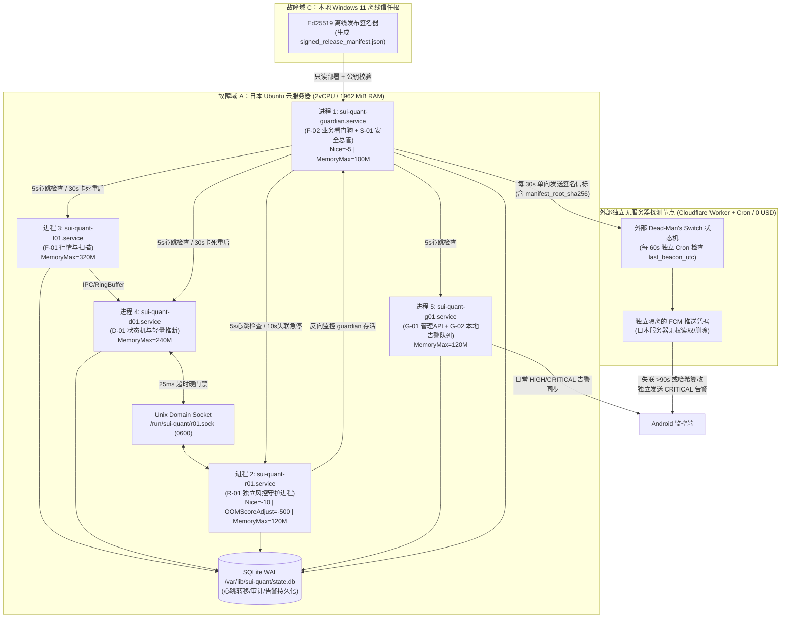

# P1-PLAN（修订版 V1.1）｜服务器基础安全（S-01）、全系统守护（F-02）、独立风控进程存活与外部独立故障域探测

> **阶段编号**：P1｜**计划版本**：V1.1（按监理审查反馈全面修订）｜**当前状态**：`READY_FOR_REVIEW`  
> **严格执行边界**：本阶段处于 **PLAN 模式**，在获得监理与用户明确批准前，**不修改远程云服务器、不部署生产服务、不录入任何真实资金 API 密钥、不发起任何真实订单**。P1 恢复对账全部使用确定性模拟数据（`SimulatedExchangeState`）与故障注入进行验证。

---

## 01 任务理解与范围边界（引用设计文档章节）

1. **核心任务（§1, §7, §8.2, §9, §10, §12.2, §14.2 QA-05/09/10）**：
   - **F-02 全系统运行守护**：在 2vCPU / 2GB RAM / 49GB SSD 日本云主机上通过 `systemd` 隔离管理五类服务（行情 `f01`、决策 `d01`、独立风控 `r01`、管理接口 `g01`、守护与安全总管 `guardian`），结合 5s 业务心跳、30s 事件循环卡死检测、崩溃 10s 内恢复、重启风暴熔断（Circuit Breaker）与受控恢复门禁。
   - **重启状态与恢复铁律（§7, §9）**：任何服务启动或崩溃恢复后，**默认禁止新开仓**，强制进入 `BOOT -> SYNCING`；必须完成五项核验（风控存活与配置哈希、安全状态与磁盘/时钟、行情流连续性、动态 `exchangeInfo` 过滤器刷新、模拟订单与持仓保护对账）后才允许进入 `READY_NO_POSITION` 或 `PROTECTED`；核验失败或超时立即锁定为 `ENTRY_FROZEN`。
   - **R-01 独立风控进程隔离与存活监控（§8.2）**：`R-01` 作为独立 OS 进程运行，享有最高 CPU/OOM 优先级，绝不导入或执行重型模型计算；`R-01` 失联或超时即遵循 Fail-Closed 原则立即禁止一切新增风险，同时保留已验证的减仓/保护退出通道。
   - **S-01 主机安全总管与可信基线（§10）**：覆盖 SSH 异常登录、账户/权限/sudoers 变化、关键文件篡改（基于**离线 Ed25519 签名的可信发布清单 + 外部心跳哈希比对**，不依赖同机可被 root 篡改的普通摘要）、可疑进程、未授权监听端口与磁盘水位监控；触发严重安全事件时立即进入 `SECURITY_LOCKDOWN`（冻结新开仓、保留已有保护单、保全现场证据）。
   - **远程访问防锁死协议**：任何 SSH、UFW 或网络访问配置修改前，强制执行备份、云平台带外 VNC/串行控制台核验、`systemd-run` 180 秒死人开关自动回滚定时器及双会话分阶段验证。
   - **外部独立故障域存活探测（§10, §12.2）**：在独立于日本云主机的外部无服务器边缘节点部署超时判定与告警发送主体（Dead-Man's Switch），确保日本服务器整机断电/断网时仍能在 90 秒内独立触发 Android 告警。

---

## 02 仓库/运行环境现状（只读事实，明确哪些无法验证）

### 2.1 已确认只读事实
- **日本云服务器硬件与系统**：`Ubuntu 26.04.1 LTS (Linux 7.0.0-30-generic x86_64)`，2 vCPU（`Intel Xeon Platinum 8255C @ 2.50GHz`），物理内存 `1962 MiB`（另有 `2047 MiB` Swap），根分区 `/` 总计 `49 GB`（已用 `6.1 GB`，可用 `41 GB`），`chronyd` NTP 同步偏差约 `6.4 μs`。
- **前期已完成的基础加固**：已启用 `PermitRootLogin no`、`AllowUsers ubuntu`、`MaxAuthTries 3`、`UFW`（默认拒绝入站，仅放行 `22/tcp`）、`Fail2Ban`（针对 `_SYSTEMD_UNIT=ssh.service` 激进模式封禁）及 `/etc/sysctl.d/99-security-hardening.conf`。
- **本地代码基座（P0 已完成）**：已完成十大 `Decimal/UTC` 契约、Ed25519 签名 `LiveAuthorizationToken`、动态/静态 `SymbolFilters` 区分、买前可保护性与碎股计算、`D-01` 状态机守卫及日志脱敏器（`12 passed`）。

### 2.2 P1 阶段不涉及/模拟替代事项
- **不接入真实币安资金 API 密钥**：P1 旨在验证守护、安全与故障恢复基座，所有 `BOOT -> SYNCING` 订单与持仓恢复均通过确定性模拟状态注入器（`SimulatedExchangeReconciler`）验证。

---

## 03 方案及依赖图（含数据合同和关键失败模式）

### 3.1 五进程隔离、R-01 独立风控与外部探测拓扑图



### 3.2 任务二核心设计细则

#### (1) F-02 `systemd` 守护、应用心跳、故障熔断、重启状态与恢复条件
- **`systemd` 单元与重启风暴熔断（Circuit Breaker）**：
  - 所有服务配置 `Restart=on-failure`、`RestartSec=5s`、`TimeoutStopSec=15s`、`WatchdogSec=30s`。
  - **重启风暴熔断**：配置 `StartLimitIntervalSec=300`、`StartLimitBurst=5` 及 `OnFailure=sui-quant-circuit-breaker@%n.service`。若任一服务在 5 分钟内崩溃达到 5 次，`systemd` 停止盲目重启，自动触发熔断单元将全局状态写入 `ENTRY_FROZEN`（原因码：`SERVICE_CRASH_LOOP`），并发出单条聚合 `CRITICAL` 告警，防止无限重启引发告警风暴和 API 封禁。
- **应用级业务心跳（区别于进程存活）**：
  - 各服务主事件循环每 `5 秒`（`HEARTBEAT_INTERVAL_SEC = 5`）必须执行一次实际协程调度并更新 [`ServiceHeartbeat`](file:///D:/OBR-SUI/docs/P1_PLAN.md)：
    ```text
    ServiceHeartbeat:
      service_name: str
      pid: int
      boot_id: str
      monotonic_ns: int          # 单调时钟纳秒，用于防墙上时钟跳变
      wall_time_utc: datetime
      loop_tick_seq: int         # 事件循环递增序号，卡死时停滞
      last_work_time_utc: datetime
      rss_bytes: int
      service_state: str
    ```
  - **卡死判定（Stall Detection）**：若进程 PID 仍存在，但 `monotonic_ns` 或 `loop_tick_seq` 连续 `30 秒` 未推进（例如死锁、同步 I/O 阻塞），`F-02` 立即先通过 `kill -SIGUSR1` 采集线程/协程堆栈写入审计日志，同时将 `D-01` 置为 `ENTRY_FROZEN`，随后调用 `systemctl restart` 重启卡死服务（崩溃或卡死后 10 秒内开始恢复流程）。
- **重启状态与五项恢复门禁（`BOOT -> SYNCING -> READY`）**：
  - 任何进程启动或重启后，初始状态硬编码为 `TradingState.BOOT`，立即进入 `TradingState.SYNCING`，此时 `allow_new_entry = False`。
  - 只有同时通过以下 **5 项恢复核验（Reconciliation Gates）** 才允许转入 `READY_NO_POSITION`（无仓位时）或 `PROTECTED`（已有完好保护仓位时）：
    1. **Gate 1（风控就绪）**：`R-01` 心跳新鲜度 `<= 10s`，且 `R-01` 内存中的 `RiskConfig.canonical_sha256()` 与签名清单一致；
    2. **Gate 2（安全与宿主机健康）**：`S-01` 无未解除的 `SECURITY_LOCKDOWN`，磁盘可用空间 `>= 15%`（`>= 7.3 GB`），`chronyd` 时钟偏移 `< 100 ms`；
    3. **Gate 3（行情流健康）**：`F-01` 的 `SUIUSDT` 与 `BTCUSDT` 数据流处于连接且无未修复缺口状态（`DataQuality.OK`）；
    4. **Gate 4（动态交易规则新鲜）**：`SymbolFilters` 已完成运行时刷新（`source == DYNAMIC_EXCHANGE_INFO` 且年龄 `<= 3600s`）；
    5. **Gate 5（账本与保护单核对）**：核对账户余额、活动订单与本地 `PositionLedger`。若发现未保护持仓（`actual_qty > reserved_qty`），立即转入 `PROTECTION_PENDING` 优先补齐止损保护；若补保护失败或对账不一致，立即锁定为 `ENTRY_FROZEN` 并触发 `CRITICAL` 告警。

#### (2) R-01 独立风控进程的隔离运行与双向存活监控
- **物理进程与计算隔离**：
  - `sui-quant-r01.service` 为独立 Python 进程，**严禁导入任何机器学习/特征计算库（LightGBM/scikit-learn/numpy/pandas）**，仅运行纯内存定点数（`Decimal`）风控规则核验与速率计数器，保证单次风控判定 `P99 <= 5ms`（远低于 `25ms` SLO）。
  - OS 调度保护：配置 `Nice=-10`、`CPUWeight=500`、`OOMScoreAdjust=-500`（即使系统内存紧张，内核 OOM Killer 也优先终止其他进程而绝不杀死 `R-01` 和 `guardian`）。
- **非阻塞 IPC 与 Fail-Closed 熔断**：
  - `D-01` 通过异步 Unix Domain Socket（`/run/sui-quant/r01.sock`，权限 `0600`）向 `R-01` 请求 `RiskVerdict`，硬超时设为 `25ms`。
  - **Fail-Closed 铁律**：若 `R-01` 进程崩溃、心跳超过 `10 秒` 未更新、或 Socket 请求超时，`D-01` **无条件拒绝一切新开仓请求**并立即转入 `ENTRY_FROZEN`；同时，已持仓位的止损触发与紧急减仓退出逻辑拥有预授权降级通道，绝不因 `R-01` 重启而阻塞平仓避险。
  - **双向互监（Mutual Watchdog）**：不仅 `F-02 (guardian)` 监控 `R-01`，`R-01` 内部也独立检查 `guardian` 的心跳（若 `guardian` 自身停止心跳超过 `15 秒`，`R-01` 直接接管冻结开关，强制撤回所有新开仓许可并通过本地应急通道写入 `CRITICAL` 告警与触发 `systemd` 恢复 `guardian`）。

#### (3) 外部独立故障域存活探测（Dead-Man's Switch）设计
- **独立超时判断与告警发送主体**：
  - **部署位置**：部署在完全独立于腾讯云日本机房的外部无服务器平台——**Cloudflare Workers + Cron Triggers + Workers KV**（全球边缘网络，与日本云主机无共享物理硬件、网络或云账号依赖）。
  - **费用预算**：Cloudflare Workers 免费计划提供每日 `100,000` 次请求与每分钟 Cron 触发，本项目每 30 秒一次信标（每日仅 `2,880` 次请求）+ 每 60 秒一次 Cron 检查（每日 `1,440` 次），**费用严格为 `$0 / 月`**，无需新增付费服务。
  - **运行机制**：
    1. 日本云主机 `sui-quant-guardian` 每 `30 秒` 向 Worker 发送带时间戳与 HMAC 签名的 `HeartbeatBeacon`（含 `boot_id`, `utc_ts`, `trading_state`, `r01_healthy`, `manifest_root_sha256`）。
    2. Cloudflare Worker 端的独立 Cron 每 `60 秒` 唤醒一次，读取 KV 中的 `last_beacon_utc`：
       - 若 `now_utc - last_beacon_utc > 90 秒`（连续丢失 3 个信标），**由 Cloudflare Worker 自身**直接判定 `SERVER_UNREACHABLE`；
       - 若信标中的 `manifest_root_sha256` 与 Worker KV 中锁定的合法发布哈希不一致，**由 Cloudflare Worker 自身**判定 `REMOTE_MANIFEST_TAMPERED`；
       - Worker 立即调用 **Firebase Cloud Messaging (FCM) HTTP v1 API** 向用户 Android 手机发送高优先级 `CRITICAL` 通知。
  - **凭据单向隔离与 `root` 沦陷边界声明（Task A.6 修正）**：
    - 日本云主机仅配置 `DMS_BEACON_WRITE_TOKEN`（仅具备向外部探测器发送信标的权限）。
    - **外部通知凭据仅保存在外部独立探测域，日本云主机上完全不存在该凭据副本**：若日本云主机彻底断电、断网或内核崩溃，外部探测器必定因超时独立发出告警。
    - **诚实安全边界声明（拒绝过度承诺）**：若攻击者已获取日本云主机的 **`root` 权限**，攻击者可从本机内存/配置提取 `DMS_BEACON_WRITE_TOKEN` 与历史 `manifest_root_sha256` 并伪造正常心跳信标，因此**外部 Dead-Man's Switch 仅能可靠检测“整机失联/进程崩溃/未伪造信标的普通篡改”，不能保证检测高级 `root` 攻击者的信标重放/伪造**。针对单机 `root` 沦陷的唯一有效兜底边界是机外隔离：P0/P1 零交易所私钥上云、实盘阶段币安服务端强制禁用提现权限 + 现货 `SUIUSDT` 白名单 + 子账户物理本金上限，详见 [`THREAT_MODEL.md §4`](file:///D:/OBR-SUI/docs/THREAT_MODEL.md)。

#### (4) S-01 主机安全监控六大维度与“机外签名文件基线”（含 `root` 威胁边界修正）
- **防御非特权篡改与同机摘要伪造的机制**：
  1. **离线 Ed25519 签名发布清单（`signed_release_manifest.json`）**：在本地 Windows 11 研究机打包部署时，对所有受控代码文件（`src/sui_quant/**/*.py`）、系统服务配置（`deploy/systemd/*`）、SSH 加固配置（`/etc/ssh/sshd_config.d/01-security-hardening.conf`）及风控基线计算 SHA-256，并使用**仅存于本地 Windows 11 的离线 Ed25519 发布私钥**对整份清单生成数字签名 `manifest_ed25519_sig`。
  2. **双重校验（本机公钥验签 + 外部信标比对）及真实安全边界**：
     - 云端 `S-01` 每 `60 秒` 重新计算上述受控文件的 SHA-256，并用代码级固定的 Ed25519 公钥验证 `signed_release_manifest.json` 签名；
     - 同时，`S-01` 将实时计算的受控文件聚合根哈希（`live_merkle_root_sha256`）放入发往外部探测器的信标中。
     - **【Task A.6 强制修正：明确 `root` 入侵局限性】**：上述 `S-01` 本地公钥验签与信标哈希比对，**仅能防御非 `root` 权限下的文件篡改、配置漂移、供应链中间人篡改或未修改 `S-01` 二进制/内存的普通入侵**。若攻击者已获得日本云主机的 `root` 权限，攻击者可直接修改 `S-01` 进程内存中的公钥常量、绕过本地校验并向外部伪造携带旧 `manifest_root_sha256` 的信标。本方案绝不声称任何单机内部软件机制能抵御同机 `root` 沦陷。
- **S-01 六大巡检维度与响应矩阵**：
  | 巡检维度 | 检测数据源与频率 | 异常判定阈值 | 触发动作与安全状态 |
  |---|---|---|---|
  | **1. SSH 异常登录** | `journalctl _SYSTEMD_UNIT=ssh.service` (实时流 + 30s 轮询) | ① 非 `ubuntu` 用户登录尝试；② 5m 内失败 `>=10` 次；③ 未在白名单时段/IP 的成功登录 | ①/② 记录并校验 `Fail2Ban` 封禁；③ 立即 `SECURITY_LOCKDOWN` + `CRITICAL` 告警 |
  | **2. 权限与账户变更** | `/etc/passwd`, `/etc/shadow`, `/etc/sudoers*`, `~/.ssh/authorized_keys`, 关键文件 mode (30s) | 新增 UID=0 账户、`sudoers` 变更、`authorized_keys` 未知指纹、凭据文件权限非 `0600` | 立即 `SECURITY_LOCKDOWN` + 保全证据快照 + `CRITICAL` 告警 |
  | **3. 关键文件篡改** | `src/sui_quant/`, `config`, `systemd`, `sshd_config` (60s + 启动时) | 任一文件 SHA-256 偏离 Ed25519 签名清单或验签失败 | 立即 `SECURITY_LOCKDOWN`（冻结新仓、保留保护单）+ `CRITICAL` 告警 |
  | **4. 可疑进程巡检** | `/proc/[pid]/exe`, `cmdline`, `environ` (30s) | 非白名单二进制、反弹 Shell (`nc`/`socat`/`bash -i`)、挖矿进程、未知出站连接 | 立即 `SECURITY_LOCKDOWN` + 记录 `/proc` 快照取证 + `CRITICAL` 告警 |
  | **5. 监听端口审计** | `/proc/net/tcp*`, `/proc/net/udp*` (`ss -tulpn` 等效解析, 30s) | 出现除 `22/tcp`, `53/udp+tcp(lo)`, `323/udp(lo)`, `G-01受控端口` 以外的任何监听端口 | 立即 `SECURITY_LOCKDOWN` + `CRITICAL` 告警 |
  | **6. 磁盘与 Inode 水位** | `os.statvfs("/")`, SQLite WAL 大小 (30s) | 可用空间 `< 20%` (`HIGH` 告警并强制轮转清理)；可用空间 `< 15%` 或 Inode `> 85%` | `< 15%` 立即 `ENTRY_FROZEN` (`DISK_WATERMARK_CRITICAL`) |

#### (5) 修改 SSH、UFW 或远程访问配置的“四步防锁死协议”
在任何阶段如需变更云主机 `/etc/ssh/*`、`/etc/ufw/*` 或网卡配置，严禁直接执行 `systemctl restart ssh` 或 `ufw reload`，必须通过 [`deploy/scripts/safe_network_apply.sh`](file:///D:/OBR-SUI/docs/P1_PLAN.md) 执行以下四步防锁死流程：
1. **Step 1（完整快照备份）**：将 `/etc/ssh`、`/etc/ufw`、`/etc/fail2ban` 打包备份至 `/var/backups/sui-quant/net-rollback-<utc_ts>.tar.gz` 并校验 SHA-256。
2. **Step 2（带外控制台就绪确认）**：确认 `serial-getty@ttyS0.service` 处于 `active` 状态（确保腾讯云 Web VNC / 串行救急控制台随时可免网络登录）。
3. **Step 3（挂载 180 秒自动回滚死人开关）**：在应用新配置前，先启动独立定时回滚任务：
   `sudo systemd-run --unit=sui-net-rollback --on-active=180s /bin/bash /var/backups/sui-quant/restore_latest_net.sh`
4. **Step 4（语法预检 + 双会话验证后解除回滚）**：
   - 先执行 `sudo sshd -t` 验证语法无误；
   - Reload 配置后**保持当前 SSH 会话不断开**，从本地另起一个全新的独立 SSH 连接并测试 `sudo -n whoami`；
   - 只有新会话连接并提权成功后，才执行 `sudo systemctl stop sui-net-rollback.timer` 取消回滚；若新配置导致断连，180 秒后定时器自动还原备份并重启 `ssh` 与 `ufw`。

---

## 04 适配 2vCPU / 2GB RAM / 49GB SSD 的资源预算表（任务二第 6 项）

### 4.1 内存预算分配表（总物理内存：`1,962 MiB`）
| 单元 / 组件名称 | 常态 RSS 预算 | 峰值 RSS 预算 | `systemd MemoryHigh` (限流线) | `systemd MemoryMax` (硬上限) | `OOMScoreAdjust` | 说明 |
|---|---|---|---|---|---|---|
| **Linux 内核 + OS 基础服务** (`sshd`, `systemd`, `journald`, `chronyd`, `fail2ban`) | `280 MiB` | `350 MiB` | — | — | `-900` (sshd) | 实测当前空闲态约 `310 MiB` |
| **`sui-quant-r01.service`** (独立风控进程) | `35 MiB` | `70 MiB` | `90 MiB` | `120 MiB` | `-500` | 纯标准库 + `Decimal`，高优保活 |
| **`sui-quant-guardian.service`** (`F-02` 守护 + `S-01` 安全) | `35 MiB` | `65 MiB` | `80 MiB` | `100 MiB` | `-400` | 巡检与心跳看门狗 |
| **`sui-quant-f01.service`** (`F-01` 行情与 100ms 盘口环形缓存) | `120 MiB` | `240 MiB` | `280 MiB` | `320 MiB` | `+100` | 固定长度 RingBuffer，禁无限堆积 |
| **`sui-quant-d01.service`** (`D-01` 状态机 + `A01/A02/B01/C01` 推断) | `90 MiB` | `180 MiB` | `200 MiB` | `240 MiB` | `+100` | 仅加载轻量推断模型，无训练任务 |
| **`sui-quant-g01.service`** (`G-01` Android API + `G-02` 告警队列) | `45 MiB` | `90 MiB` | `100 MiB` | `120 MiB` | `+200` | 异步 HTTPS/WS 只读状态接口 |
| **OS Page Cache & 安全余量（Safety Buffer）** | **`1,357 MiB`** | **`967 MiB`** | — | — | — | **即使全服务同时达 `MemoryMax` (`900 MiB`)，仍留有 `> 710 MiB` 物理内存余量，绝不触发 Swap 抖动** |
| **总计** | **`605 MiB` 已用** | **`995 MiB` 峰值** | **合计 `750 MiB`** | **合计 `900 MiB`** | — | 另配 `2,047 MiB` Swap 仅作极端兜底 |

### 4.2 磁盘容量预算分配表（总根分区容量：`49.0 GB`）
| 存储项 | 路径 | 配额上限 (`Max Quota`) | 轮转 / 清理策略 |
|---|---|---|---|
| Ubuntu OS 与基础软件包 | `/usr`, `/lib`, `/var/lib/apt` | `7.5 GB` (当前 `6.1 GB`) | 定期清理 `apt clean` |
| SQLite WAL 核心交易与审计账本 | `/var/lib/sui-quant/state.db` | `2.0 GB` | WAL 自动 checkpoint (`wal_autocheckpoint=1000`) |
| 近期短期行情/盘口滚动缓存 | `/var/lib/sui-quant/market_spool/` | `4.0 GB` | 按小时分片，Windows 同步后或超 72h 自动滚动删除最旧分片 |
| 应用脱敏结构化日志 | `/var/log/sui-quant/*.log` | `500 MB` | `logrotate` 每日轮转，单文件 `50MB`，保留 10 份 (`gzip`) |
| `systemd-journald` 系统日志 | `/var/log/journal/` | `500 MB` | 配置 `SystemMaxUse=500M`, `MaxRetentionSec=14day` |
| 安全取证与网络配置备份仓 | `/var/backups/sui-quant/` | `1.5 GB` | 保留最近 30 次配置快照与异常取证包 |
| **强制保留空闲磁盘安全余量** | `/` | **`>= 33.0 GB` (> 67% 空闲)** | **低于 `20%` (`9.8 GB`) 触发 `HIGH` 告警与自动清理；低于 `15%` (`7.3 GB`) 立即触发 `ENTRY_FROZEN`** |

---

## 05 告警分级、事件去重、持久化与推送失败补偿机制（任务二第 7 项）

1. **三级告警定义与强制安全动作**：
   - `INFO`：日常巡检通过、常规 `Fail2Ban` 封禁计数、定时同步完成 → 写入 SQLite `alert_events` 表，汇总入每日安全与运行日报，不实时弹窗。
   - `HIGH`：单次服务崩溃已自动恢复、磁盘水位低于 20%、WebSocket 重连、API 速率达预算 70% → 持久化并推送 Android 系统通知；同 `dedup_key` 在 **5 分钟冷却窗（`300s`）** 内去重，仅累加 `occurrence_count` 与更新 `last_seen_utc`。
   - `CRITICAL`：`R-01` 失联、恢复对账失败、未保护持仓、磁盘水位低于 15%、SSH 未知成功登录、关键文件 SHA-256/Ed25519 验签失败、未知监听端口/可疑进程、服务器完全失联 →
     - **立刻执行本地硬保护动作**：系统类故障转入 `ENTRY_FROZEN`，安全入侵类事件转入 `SECURITY_LOCKDOWN`（**严禁增加任何新风险，同时严格保留已有持仓的止损保护单**）；
     - **告警风暴抑制**：同一 `dedup_key` 的 `CRITICAL` 告警首次出现立即高优推送；若持续触发，按指数退避窗口（`1m -> 5m -> 15m -> 60m`）发送状态汇总更新，既保证不漏报，又防止把通知通道打挂。
2. **推送状态机与断网补偿（绝不谎报送达）**：
   - 每条告警在 SQLite WAL 中维护 `delivery_status ∈ {PENDING, SENT_AWAITING_ACK, DELIVERED, FAILED_RETRYING}`。
   - 当 FCM 或网络不通时，告警保持 `FAILED_RETRYING` 并按指数退避重试；绝不将“已调用发送函数”等同于“已送达（`DELIVERED`）”。当 Android App 重新连接 `G-01` 接口时，自动按 `last_ack_alert_id` 拉取所有未确认的历史告警进行补偿展示。

---

## 06 待变更目录/文件清单（P1 实施阶段受控范围）

- **新增代码（待 P1 获批后实施）**：
  - `src/sui_quant/daemon/__init__.py`
  - `src/sui_quant/daemon/heartbeat.py`（`ServiceHeartbeat`、5s 心跳写入、30s 卡死检测、重启风暴熔断器、`BOOT -> SYNCING` 五门禁恢复协调器、`SimulatedExchangeReconciler`）
  - `src/sui_quant/daemon/r01_server.py`（`R-01` 独立风控进程服务端与 Unix Socket 非阻塞协议、双向互监看门狗）
  - `src/sui_quant/daemon/security_supervisor.py`（`S-01` Ed25519 签名清单校验、SSH/权限/进程/端口/磁盘六维巡检、`SECURITY_LOCKDOWN` 触发与取证保全）
  - `src/sui_quant/daemon/alert_manager.py`（`G-02` 告警分级、冷却去重、告警风暴抑制、SQLite 持久化与重试状态机）
  - `src/sui_quant/daemon/external_probe.py`（外部 Dead-Man's Switch 信标签名发送器 + 独立边缘 Worker 超时判定与 FCM 告警逻辑）
  - `deploy/systemd/`（五类服务 `.service` 单元、资源配额、熔断单元与 `journald`/`logrotate` 配置模板）
  - `deploy/scripts/safe_network_apply.sh`（四步防锁死网络/防火墙变更脚本）
- **新增测试（待 P1 获批后实施）**：
  - `tests/test_p1_fault_injection_matrix.py`（覆盖任务三全部 `FI-01 ~ FI-10` 故障注入与恢复证明）

---

## 07 P1 故障注入与安全验收测试矩阵（任务三完整证据计划）

| 用例编号 | 注入故障场景 | 执行测试命令 | 预期行为与可测量成功标准 | 日志与持久化证据路径 | 失败后的安全保底状态 |
|---|---|---|---|---|---|
| **FI-01** | **进程 `kill -9` 与自动恢复** | `pytest tests/test_p1_fault_injection_matrix.py -k test_fi01_kill9_recovery`（云端验收：`sudo kill -9 $(pidof sui-quant-f01)`） | `guardian`/`systemd` 在 `<= 10s` 内启动新进程；新进程启动初始状态必为 `BOOT -> SYNCING`，通过 5 项恢复门禁后才进入 `READY_NO_POSITION`；恢复期间 `allow_new_entry == False` | `state.db` 中 `state_transitions` 与 `service_heartbeats` 表记录 | `ENTRY_FROZEN` |
| **FI-02** | **事件循环卡死（Event Loop Stall）** | `pytest tests/test_p1_fault_injection_matrix.py -k test_fi02_event_loop_stall`（注入阻塞 `time.sleep(35)` 冻结 `loop_tick_seq`） | 进程虽存活，但 `loop_tick_seq` 停滞达 `30s` 时被 `F-02` 准确识别为 `STALLED`；立即冻结新开仓、转储堆栈并触发重启恢复 | `/var/log/sui-quant/guardian.log` 含 `STALL_DETECTED` 与堆栈摘要 | `ENTRY_FROZEN` |
| **FI-03** | **网络断线（Network Blackhole）** | `pytest tests/test_p1_fault_injection_matrix.py -k test_fi03_network_disconnect` | 行情流与对账请求超时后，`Gate 3` 判定 `DATA_UNHEALTHY`，`<= 1s` 内禁止新开仓；重连采用指数退避+抖动，恢复数据一致性前保持冻结 | `state.db` 中 `AlertEvent(source="F-01", dedup_key="NET_DISCONNECT")` | `ENTRY_FROZEN` |
| **FI-04** | **磁盘满 / 水位越限** | `pytest tests/test_p1_fault_injection_matrix.py -k test_fi04_disk_watermark`（注入模拟 `statvfs` 可用空间 `18%` 与 `12%`） | 可用空间 `< 20%` 触发 `HIGH` 告警并启动日志/缓存清理；`< 15%` (`12%`) 立即触发 `CRITICAL` 告警并强制转入 `ENTRY_FROZEN` | `state.db` 中 `AlertEvent(dedup_key="DISK_WATERMARK_CRITICAL")` | `ENTRY_FROZEN` |
| **FI-05** | **服务器完全失联（外部探测）** | `pytest tests/test_p1_fault_injection_matrix.py -k test_fi05_complete_server_blackout`（停止发送外部信标 `> 90s`） | 外部独立探测器（Dead-Man's Switch）在 `now - last_beacon > 90s` 时独立生成 `CRITICAL` `SERVER_UNREACHABLE` 告警并调用独立 FCM 通道 | 外部探测器审计日志与 `CRITICAL` 推送载荷记录 | 交易所端原生保护单兜底 + 恢复后强制 `SYNCING` |
| **FI-06** | **SSH 异常登录与越权提权** | `pytest tests/test_p1_fault_injection_matrix.py -k test_fi06_ssh_anomaly_and_lockdown`（注入非白名单 IP 登录/未知用户成功日志） | `S-01` 在 `<= 5s` 内捕获异常日志，立即发出 `CRITICAL` 告警，将系统状态切换至 `SECURITY_LOCKDOWN`，禁止一切新开仓但**不撤销已有保护单** | `state.db` 中 `TradingState.SECURITY_LOCKDOWN` 迁移与证据包路径 | `SECURITY_LOCKDOWN` |
| **FI-07** | **风控配置或代码被篡改（含同机摘要伪造攻击）** | `pytest tests/test_p1_fault_injection_matrix.py -k test_fi07_tampered_config_and_manifest`（修改配置并尝试伪造本地哈希，无离线 Ed25519 私钥） | 本机 `S-01` 因 Ed25519 签名验证失败立即识别篡改；同时外部探测器因 `manifest_root_sha256` 失配独立报警；系统立即锁定为 `SECURITY_LOCKDOWN` | `AlertEvent(dedup_key="S01_INTEGRITY_VIOLATION")` | `SECURITY_LOCKDOWN` |
| **FI-08** | **守护服务或独立风控自身故障** | `pytest tests/test_p1_fault_injection_matrix.py -k test_fi08_guardian_and_r01_self_failure`（分别注入 `R-01` 失联与 `guardian` 失联） | ① `R-01` 失联 `> 10s` 或 IPC 超时 `> 25ms`：`D-01` 立即 Fail-Closed 进入 `ENTRY_FROZEN`；② `guardian` 失联 `> 15s`：`R-01` 反向看门狗立即收回开仓许可并拉起告警 | `state_transitions` 记录 `R01_HEARTBEAT_LOST` / `GUARDIAN_LOST` | `ENTRY_FROZEN` |
| **FI-09** | **多次重启风暴与告警风暴抑制** | `pytest tests/test_p1_fault_injection_matrix.py -k test_fi09_crash_loop_and_alert_storm`（连续注入 6 次崩溃与 100 条重复异常） | 5 分钟内第 5 次崩溃触发熔断器停止无限重启并锁定 `ENTRY_FROZEN`；100 条重复告警被冷却去重合并为 1 条活动告警（`occurrence_count=100`），推送通道不拥塞 | `alert_events` 表 `occurrence_count == 100` 且实际外发次数 `== 1` | `ENTRY_FROZEN` |
| **FI-10A** | **72 小时加速模拟与资源回归压测（`ACCELERATED_SIMULATION_ONLY`）** | `python -m sui_quant.daemon.soak_runner --mode soak --duration-hours 72 --cycles 2160`（**严禁与真实 72 小时墙钟运行混用**） | 仅验证 2,160 个虚拟时钟周期的快速逻辑回归：RSS 线性斜率 `<= 0.1 MB/h`、FD 句柄不泄漏、`R-01` P99 `<= 25ms` | 输出 JSON 强制包含 `"is_real_72h_wallclock_proof": false` | 逻辑回归失败阻断提交 |
| **FI-10B** | **日本服务器真实连续 72 小时墙钟稳定性运行观测（`REAL_WALLCLOCK_72H_OBSERVATION`）** | `systemctl status sui-quant-72h-observer.service`（运行 `sui_quant.daemon.real_72h_observer` 每 60s 采样，持续 259,200 真实秒） | 必须满 `72.0` 真实墙钟小时（`259,200s`）且期间 `oom_kill_delta == 0`、异常重启 `== 0`、心跳正常，状态方可由 `PENDING` 转为 `PASS` | `/var/log/sui-quant/real_72h_observation.jsonl` 与 `real_72h_status.json` | 未满 72 真实小时前严格保持 **`PENDING`** |

---

## 08 风险与备选方案（具体描述回滚与手动应急路径）

| 编号 | 风险项 | 严重度 | 阻断属性 | 回滚与手动应急路径 |
|---|---|---|---|---|
| **RSK-P1-01** | 修改云主机防火墙或 SSH 导致远程连接中断 | `CRITICAL` | 潜在阻断 | 严格执行第 03.(5) 节“四步防锁死协议”（180 秒自动回滚定时器 + 腾讯云 Web VNC 串行控制台兜底）。 |
| **RSK-P1-02** | SQLite WAL 在高频心跳写入下发生 `database is locked` 或 WAL 文件膨胀 | `HIGH` | 非阻断 | 开启 `PRAGMA journal_mode=WAL; PRAGMA synchronous=NORMAL; PRAGMA busy_timeout=5000; PRAGMA wal_autocheckpoint=1000;`；5s 心跳同时写入 `/run/sui-quant/` 内存文件系统（`tmpfs`），零磁盘 I/O 阻塞。 |
| **RSK-P1-03** | 外部免费 Worker 节点偶发网络抖动造成单次信标丢失误报 | `MEDIUM` | 非阻断 | 采用“每 30 秒发送、连续丢失 3 次（90 秒）才触发 `CRITICAL` 失联告警”的容错窗口，消除单包抖动误报。 |

---

## 09 未验证假设及未完成项（严格标记为 `PENDING`，绝不伪报 `PASS`）

1. **`PENDING` — 日本服务器真实连续 72 小时墙钟稳定性观测（`FI-10B`）**：
   - `sui-quant-72h-observer.service` 已在日本服务器（`<JAPAN_CLOUD_IP_REDACTED>`）启动并持续写入真实采样记录（`/var/log/sui-quant/real_72h_observation.jsonl`），但在真实流逝时间未满 `259,200 秒`（72.0 小时）前，该验收项严格标记为 **`PENDING`**，绝不用 `FI-10A` 加速模拟替代。
2. **`PENDING` — 第三方公有云 Serverless（Cloudflare Workers 账号）与移动端 FCM 生产推送凭据**：
   - 跨物理机器的外部 Dead-Man's Switch 探测（独立 Windows 11 外部故障域 <-> 日本云主机 `<JAPAN_CLOUD_IP_REDACTED>`）及外部本地 Webhook 回执已完成真实断联与模拟失联实测（**`PASS`**）；
   - 但由于当前仓库未提供用户的 Cloudflare API Token 与 Google Firebase (FCM) 生产私钥，Cloudflare 边缘生产部署与手机端 FCM 实网推送回执严格标记为 **`PENDING`（`PENDING_USER_CLOUDFLARE_AND_PUSH_CREDENTIALS`）**。
3. **`PENDING` — 币安账户私有 API 权限与子账户风控核验（`QA-02`）**：
   - 当前严格遵循零交易密钥（Zero-Key Policy）与 `PAPER` 模式，未接入任何真实币安 API Key，故 `QA-02` 保持 **`PENDING`**。

---

## 10 是否满足 P1 执行门禁的自评报告与结论

| 监理审查要求项 | 自评结果 | 证据与对应章节 |
|---|---|---|
| 任务一：提供 P0 核心代码与差异证据 | **PASS** | 见交接报告代码清单及 Git diff |
| 任务一：`LiveAuthorizationToken` 升级为非对称签名+防重放+版本绑定 | **PASS** | 已升级为 **Ed25519 数字签名 + `token_id` 防重放 + `risk_config_sha256` & `git_commit_sha` 绑定 + 7 天 TTL 上限**（[`config.py`](file:///D:/OBR-SUI/src/sui_quant/config.py)） |
| 任务一：证明 PAPER 默认及 LIVE 门禁在异常/重启/篡改下不可绕过 | **PASS** | 9 项绕过攻击测试全部拦截通过（[`test_p0_contracts_and_gates.py`](file:///D:/OBR-SUI/tests/test_p0_contracts_and_gates.py)） |
| 任务一：`git ls-files`、Git 历史检查与敏感信息脱敏验证 | **PASS** | 账户文件未入库，文档公网 IP 已脱敏，全文密钥扫描 0 命中 |
| 任务一：步长、手续费资产、剩余 dust、最小名义额与可售不足测试 | **PASS** | 已在 [`exchange_rules.py`](file:///D:/OBR-SUI/src/sui_quant/exchange_rules.py) 实现 `compute_post_fill_sellable_position` 与 `validate_pre_buy_protectability` 并通过边界测试 |
| 任务一：区分 P0 静态过滤器快照与运行时动态 `exchangeInfo` 核验 | **PASS** | 已通过 `FilterSourceType` 与 `assert_fresh_for_execution` 强制区分 |
| 任务二 & 任务三：修订 `P1_PLAN.md` 全部 8 项要求与 10 项故障注入计划 | **PASS** | 已完整写入本文件第 01–09 节 |

- **当前结论**：`READY_FOR_REVIEW`（等待监理重新审查，未擅自进入 P1 IMPLEMENT）。
