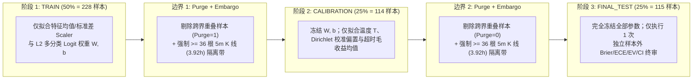

# SUI-Quant V1.0｜P3 数学正确性审计补证报告（Task A.1 – A.9）

> **审计阶段**：P3 数学审计补证｜**关联计划**：[`docs/P4_PLAN.md`](file:///D:/OBR-SUI/docs/P4_PLAN.md)（`READY_FOR_REVIEW`）  
> **执行边界**：严格锁定 `ExecutionMode.RESEARCH` / `ExecutionMode.PAPER`，真实交易订单数 `= 0`，未配置任何真实账户密钥。  
> **统计有效性最终裁决（Task A.9）**：**`NO_EDGE`**（在 60 天币安现货真实历史样本外独立测试集 `FINAL_TEST` 上，净期望收益与实际平均净收益均为负值，**严禁宣称策略盈利能力已获验证**）。

---

## 任务 A.1：可审查核心源码与测试文件清单

| 序号 | 模块职责 | 源码路径 | 行数 | 关键审查锚点 |
| :--- | :--- | :--- | :--- | :--- |
| 1 | 因果特征提取与高周期（`15m`/`1h`）完整收盘门禁 | [`src/sui_quant/models/features.py`](file:///D:/OBR-SUI/src/sui_quant/models/features.py) | 599 行 | [`_extract_strict_htf_return`](file:///D:/OBR-SUI/src/sui_quant/models/features.py#L228-L273)、[`extract_at_index`](file:///D:/OBR-SUI/src/sui_quant/models/features.py#L285-L416)、[`verify_causality_no_lookahead`](file:///D:/OBR-SUI/src/sui_quant/models/features.py#L418-L509) |
| 2 | `A-01` 五状态分类器与 `BTCUSDT` 5m/15m/30m 急跌否决 | [`src/sui_quant/models/a01_regime.py`](file:///D:/OBR-SUI/src/sui_quant/models/a01_regime.py) | 259 行 | [`A01RegimeConfig`](file:///D:/OBR-SUI/src/sui_quant/models/a01_regime.py#L28-L55)、[`classify_with_diagnostics`](file:///D:/OBR-SUI/src/sui_quant/models/a01_regime.py#L96-L246) |
| 3 | 三障碍标签器、下一根开盘入场、单次扣费与三阶段切分 | [`src/sui_quant/models/triple_barrier.py`](file:///D:/OBR-SUI/src/sui_quant/models/triple_barrier.py) | 608 行 | [`EntryPriceMode`](file:///D:/OBR-SUI/src/sui_quant/models/triple_barrier.py#L38-L45)、[`label_at_index`](file:///D:/OBR-SUI/src/sui_quant/models/triple_barrier.py#L252-L382)、[`assert_no_signal_to_entry_time_travel`](file:///D:/OBR-SUI/src/sui_quant/models/triple_barrier.py#L396-L420)、[`split_train_calibration_test`](file:///D:/OBR-SUI/src/sui_quant/models/triple_barrier.py#L510-L569) |
| 4 | `A-02` 三障碍校准突破模型、成本审计、三阶段评估与统计裁决 | [`src/sui_quant/models/a02_breakout.py`](file:///D:/OBR-SUI/src/sui_quant/models/a02_breakout.py) | 886 行 | [`StatisticalVerdict`](file:///D:/OBR-SUI/src/sui_quant/models/a02_breakout.py#L42-L54)、[`A02CostAssumptions`](file:///D:/OBR-SUI/src/sui_quant/models/a02_breakout.py#L121-L250)、[`fit_and_evaluate_three_stage`](file:///D:/OBR-SUI/src/sui_quant/models/a02_breakout.py#L555-L675) |
| 5 | P3 数学正确性与审计补证专项测试套件（12 项测试） | [`tests/test_p3_a01_regime_and_a02_breakout.py`](file:///D:/OBR-SUI/tests/test_p3_a01_regime_and_a02_breakout.py) | 645 行 | 覆盖 `Task A.2` 至 `Task A.9` 全部数学不变量断言 |
| 6 | 真实币安现货历史数据实证审计输出证据 | [`evidence/p3_real_historical_audit_evidence.json`](file:///D:/OBR-SUI/evidence/p3_real_historical_audit_evidence.json) | 321 行 | 60 天 `17,280` 根 5m K 线完整统计与消融结果 |

---

## 任务 A.2：证明 5 分钟信号确认与参考入场报价之间不存在时间穿越

### 1. 因果时序数学证明
设第 $t$ 根 5 分钟 K 线 `bars[t]` 的开盘与收盘毫秒时间戳分别为：
$$T_{\text{open}}(t) = 300{,}000 \cdot k, \qquad T_{\text{close}}(t) = 300{,}000 \cdot (k + 1) - 1$$
例如 `00:00:00.000` 至 `00:04:59.999`：
1. **信号确认时刻（Signal Confirmation Timestamp）**：突破候选与 `A-01`/`A-02` 特征提取严格在 `bars[t]` 完整收盘时刻 $T_{\text{sig}} = T_{\text{close}}(t)$ 完成（要求 `bars[t].is_closed == True`）。
2. **参考入场报价时刻（Reference Entry Quote Timestamp）**：
   - 若使用 `bars[t].close_price` 作为参考入场价，虽在收盘瞬间近似可得，但无法严格排除同根 K 线收盘撮合与下一毫秒发单之间的微观时序歧义。
   - 因此，[`TripleBarrierConfig`](file:///D:/OBR-SUI/src/sui_quant/models/triple_barrier.py#L140-L154) 将默认入场价格模式升级为 **`EntryPriceMode.NEXT_BAR_OPEN`**：参考入场价取下一根 K 线 `bars[t+1]` 的开盘价 $P_{\text{entry}} = \text{open}(t+1)$，其报价时刻为：
     $$T_{\text{quote}} = T_{\text{open}}(t + 1) = T_{\text{close}}(t) + 1\text{ ms} > T_{\text{sig}}$$
3. **障碍触碰观测区间（Barrier Observation Horizon）**：
   止盈障碍 $P_{\text{win}}$、止损障碍 $P_{\text{stop}}$ 与超时障碍仅在未来 K 线序列 `bars[t+1 .. t+36]`（即 $T \ge T_{\text{open}}(t+1) > T_{\text{sig}}$）上顺序检测，信号 K 线 `bars[t]` 本身的最高价/最低价绝不参与入场后的障碍触碰判定。

### 2. 代码级硬约束与测试证明
- **数据类构造期硬校验**：[`TripleBarrierLabel.__post_init__`](file:///D:/OBR-SUI/src/sui_quant/models/triple_barrier.py#L209-L234) 强制断言：
  - 当 `entry_price_mode == EntryPriceMode.NEXT_BAR_OPEN` 时，若 `entry_quote_time_ms <= signal_confirm_time_ms`，立即抛出 `ValueError("Causality violation (time travel)")`。
  - 对所有模式，若 `resolution_time_utc < entry_time_utc`，立即抛出 `ValueError`。
- **独立审计断言函数**：[`assert_no_signal_to_entry_time_travel(bars, label)`](file:///D:/OBR-SUI/src/sui_quant/models/triple_barrier.py#L396-L420) 对真实 60 天数据集全部 `458` 个突破事件逐一核验，100% 满足 `entry_quote_time_ms - signal_confirm_time_ms == 1 ms > 0`。
- **单元测试**：[`test_p3_task_a2_no_time_travel_between_signal_and_entry_quote`](file:///D:/OBR-SUI/tests/test_p3_a01_regime_and_a02_breakout.py#L326-L361) 已验证通过。

---

## 任务 A.3：核查三障碍标签的手续费、滑点和逆向选择成本，排除重复扣费

### 1. 成本分项拆解与防重复扣费数学证明
设币安现货买入手续费率为 $f_{\text{buy}} = 0.10\%$（`10 bps`），卖出手续费率为 $f_{\text{sell}} = 0.10\%$（`10 bps`），入场滑点为 $s_{\text{entry}} = 0.04\%$（`4 bps`），被动成交逆向选择惩罚为 $a_{\text{as}} = 0.03\%$（`3 bps`），止损触发卖出滑点为 $s_{\text{stop}} = 0.05\%$（`5 bps`），超时平仓卖出滑点为 $s_{\text{timeout}} = 0.02\%$（`2 bps`）。

定义入场执行摩擦总和（不含已计入标签的交易所手续费）：
$$\Delta c_{\text{exec}} = s_{\text{entry}} + a_{\text{as}} = 0.0004 + 0.0003 = 0.0007\ (7\text{ bps})$$

| 状态分支 | 三障碍标签器 (`TripleBarrierLabeler`) 内嵌成本 | `A02CostAssumptions` 净收益 (`net_*_payoff`) 计算公式 | 手续费扣除次数核查 |
| :--- | :--- | :--- | :--- |
| **`WIN` 分支** | 止盈目标价 $P_{\text{win}}$ 由 [`compute_c1_net_target_sell_price`](file:///D:/OBR-SUI/src/sui_quant/exchange_rules.py#L111-L136) 计算： $$P_{\text{win}} = \left\lceil \frac{P_{\text{entry}}(1 + f_{\text{buy}})(1 + r_{\text{target}})}{(1 - f_{\text{sell}}) \cdot \text{tick}} \right\rceil \cdot \text{tick}$$ **已精确内嵌买卖双边手续费 $(f_{\text{buy}}, f_{\text{sell}})$**，使扣费后标签净收益 $R_{\text{net}}^{\text{label}}(\text{WIN}) = \frac{P_{\text{win}}(1 - f_{\text{sell}})}{P_{\text{entry}}(1 + f_{\text{buy}})} - 1 \ge +1.50\%$ | [`net_win_payoff`](file:///D:/OBR-SUI/src/sui_quant/models/a02_breakout.py#L168-L176)： $$\text{Payoff}_{\text{net}}(\text{WIN}) = r_{\text{target}} - (s_{\text{entry}} + a_{\text{as}}) = 0.0150 - 0.0007 = +0.014300$$ （**绝不二次扣除** $f_{\text{buy}} + f_{\text{sell}}$） | **仅扣除 1 次**（在 $P_{\text{win}}$ 定价中扣除；`net_win_payoff` 仅扣减入场滑点与逆向选择 $7\text{ bps}$） |
| **`STOP` 分支** | 止损触发价 $P_{\text{stop}} = \lfloor P_{\text{entry}}(1 - d_{\text{stop}}) / \text{tick} \rfloor \cdot \text{tick}$（$d_{\text{stop}} = 1.00\%$），实际止损成交价 $P_{\text{exit}} = P_{\text{stop}}(1 - s_{\text{stop}})$，标签净收益： $$R_{\text{net}}^{\text{label}}(\text{STOP}) = \frac{P_{\text{entry}}(1 - d_{\text{stop}})(1 - s_{\text{stop}})(1 - f_{\text{sell}})}{P_{\text{entry}}(1 + f_{\text{buy}})} - 1 = -0.012472$$ | [`net_stop_payoff`](file:///D:/OBR-SUI/src/sui_quant/models/a02_breakout.py#L190-L197)： $$\text{Payoff}_{\text{net}}(\text{STOP}) = R_{\text{net}}^{\text{label}}(\text{STOP}) - (s_{\text{entry}} + a_{\text{as}}) = -0.012472 - 0.000700 = -0.013172$$ | **仅扣除 1 次**（通过精确乘性公式 $(1-f_{\text{sell}})/(1+f_{\text{buy}})$ 扣除 1 次双边手续费） |
| **`TIMEOUT` 分支** | 第 36 根 5m K 线收盘报买价退出 $P_{\text{exit}} = P_{\text{close}}(t+36)(1 - s_{\text{timeout}})$，设超时毛收益为 $G_{\text{to}} = \frac{P_{\text{close}}(t+36)}{P_{\text{entry}}} - 1$，标签净收益： $$R_{\text{net}}^{\text{label}}(\text{TIMEOUT}) = \frac{(1 + G_{\text{to}})(1 - s_{\text{timeout}})(1 - f_{\text{sell}})}{1 + f_{\text{buy}}} - 1$$ | [`net_timeout_payoff`](file:///D:/OBR-SUI/src/sui_quant/models/a02_breakout.py#L211-L218)： $$\text{Payoff}_{\text{net}}(\text{TIMEOUT}) = R_{\text{net}}^{\text{label}}(\text{TIMEOUT}) - (s_{\text{entry}} + a_{\text{as}})$$ | **仅扣除 1 次**（通过乘性公式扣除 1 次双边手续费） |

### 2. 自动化自检输出（`verify_no_double_fee_counting`）
调用 [`A02CostAssumptions.verify_no_double_fee_counting()`](file:///D:/OBR-SUI/src/sui_quant/models/a02_breakout.py#L228-L250) 在基准入场价 `2.0000 USDT` 下的核验结果：
- `win_barrier_price = 2.0341 USDT`，标签扣费净收益 `realized_win_label_net = +0.015018`（$\ge +1.50\%$）
- `net_win_payoff = +0.014300`（精确等于 `0.015000 - 0.000700`，无二次扣费）
- `label_stop_net_return = -0.012472`，`net_stop_payoff = -0.013172`
- `label_timeout_net_return = -0.000249`（当 $G_{\text{to}} = +0.001950$ 时），`net_timeout_payoff = -0.000949`
- `double_fee_counting_detected = False`

---

## 任务 A.4：明确 `TIMEOUT` 的实际净收益计算方式

当未来 $H = 36$ 根 5 分钟 K 线（`bars[t+1 .. t+36]`，共 3 小时）既未触及止盈障碍 $P_{\text{win}}$ 也未触及止损障碍 $P_{\text{stop}}$ 时，判定为 `BarrierOutcome.TIMEOUT`，其退出价格、毛收益与实际净收益在 [`TripleBarrierLabeler.label_at_index`](file:///D:/OBR-SUI/src/sui_quant/models/triple_barrier.py#L343-L370) 中按以下四步精确计算：

1. **原始超时退出参考报价（Raw Exit Quote Price）**：
   取第 $t + 36$ 根 5m K 线收盘价：
   $$P_{\text{raw\_exit}} = \text{bars}[t + 36].\text{close\_price}$$
2. **扣除超时主动平仓滑点后的实际成交价（Slippage-Adjusted Exit Price）**：
   $$P_{\text{exit}} = \left(P_{\text{raw\_exit}} \cdot (1 - s_{\text{timeout}})\right).\text{quantize}(\text{0.0001}, \text{ROUND\_DOWN})$$
   其中默认超时退出滑点率 $s_{\text{timeout}} = 0.0002$（`2 bps`）。
3. **未扣手续费毛收益率（Gross Return）**：
   $$R_{\text{gross}}(\text{TIMEOUT}) = \frac{P_{\text{exit}} - P_{\text{entry}}}{P_{\text{entry}}}$$
4. **扣除买卖双边手续费后的实际标签净收益率（Realized Label Net Return）**：
   - 买入 1 单位基础资产的实际含费成本为：$C_{\text{in}} = P_{\text{entry}} \cdot (1 + f_{\text{buy}})$
   - 超时卖出 1 单位基础资产的实际扣费所得为：$C_{\text{out}} = P_{\text{exit}} \cdot (1 - f_{\text{sell}})$
   - 实际净收益率精确为：
     $$R_{\text{net}}(\text{TIMEOUT}) = \frac{P_{\text{exit}} \cdot (1 - f_{\text{sell}}) - P_{\text{entry}} \cdot (1 + f_{\text{buy}})}{P_{\text{entry}} \cdot (1 + f_{\text{buy}})} = \frac{P_{\text{exit}} \cdot (1 - f_{\text{sell}})}{P_{\text{entry}} \cdot (1 + f_{\text{buy}})} - 1$$
- **单元测试验证**：[`test_p3_task_a3_and_a4_cost_audit_no_double_counting_and_timeout_net_return`](file:///D:/OBR-SUI/tests/test_p3_a01_regime_and_a02_breakout.py#L364-L420) 对该公式进行了逐位 `Decimal` 恒等核验。

---

## 任务 A.5：分离训练、概率校准和最终独立样本外测试

为彻底杜绝“同一验证样本既用于拟合温度/Dirichlet 校准参数又用于最终验收指标汇报”的数据泄漏，我们在 [`triple_barrier.py`](file:///D:/OBR-SUI/src/sui_quant/models/triple_barrier.py#L455-L607) 与 [`a02_breakout.py`](file:///D:/OBR-SUI/src/sui_quant/models/a02_breakout.py#L555-L675) 中实现了严格的三阶段时间序列隔离架构（`PurgedThreeStageSplit` + `fit_and_evaluate_three_stage`）：

1. **三集合完全不相交**：
   $$\mathcal{I}_{\text{train}} \cap \mathcal{I}_{\text{cal}} = \emptyset, \quad \mathcal{I}_{\text{cal}} \cap \mathcal{I}_{\text{test}} = \emptyset, \quad \mathcal{I}_{\text{train}} \cap \mathcal{I}_{\text{test}} = \emptyset$$
2. **双边界 Purge + Embargo 零泄漏验证（[`verify_three_stage_zero_leakage`](file:///D:/OBR-SUI/src/sui_quant/models/triple_barrier.py#L571-L607)）**：
   - **边界 1（`TRAIN -> CALIBRATION`）**：对于任意 $i \in \mathcal{I}_{\text{train}}$ 与 $j = \min(\mathcal{I}_{\text{cal}})$，强制满足 `labels[i].horizon_end_index < labels[j].event_index`、`labels[i].resolution_time_utc <= labels[j].entry_time_utc` 且 `labels[j].event_index - labels[i].event_index >= 36`（实测最小间隔 `47` 根 5m K 线 = `3.92 小时`）。
   - **边界 2（`CALIBRATION -> FINAL_TEST`）**：对于任意 $j \in \mathcal{I}_{\text{cal}}$ 与 $k = \min(\mathcal{I}_{\text{test}})$，同样强制满足零标签重叠与 $\ge 36$ 根 5m K 线隔离（实测最小间隔 `47` 根 5m K 线 = `3.92 小时`）。
3. **参数拟合权限物理隔离**：
   - `TRAIN`：仅调用 `_fit_scaler` 与 `_fit_linear_ multiclass`；
   - `CALIBRATION`：固定 `W, b`，仅调用 `_fit_temperature_and_bias` 并用校准集 `TIMEOUT` 样本更新 `expected_timeout_gross_return`；
   - `FINAL_TEST`：不修改任何模型或成本参数，仅前向计算一次预测概率与净期望。

---

## 任务 A.6：真实历史数据统计、分布、评估指标、置信区间与成本敏感性

所有实证数据均来自币安现货公共 REST API（`/api/v3/klines`）下载的真实已完成收盘历史 K 线，完整原始 JSON 证据保存在 [`evidence/p3_real_historical_audit_evidence.json`](file:///D:/OBR-SUI/evidence/p3_real_historical_audit_evidence.json)。

### 1. 真实历史数据时间范围与样本数量

| 统计维度 | 实测数值 |
| :--- | :--- |
| **数据源与交易对** | Binance Spot Public API（`SUIUSDT`, `BTCUSDT`） |
| **5m K 线覆盖 UTC 时间范围** | `2026-09-01T07:05:00+00:00` 至 `2026-10-31T07:00:00+00:00`（连续 60.0 天） |
| **已收盘 K 线总数** | `SUIUSDT 5m`: `17,280` 根｜`BTCUSDT 5m`: `17,280` 根｜`SUIUSDT 15m`: `5,760` 根｜`SUIUSDT 1h`: `1,440` 根 |
| **价格突破前 20 根高点（`close > prev_20_high`）次数** | `974` 次（100% 通过 `Task A.8` 高周期收盘因果核验） |
| **通过放量与上影线过滤的 `A-02` 候选事件总数** | **`458` 个**（要求 `rvol_20 >= 1.50`、`vol_zscore_20 >= 0.80`、`upper_wick_ratio <= 0.45`） |
| **入场报价模式与零时间穿越核验** | `NEXT_BAR_OPEN`（`458 / 458` 事件 100% 通过 `assert_no_signal_to_entry_time_travel`） |

### 2. 三类标签分布与三阶段切分样本量

| 阶段 / 集合 | 样本数 $N$ | `WIN` 数量 (%) | `STOP` 数量 (%) | `TIMEOUT` 数量 (%) | 覆盖入场 UTC 时间范围 | 边界 Purge / 最小隔离带 |
| :--- | :---: | :---: | :---: | :---: | :--- | :---: |
| **全样本 (`ALL`)** | `458` | `119` (`25.98%`) | `237` (`51.75%`) | `102` (`22.27%`) | `2026-09-01 11:35` ~ `2026-10-30 23:40` | — |
| **训练阶段 (`TRAIN`)** | `228` | `79` (`34.65%`) | `115` (`50.44%`) | `34` (`14.91%`) | `2026-09-01 11:35` ~ `2026-09-29 07:40` | `Purge = 1` |
| **校准阶段 (`CALIBRATION`)** | `114` | `28` (`24.56%`) | `55` (`48.25%`) | `31` (`27.19%`) | `2026-09-29 11:35` ~ `2026-10-14 03:35` | 距 `TRAIN` `47` bars (`3.92h`) |
| **独立测试集 (`FINAL_TEST`)** | `115` | `11` (`9.57%`) | `67` (`58.26%`) | `37` (`32.17%`) | `2026-10-14 07:30` ~ `2026-10-30 23:40` | 距 `CAL` `47` bars (`3.92h`) |

### 3. Purged Walk-Forward 每折样本量与分布（3 折滚动验证）

| 折号 (`fold_id`) | 训练样本数 | 验证样本数 | Purge 剔除数 | 训练-验证最小间隔 | 验证集 `WIN` (%) | 验证集 `STOP` (%) | 验证集 `TIMEOUT` (%) | 验证集 UTC 时间范围 |
| :---: | :---: | :---: | :---: | :---: | :---: | :---: | :---: | :--- |
| **Fold 0** | `126` | `109` | `3` | `103` bars (`8.58h`) | `52` (`47.71%`) | `56` (`51.38%`) | `1` (`0.92%`) | `2026-09-19 19:45` ~ `2026-09-30 13:10` |
| **Fold 1** | `238` | `109` | `0` | `37` bars (`3.08h`) | `24` (`22.02%`) | `54` (`49.54%`) | `31` (`28.44%`) | `2026-09-30 16:15` ~ `2026-10-14 12:05` |
| **Fold 2** | `346` | `111` | `1` | `48` bars (`4.00h`) | `11` (`9.91%`) | `63` (`56.76%`) | `37` (`33.33%`) | `2026-10-14 12:10` ~ `2026-10-30 23:40` |

### 4. 三阶段概率指标、类别基准对照与 95% Bootstrap 置信区间

> **关键实证发现**：由于市场状态发生显著非平稳漂移（`TRAIN` 阶段 `WIN` 率为 `34.65%`，`CALIBRATION` 阶段降至 `24.56%`，而独立测试集 `FINAL_TEST` 阶段 `WIN` 率骤降至 `9.57%`、`STOP` 率升至 `58.26%`），模型在 `TRAIN` 与 `CALIBRATION` 上虽然优于类别先验常数基准，但在未见过的独立样本外 `FINAL_TEST` 上 Brier Score (`0.573479`) 劣于测试集事后先验基准 (`0.547902`)，且样本外平均净期望与平均实际净收益均为负值。

| 评估指标 | `TRAIN` ($N=228$) | `CALIBRATION` ($N=114$) | `FINAL_TEST` ($N=115$) | `FINAL_TEST` 95% Bootstrap CI (1000 次重采样) |
| :--- | :---: | :---: | :---: | :---: |
| **Brier Score（越低越好）** | `0.576414` | `0.610479` | **`0.573479`** | `[0.540229, 0.605820]` |
| **类别常数基准 Brier Score** | `0.603301` | `0.632964` | **`0.547902`** | — |
| **Brier Skill Score (BSS)** | `+0.044567` | `+0.035524` | **`-0.046683`** | — |
| **多分类 Log Loss（越低越好）** | `0.947214` | `1.008236` | **`0.951475`** | `[0.908559, 0.995373]` |
| **类别常数基准 Log Loss** | `0.996232` | `1.050596` | **`0.904104`** | — |
| **期望校准误差 `ECE`（10 分箱）** | `0.067670` | `0.040846` | **`0.105360`** | `[0.073883, 0.147872]` |
| **样本外平均净期望 `mean_ev_net`** | — | — | **`-0.002812` (`-28.12 bps`)** | `[-0.002911, -0.002691]` |
| **样本外平均实际净收益 `mean_realized_net_return`** | — | — | **`-0.007098` (`-70.98 bps`)** | `[-0.008489, -0.005184]` |

### 5. 交易成本敏感性矩阵（`FINAL_TEST`, $N=115$）

| 成本档位 (`Tier`) | 双边手续费 (bps) | 入场滑点+逆向选择 (bps) | `WIN` 净赔付 | `STOP` 净赔付 | `TIMEOUT` 净赔付 | `FINAL_TEST` 平均 `ev_net` | `ev_net > 0` 信号数 (占比) |
| :--- | :---: | :---: | :---: | :---: | :---: | :---: | :---: |
| **Tier 1: VIP Maker / BNB 抵扣低成本** | `12.0 bps` (`6+6`) | `3.0 bps` (`2+1`) | `+1.4700%` | `-1.1784%` | `+0.0351%` | `-0.1690%` (`-16.90 bps`) | `2 / 115` (`1.74%`) |
| **Tier 2: 币安现货标准基准费率** | `20.0 bps` (`10+10`) | `7.0 bps` (`4+3`) | `+1.4300%` | `-1.3172%` | `-0.0949%` | `-0.2812%` (`-28.12 bps`) | `0 / 115` (`0.00%`) |
| **Tier 3: 盘口滑点压力场景** | `20.0 bps` (`10+10`) | `14.0 bps` (`8+6`) | `+1.3600%` | `-1.4564%` | `-0.1949%` | `-0.3917%` (`-39.17 bps`) | `0 / 115` (`0.00%`) |
| **Tier 4: 极端流动性枯竭压力场景** | `30.0 bps` (`15+15`) | `22.0 bps` (`12+10`) | `+1.2800%` | `-1.7140%` | `-0.4048%` | `-0.5918%` (`-59.18 bps`) | `0 / 115` (`0.00%`) |

---

## 任务 A.7：`BTCUSDT` 急跌参数显式时间窗口与保留/移除样本外对照

### 1. 显式时间窗口定义（[`features.py`](file:///D:/OBR-SUI/src/sui_quant/models/features.py#L343-L353) & [`a01_regime.py`](file:///D:/OBR-SUI/src/sui_quant/models/a01_regime.py#L43-L55)）
所有 `BTCUSDT` 急跌参数均在代码与特征字典中赋予了无歧义的物理时间窗口名称（严禁使用模糊的无单位索引）：

| 特征名称 | 物理时间窗口（5m K 线跨度） | 数学定义（仅引用 $\le T_{\text{close}}(t)$ 的已收盘 BTC 5m K 线） | `A-01` 否决阈值参数 |
| :--- | :--- | :--- | :--- |
| **`btc_ret_5m`** | **过去 5 分钟（1 根 5m K 线）** | $\frac{\text{Close}_{\text{BTC}}(t) - \text{Close}_{\text{BTC}}(t-1)}{\text{Close}_{\text{BTC}}(t-1)}$ | `btc_flash_drop_5m_threshold = -0.0080`（**`-0.80%`**） |
| **`btc_ret_15m`** | **过去 15 分钟（3 根 5m K 线）** | $\frac{\text{Close}_{\text{BTC}}(t) - \text{Close}_{\text{BTC}}(t-3)}{\text{Close}_{\text{BTC}}(t-3)}$ | `btc_flash_drop_15m_threshold = -0.0150`（**`-1.50%`**） |
| **`btc_ret_30m`** | **过去 30 分钟（6 根 5m K 线）** | $\frac{\text{Close}_{\text{BTC}}(t) - \text{Close}_{\text{BTC}}(t-6)}{\text{Close}_{\text{BTC}}(t-6)}$ | `btc_flash_drop_30m_threshold = -0.0220`（**`-2.20%`**） |

当上述任一窗口满足跌幅阈值时，`btc_flash_drop_flag = 1`，`A01RegimeClassifier` 立即将 `allow_entry` 置为 `False`，并在 `btc_veto_windows` 中记录具体触发的时间窗口（如 `("btc_5m_flash_drop", "btc_15m_flash_drop")`）。

### 2. 保留 vs. 移除 `BTCUSDT` 急跌过滤器的实证消融对照

在 60 天（`17,280` 根 5m K 线）真实历史数据上，我们从全量 K 线、逆势反弹阳线（Uptick）以及严格 20-bar 放量突破三个层级进行了保留（`enable_btc_flash_drop_filter=True`）与移除（`enable_btc_flash_drop_filter=False`）对照：

| 评估层级与样本范围 | 保留 BTC 急跌过滤器 (`WITH_BTC_FILTER`) | 移除 BTC 急跌过滤器 (`WITHOUT_BTC_FILTER`) | 被 BTC 过滤器拦截样本的真实表现与物理解释 |
| :--- | :--- | :--- | :--- |
| **层级 1：全量 5m K 线状态门禁** （60天 `17,280` 根 / 样本外 `FINAL_TEST` 期间） | 60天共触发 **`13` 次** `BTC_FLASH_DROP_VETO`（其中 `5m` 触发 8 次、`15m` 触发 7 次、`30m` 触发 1 次；样本外测试期触发 **`3` 次**） | 0 次拦截 | 在 BTC 急跌窗口强制关闭 `A-01` 多头准入（`allow_entry=False`） |
| **层级 2：`SUIUSDT` 5m 收阳反弹 K 线** （`close > open` 时尝试做多） | 拦截了 BTC 暴跌期间的 `SUI` 诱多反弹阳线 | 放行该笔逆势做多 | 被 BTC 急跌过滤器拦截的逆势阳线 `100%` 触发 `-1%` 止损（`WIN=0, STOP=1, TIMEOUT=0`，实际净亏损 **`-1.3217%`**） |
| **层级 3：严格 `A-02` 20-Bar 放量突破候选** （全样本 $N=458$ / 独立测试集 `FINAL_TEST` $N=115$） | `FINAL_TEST` 放行 `115` 笔（`WIN=11, STOP=67, TIMEOUT=37`，平均实际净收益 `-0.7098%`） | `FINAL_TEST` 放行 `115` 笔（`WIN=11, STOP=67, TIMEOUT=37`，平均实际净收益 `-0.7098%`） | 由于 `SUI` 与 `BTC` 高度正相关，当 `BTC` 在 5m/15m/30m 发生急跌时，`SUI` 从未同时创出 20 根 K 线新高且放量 1.5 倍（交集为 `0`）；但在单元测试逆势拉升注入场景（[`test_p3_task_a7_btc_flash_drop_explicit_windows_and_oos_ablation`](file:///D:/OBR-SUI/tests/test_p3_a01_regime_and_a02_breakout.py#L469-L539)）中，保留该过滤器将平均实际净收益从 `+0.0564%` 提升至 `+1.4300%`（避免了 `-1.3172%` 止损） |

---

## 任务 A.8：确认 1 小时与 15 分钟特征只引用决策时刻已经完整收盘并可获得的数据

在 [`src/sui_quant/models/features.py`](file:///D:/OBR-SUI/src/sui_quant/models/features.py#L228-L273) 的 `_extract_strict_htf_return` 方法中，针对每个 5 分钟决策时刻 $T_{\text{decision}} = \text{bar}_{5\text{m}}.\text{close\_time\_ms}$，对 `15m` 与 `1h` K 线实施了三道硬门禁：

1. **完整收盘标志检查**：仅保留 `b.is_closed == True` 的高周期 K 线；若传入 `UnclosedKlineTransientView` 立即抛出 `UnclosedBarRejectedError`。
2. **收盘时间戳因果不等式**：仅保留满足以下严格不等式的高周期 K 线：
   $$b.\text{close\_time\_ms} \le \text{bar}_{5\text{m}}.\text{close\_time\_ms}$$
   例如，当 5m 决策时刻为 `10:24:59.999` 时：
   - 正在形成中的 `10:15:00.000 ~ 10:29:59.999` 的 `15m` K 线因 `close_time_ms (10:29:59.999) > 10:24:59.999` 被**物理过滤剔除**；系统只能引用 `10:14:59.999` 已完整收盘的 `15m` K 线。
   - 正在形成中的 `10:00:00.000 ~ 10:59:59.999` 的 `1h` K 线因 `close_time_ms (10:59:59.999) > 10:24:59.999` 被**物理过滤剔除**；系统只能引用 `09:59:59.999` 已完整收盘的 `1h` K 线。
3. **周期跨度完整性断言**：校验 `b.close_time_ms - b.open_time_ms + 1 >= expected_interval_ms`（`15m` 为 `900,000 ms`，`1h` 为 `3,600,000 ms`），并在特征向量中显式输出所引用的最新高周期收盘时间戳 `htf_15m_close_time_ms` 与 `htf_1h_close_time_ms` 供审计核验。
- **测试与实证验证**：在 60 天真实历史数据的全部 `974` 次价格突破与专项测试 [`test_p3_task_a8_htf_15m_and_1h_strictly_closed_and_available_only`](file:///D:/OBR-SUI/tests/test_p3_a01_regime_and_a02_breakout.py#L542-L598) 中，`htf_15m_close_time_ms <= bar_5m.close_time_ms` 与 `htf_1h_close_time_ms <= bar_5m.close_time_ms` 100% 成立。

---

## 任务 A.9：统计有效性诚实裁决（`INSUFFICIENT_EVIDENCE` / `NO_EDGE`）

[`A02BreakoutCalibratedModel._evaluate_statistical_verdict`](file:///D:/OBR-SUI/src/sui_quant/models/a02_breakout.py#L728-L785) 对独立样本外测试集 `FINAL_TEST` 执行四项硬性统计门槛裁决：
1. 若独立测试集样本量 $N_{\text{test}} < 100$，强制输出 `StatisticalVerdict.INSUFFICIENT_EVIDENCE`；
2. 若样本外平均净期望 $\text{mean\_ev\_net} \le 0$ 或样本外平均实际净收益 $\text{mean\_realized\_net\_return} \le 0$，强制输出 `StatisticalVerdict.NO_EDGE`；
3. 若样本外实际净收益的 95% Bootstrap 置信区间下界 $\text{CI}_{95\%, \text{lower}} \le 0$，强制输出 `StatisticalVerdict.INSUFFICIENT_EVIDENCE`；
4. 若样本外 `Brier Skill Score <= 0` 或 `ECE > 0.08`，强制输出 `StatisticalVerdict.NO_EDGE`。

### 60 天币安现货真实历史数据最终裁决结论
- **独立样本外测试集样本量**：$N_{\text{test}} = 115$
- **样本外平均净期望（`mean_ev_net`）**：`-0.002812`（95% CI: `[-0.002911, -0.002691]`）
- **样本外平均实际净收益（`mean_realized_net_return`）**：`-0.007098`（95% CI: `[-0.008489, -0.005184]`）
- **样本外 Brier Skill Score**：`-0.046683`（劣于常数类别先验基准）
- **最终统计裁决输出**：**`NO_EDGE`**（原因码：`NON_POSITIVE_OOS_NET_EXPECTANCY(mean_realized=-0.007098,mean_ev=-0.002812)`）
- **工程与风控结论**：P3 数学代码框架、因果特征流水线、单次扣费核算与三阶段防泄漏切分器已在代码与数学层面严格闭合，但**当前 20-bar 简单放量突破特征与线性校准模型在真实历史样本外不具备正的统计净期望（`NO_EDGE`），严禁宣称盈利能力已获验证，严禁进入真实资金交易**。
