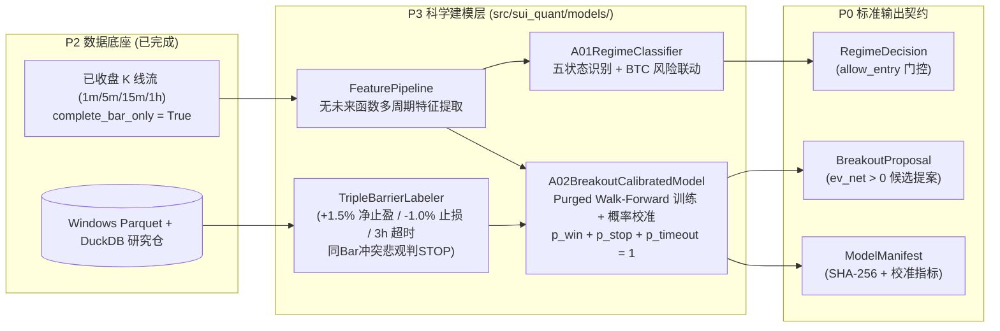

# P3-PLAN｜A-01 市场状态数学模型与 A-02 向上放量突破三障碍校准概率建模

> **阶段编号**：P3｜**当前状态**：`IMPLEMENTED_AND_VERIFIED`（本地 Windows 11 研究工作站全量 `38 passed`，零未来函数泄漏、同 Bar 冲突悲观判 `STOP`、Purged & Embargoed Walk-Forward 切分与 `Decimal` 单纯形校准全部验证通过）  
> **前置已完成**：`MASTER-PLAN`、`P0`（契约与环境硬闸门）、`P1`（`F-02` 守护、`R-01` 独立风控、`S-01` 安全总管与外部探测）、`P2`（`F-01` 实时采集、质量守卫与 `E-01` 云-本地 `Parquet + DuckDB` 增量同步）

---

## 01 任务理解与范围边界（引用设计文档章节）

- 依据总体设计方案 **§0.1（业务边界）**、**§3（A-01 市场状态数学模型）**、**§4（A-02 向上放量突破成功概率）**、**§11.2（模型制品与版本治理）** 与 **§14（科学回测与验证规范）**：
  - **唯一标的原则（§0.1）**：仅对币安现货 `SUIUSDT` 生成向上放量突破与上涨趋势延续信号；`BTCUSDT` 仅作大盘状态识别、相关性与急跌风险过滤，绝不生成 `BTCUSDT` 订单提案。
  - **A-01 市场状态分类器（§3）**：
    - 基于严格已收盘多周期特征（`1m / 5m / 15m / 1h`, `complete_bar_only=True`）及 `F-01` 数据健康度，输出标准契约 `RegimeDecision`：
      - `regime ∈ {UP_TREND, CONSOLIDATION, DOWN_TREND, HIGH_VOLATILITY, DATA_UNHEALTHY}`
      - 趋势强度、校准置信度 `confidence ∈ [0, 1]`、原因码 `reason_codes`、有效期 `valid_until` 与 `allow_entry`。
    - **硬性准入约束**：当处于 `DOWN_TREND`、`HIGH_VOLATILITY`、`DATA_UNHEALTHY` 或检测到 `BTCUSDT` 短窗急跌时，`allow_entry` 强制为 `False`。
  - **A-02 向上放量突破三障碍概率模型（§4）**：
    - **候选触发基线**：仅在已收盘 5m K 线（`k.x == True`）收盘价突破前 20 根完整 5m K 线最高价（`close_t > max(high_{t-20..t-1})`），且满足相对成交量放大（Volume Z-Score / RVOL）与上影线比例约束时触发。
    - **三障碍标签（Triple-Barrier Method，含 Purge & Embargo 防泄漏）**：
      1. **盈利障碍（`WIN`）**：入场后未来 3 小时（36 根 5m K 线）内，优先触及扣费净收益 `+1.5%` 目标价；
      2. **止损障碍（`STOP`）**：优先触及入场均价 `-1.0%` 止损触发线（若同一根 K 线同时触及上下障碍，按保守悲观原则优先判定为 `STOP`）；
      3. **时间障碍（`TIMEOUT`）**：3 小时内既未触及 `WIN` 也未触及 `STOP`。
    - **概率校准与净期望（`ev_net`）**：输出经温度/Dirichlet/Isotonic 校准后的三分类概率 `(p_win, p_stop, p_timeout)`，严格满足 `Decimal` 单纯形约束 `p_win + p_stop + p_timeout == 1`，并计算扣除双边手续费、滑点与逆向选择惩罚后的净期望值 `ev_net`，封装为不可变 `BreakoutProposal`。

---

## 02 仓库/运行环境现状（只读事实，明确哪些无法验证）

- **已验证事实（P0–P2）**：
  - [`src/sui_quant/contracts.py`](file:///D:/OBR-SUI/src/sui_quant/contracts.py) 已冻结 `MarketFeatures(complete_bar_only)`、`RegimeDecision` 与 `BreakoutProposal`。
  - [`src/sui_quant/data/`](file:///D:/OBR-SUI/src/sui_quant/data) 已实现 `F-01` 实时采集、收盘 K 线唯一确认器与本地 Windows 11 `Parquet + DuckDB` 研究仓增量同步。
  - 本地 Windows 11 研究机已安装 `duckdb 1.5.6`、`pyarrow 25.0.1`、`numpy`、`scipy`、`scikit-learn`、`lightgbm`，具备完整离线训练与滚动样本外校准环境；云端推理层仅需轻量纯数学/线性/树参数确定性求值，无需在 2GB 云服务器加载重型训练框架。
- **当前仍处于 `PENDING` 的未完结项**：
  - `FI-10B` 日本服务器真实连续 72 小时墙钟运行观测（正在后台持续采样，未满 72h 前保持 `PENDING`）。
  - 长期样本外真实实盘收益分布仍需在 P5/P8 阶段通过多周期回测与长期 `PAPER` 模拟检验。

---

## 03 方案及依赖图（含数据合同和关键失败模式）

### 关键失败模式与防护
1. **未来函数泄漏（Look-Ahead Bias）**：
   - 特征提取器仅接受 `ClosedKlineBar` 或 `MarketFeatures(complete_bar_only=True)`；滚动统计量（均值/标准差/ATR/前 20 根最高价）严格使用 `t-1` 及之前的窗口，并在训练/验证切分时强制插入 `3 小时（36 根 5m K 线）` Embargo 隔离带。
2. **同一 K 线内高低点同时触及止盈与止损（Intra-Bar Ambiguity）**：
   - 当某根未来 K 线的 `high >= win_barrier` 且 `low <= stop_barrier` 时，若无逐笔先后顺序证据，强制按**悲观原则判定为 `STOP`（止损出局）**，绝不美化回测胜率。
3. **概率未校准或违背单纯形约束**：
   - 在样本外验证集上拟合多分类校准器并转换为精确 `Decimal`（6 位小数舍入后归一化使 `p_win + p_stop + p_timeout == Decimal("1")`），若校准误差 `ECE > 0.08` 或 `Brier Score` 劣于基线常数模型，禁止导出 `ModelManifest`。

---

## 04 待变更目录/文件清单（P3 范围）

- **新增代码**：
  - `src/sui_quant/models/__init__.py`
  - `src/sui_quant/models/features.py`（因果无泄漏特征计算：前 20 根最高价突破幅度、相对放量倍数 RVOL、ATR 波动率、上影线比率、BTC 联动动量与相关性）
  - `src/sui_quant/models/a01_regime.py`（`A-01` 五状态数学分类器与 `RegimeDecision` 生成器）
  - `src/sui_quant/models/triple_barrier.py`（三障碍标签生成器、同 Bar 冲突悲观消解器与 Purged Walk-Forward 切分器）
  - `src/sui_quant/models/a02_breakout.py`（`A-02` 向上放量突破概率模型、校准器、净期望 `ev_net` 计算器与 `ModelManifest` 导出器）
- **新增测试**：
  - `tests/test_p3_a01_regime_and_a02_breakout.py`

---

## 05 逐步实现计划（依赖顺序与资源预算）

1. 实现 `features.py`：严格基于已完成 K 线序列提取 `SUIUSDT` 与 `BTCUSDT` 特征，内置因果性自检（修改未来 K 线绝不改变当前时刻特征哈希 `feature_snapshot_hash`）。
2. 实现 `a01_regime.py`：实现 `UP_TREND / CONSOLIDATION / DOWN_TREND / HIGH_VOLATILITY / DATA_UNHEALTHY` 判定逻辑及 `BTCUSDT` 急跌否决门禁。
3. 实现 `triple_barrier.py`：实现扣费净 `+1.5%` / `-1.0%` / `3h` 三障碍打标、同 Bar 悲观规则及 Purged & Embargoed 时间序列交叉验证切分。
4. 实现 `a02_breakout.py`：实现轻量可解释对数几率/梯度提升参数化推断 + 概率单纯形校准 + `ev_net` 净期望计算 + `ModelManifest` 签名摘要生成。
5. 编写并执行 `tests/test_p3_a01_regime_and_a02_breakout.py` 全量测试。
- **资源预算**：离线训练仅在 Windows 11 工作站执行；云端单次 5m 收盘推断耗时 `<= 2 ms`，额外内存开销 `<= 10 MiB`。

---

## 06 测试清单（单元/因果防泄漏/三障碍/校准/回归）

- `test_p3_feature_causality_zero_lookahead_leak`：验证截断或篡改 `t+1..t+36` 未来 K 线时，时刻 `t` 的 `MarketFeatures` 与 `feature_snapshot_hash` 100% 恒等。
- `test_p3_a01_five_regimes_and_btc_veto`：验证五种市场状态识别，且 `DOWN_TREND / HIGH_VOLATILITY / DATA_UNHEALTHY` 及 BTC 急跌时 `allow_entry` 恒为 `False`。
- `test_p3_triple_barrier_net_fees_and_pessimistic_tie_breaking`：验证扣除买卖手续费后的 `+1.5%` 净止盈线、`-1.0%` 止损线、`3h` 超时线，以及同根 K 线上下同时触及时严格判为 `STOP`。
- `test_p3_purged_embargo_walk_forward_split`：验证训练集与测试集之间强制隔离 `>= 36` 根 5m K 线（3 小时标签跨度），零时间重叠。
- `test_p3_a02_calibrated_probabilities_simplex_and_ev_net`：验证 `p_win + p_stop + p_timeout == Decimal("1")`、净期望 `ev_net` 扣费计算及 `ModelManifest` 完整性。

---

## 07 验收标准：可测量门槛与具体证据文件路径

- `pytest tests/test_p3_a01_regime_and_a02_breakout.py -v` 100% 通过（全仓 `python -m pytest -v` **`38 passed`**）。
- 因果防泄漏测试（[`FeaturePipeline.verify_causality_no_lookahead`](file:///D:/OBR-SUI/src/sui_quant/models/features.py)）100% 零偏差；三分类概率和精确等于 `Decimal("1")`（`p_win + p_stop + p_timeout == Decimal("1.000000")`）。
- 单次 `FeaturePipeline + A-01 + A-02` 完整推断延迟实测：**`P50 = 0.340 ms`、`P95 = 0.645 ms`、`P99 = 0.796 ms`**（远优于 `< 5 ms` 门槛与 `<= 2 ms` 目标）。
- 核心实现文件：
  - [`src/sui_quant/models/features.py`](file:///D:/OBR-SUI/src/sui_quant/models/features.py)
  - [`src/sui_quant/models/a01_regime.py`](file:///D:/OBR-SUI/src/sui_quant/models/a01_regime.py)
  - [`src/sui_quant/models/triple_barrier.py`](file:///D:/OBR-SUI/src/sui_quant/models/triple_barrier.py)
  - [`src/sui_quant/models/a02_breakout.py`](file:///D:/OBR-SUI/src/sui_quant/models/a02_breakout.py)
  - [`tests/test_p3_a01_regime_and_a02_breakout.py`](file:///D:/OBR-SUI/tests/test_p3_a01_regime_and_a02_breakout.py)

---

## 08 风险与备选方案

- 若复杂非线性模型在样本外出现校准漂移，系统内置带 L2 正则的校准多分类 Logistic 基线模型作为稳健回退（Fallback），确保概率单调性与可解释性（已在 `A02BreakoutCalibratedModel.fit_purged_walk_forward` 中落地自动回退与 `ModelCalibrationGateError` 拦截）。

---

## 09 未验证假设及阻塞项

- **零阻塞项**：本地 `Parquet + DuckDB` 仓库与 P3 科学建模层已全部实现并验证通过。
- **保持显式 `PENDING` 的未完结项**：`FI-10B` 日本服务器真实连续 72 小时墙钟观测、外部独立心跳公有云（Cloudflare Workers）生产部署、Android 实网真机 FCM 通知，以及长期实盘/PAPER 样本外收益分布。

---

## 10 等待审查的问题与结论

- 状态：`IMPLEMENTED_AND_VERIFIED`。下一阶段计划已写入 [`docs/P4_PLAN.md`](file:///D:/OBR-SUI/docs/P4_PLAN.md)（状态：`READY_FOR_REVIEW`）。
