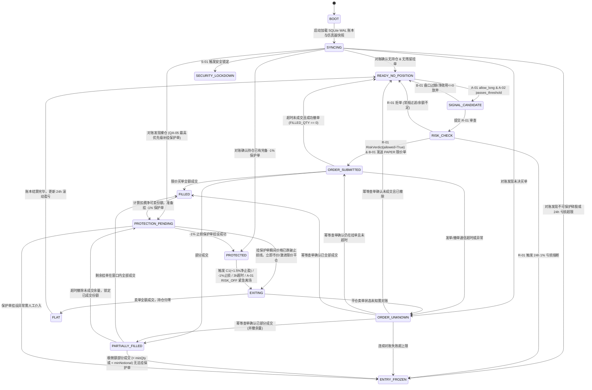
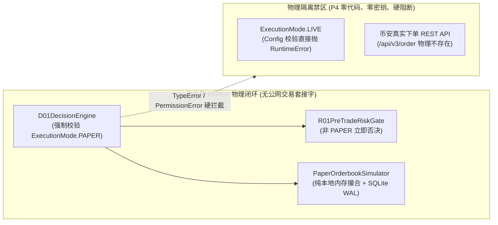

# P4-PLAN｜B-01 智能限价微观执行、D-01 自主决策状态机闭环与 R-01 独立风控最终否决（仅 PAPER）

> **阶段编号**：P4｜**当前状态**：`READY_FOR_REVIEW`（仅提交正式实施计划，等待审查批准；**严禁在未获授权前实施 P4 交易执行代码、接入真实账户密钥或开启 LIVE 交易**）  
> **前置状态**：`MASTER-PLAN`、`P0`、`P1`、`P2` 已完成；`P3` 数学代码框架有条件通过并已完成任务 A 数学审计补证。  
> **执行模式硬边界**：P4 全链路强制锁定 `ExecutionMode.PAPER`（模拟订单撮合），真实资金订单数必须严格等于 `0`。

---

## 01 任务理解与范围边界（引用总体设计章节）

依据总体设计方案 **§0.1（业务与环境边界）**、**§5（B-01 智能限价单与微观结构执行）**、**§7（D-01 唯一自主决策状态机）**、**§8（R-01 独立资金与订单风控）** 及 **§14.2（QA-03, QA-04, QA-05, QA-08）**，P4 的工程目标是构建从 P3 信号提案（`RegimeDecision` + `BreakoutProposal`）到 `PAPER` 模拟限价单执行、持仓保护与崩溃恢复的完整闭环，重点涵盖以下八大核心机制：

1. **B-01 限价成交概率与价格优化（§5）**：基于 10 档盘口快照（`PartialOrderbookSnapshot`）估计各候选限价档位 $\delta$ 的成交概率 $P(\text{fill} \mid \delta, \Delta t)$ 与成交后逆向选择 `markout(1s, 5s, 30s, 60s)`，在硬价格上限 `price_cap` 内选择净效用最大的限价报价。
2. **D-01 自主决策状态机（§7）**：作为系统唯一的下单与状态流转入口，驱动从启动对账（`BOOT -> SYNCING`）、空仓待命（`READY_NO_POSITION`）、风控核验（`RISK_CHECK`）、限价挂单（`ORDER_SUBMITTED`）、未知状态恢复（`ORDER_UNKNOWN`）、部分/全部成交（`PARTIALLY_FILLED / FILLED`）、挂设保护单（`PROTECTION_PENDING -> PROTECTED`）到平仓离场（`EXITING -> FLAT`）及异常冻结（`ENTRY_FROZEN / SECURITY_LOCKDOWN`）的全生命周期。
3. **R-01 独立风控最终否决（§8）**：独立于一切信号与执行模型，对每笔候选交易执行单笔风险定仓（$\le 0.25\%$ 净值风险）、单笔资金上限（$\le 10\%$ 净值）、24 小时滚动亏损熔断（$\ge 1.0\%$ 冻结开仓）、交易对硬锁（仅 `SUIUSDT`）及买前可保护性否决。
4. **`ORDER_UNKNOWN` 恢复与幂等性（§7.3, QA-04）**：发单超时或通信中断时严禁盲目重发，强制进入 `ORDER_UNKNOWN` 并凭确定性幂等 `clientOrderId` 查单对账，确认远端真实状态后方可执行下一步转移。
5. **部分成交及剩余持仓保护（§5.3, §8.3, QA-04）**：限价买单发生部分成交后超时，立即撤除未成交余量，对已成交净可卖份额（扣除手续费并按 `stepSize` 向下取整）立即挂设 `-1%` 止损保护单；若极端微额部分成交跌破交易所最小可保护门槛（`< minQty` 或 `< minNotional`），立即转入 `ENTRY_FROZEN` 并触发告警。
6. **价格精度、手续费、盘口延迟和动态交易规则（§8.2, §8.3）**：严格遵守动态 `SymbolFilters`（`tickSize=0.0001`、`stepSize=0.1`、`minNotional=5.0`）与新鲜度校验（`assert_fresh_for_execution`），支持 `SUI` / `USDT` / `BNB` 三种手续费扣减模式，并对盘口快照实施延迟与缺口双重门禁。
7. **`SimulatedExchange` 与 `LIVE` 接口物理隔离（§0.1, §16）**：在架构、类型签名与配置层实施三重物理隔离，P4 代码库不包含任何币安真实下单 REST 签名或网络发送逻辑，所有订单 100% 为本地内存/SQLite 持久化的 `PAPER` 模拟订单。
8. **故障注入、风险不变量及资源预算（§14.2, §15）**：通过 `QA-03`、`QA-04`、`QA-05`、`QA-08` 全套故障注入测试，运行时强制校验 8 条风险不变量，并满足日本东京 2vCPU / 2GB RAM 服务器资源与延迟预算。

---

## 02 仓库与运行环境现状（只读事实与未完结项追踪）

### 2.1 已就绪基础组件（P0–P3 已验证）
- **核心数据契约**：[`src/sui_quant/contracts.py`](file:///D:/OBR-SUI/src/sui_quant/contracts.py) 已冻结 `RegimeDecision`、`BreakoutProposal`、`RiskVerdict`、`OrderIntent`、`OrderEvent`、`PositionLedger`、`PartialOrderbookSnapshot`。
- **状态转移矩阵与重启恢复优先级**：[`src/sui_quant/state_machine.py`](file:///D:/OBR-SUI/src/sui_quant/state_machine.py) 已定义 `TradingState` 枚举、`ALLOWED_STATE_TRANSITIONS`、`assert_valid_transition` 及崩溃重启后裸仓优先保护函数 `prioritize_startup_reconciliation`。
- **动态交易规则与精度/手续费引擎**：[`src/sui_quant/exchange_rules.py`](file:///D:/OBR-SUI/src/sui_quant/exchange_rules.py) 已实现 `SymbolFilters` 新鲜度门禁 `assert_fresh_for_execution`、买前可保护性校验 `validate_pre_buy_protectability`、C1 净止盈价计算 `compute_c1_net_target_sell_price` 及买单成交后净可卖份额与碎股计算 `compute_post_fill_sellable_position`。
- **盘口质量守卫**：[`src/sui_quant/data/quality_guard.py`](file:///D:/OBR-SUI/src/sui_quant/data/quality_guard.py) 已实现 `StreamQualityGuard.is_window_valid_for_b01_calibration`，自动拦截含 `GAP_UNRECOVERABLE_FOR_FILL_CALIBRATION` 标记的断线/序列缺口窗口。
- **P3 信号层与数学补证**：[`src/sui_quant/models/`](file:///D:/OBR-SUI/src/sui_quant/models) 已实现零时间穿越因果特征流水线 `FeaturePipeline`、`A01RegimeClassifier`、三阶段隔离校准 `A02BreakoutCalibratedModel` 与三障碍标签器 `TripleBarrierLabeler`。

### 2.2 延续追踪的遗留验收项（Task C 状态）
- **`FI-10B` 72 小时真实服务器墙钟观测**：日本东京生产服务器（`ubuntu-2vcpu-2gb-jp-tyo1`）`sui-quant-f02.service` 处于持续真实墙钟采样中，在未满 72.0 小时前严格标记为 `PENDING`。
- **P1 外部独立心跳（Cloudflare Workers）与 Android 真机 FCM 通知（`G-01/G-02`）**：生产凭据部署与实网真机送达取证保持 `PENDING`。
- **P2 数据缺口与极端背压修复证据**：已在 [`tests/test_p2_f01_collector_and_e01_sync.py`](file:///D:/OBR-SUI/tests/test_p2_f01_collector_and_e01_sync.py) 与生产服务中闭环验证并保持可追踪（`PASS`）。

---

## 03 核心模块详细设计（Task B 八大重点专题）

### 3.1 B-01 限价成交概率与价格优化（`src/sui_quant/execution/b01_limit_executor.py`）

#### (1) 候选报价网格与硬价格上限 `price_cap`
当 `A-02` 在 5m 收盘时刻 $t_{\text{close}}$ 产出通过门限的 `BreakoutProposal`（参考入场基准价 $p_{\text{ref}}$），且 `R-01` 签发 `RiskVerdict(allowed=True, max_qty=q_{\max})` 后，`B-01` 基于当前最新有效 10 档盘口快照 `PartialOrderbookSnapshot` 构建有限候选买单限价集合 $\mathcal{P}_{\text{cand}}$：

1. **硬上限 `price_cap`**：防止追高滑点侵蚀 `A-02` 的净期望收益，定义最大允许加价率 $\eta_{\max} = \min\left(\text{entry\_slippage\_budget}, \frac{\text{EV}_{\text{net}}^{\text{A02}}}{2}\right)$（默认 $\eta_{\max} = 5\text{ bps} = 0.0005$）：
   $$p_{\text{cap}} = \left\lfloor \frac{p_{\text{ref}} \cdot (1 + \eta_{\max})}{\text{tickSize}} \right\rfloor \cdot \text{tickSize}$$
2. **四档微观结构候选报价 $\delta \in \{\text{PASSIVE\_BID}, \text{ STEP\_UP\_BID}, \text{ MID\_FLOOR}, \text{ AGGRESSIVE\_CAP}\}$**：
   - $\delta_0$（`PASSIVE_BID`）：$p_0 = \min(b_1, p_{\text{cap}})$，挂买一档排队（零跨价成本，高排队不确定性）。
   - $\delta_1$（`STEP_UP_BID`）：若买一卖一价差 $a_1 - b_1 \ge 2 \cdot \text{tickSize}$，取 $p_1 = \min(b_1 + \text{tickSize}, p_{\text{cap}})$（改善买一队列优先级 1 tick）。
   - $\delta_2$（`MID_FLOOR`）：$p_2 = \min\left(\lfloor \frac{b_1 + a_1}{2 \cdot \text{tickSize}} \rfloor \cdot \text{tickSize}, p_{\text{cap}}\right)$。
   - $\delta_3$（`AGGRESSIVE_CAP`）：$p_3 = \min(a_1, p_{\text{cap}})$（仅当 $a_1 \le p_{\text{cap}}$ 时允许跨价吃买单）。

#### (2) 盘口微观结构特征与成交概率模型 $P(\text{fill} \mid \delta, \Delta t)$
在挂单最大存活窗口 $\Delta t_{\text{TTL}} \in [5\text{s}, 30\text{s}]$（默认 `15,000 ms`）内，`B-01` 提取以下纯因果盘口微观特征：
- **前方排队深度比** $q_{\text{ratio}}(\delta) = \frac{Q_{\text{ahead}}(p(\delta))}{q_{\text{order}} + \bar{V}_{\text{trade}, 15\text{s}}}$，其中 $Q_{\text{ahead}}(p)$ 为盘口上价格 $\ge p$ 的现有买单挂单总量（若 $p > b_1$ 则 $Q_{\text{ahead}} = 0$）。
- **盘口失衡度（Orderbook Imbalance）**：
  $$\text{OBI}_k = \frac{\sum_{i=1}^k V_{b,i} - \sum_{i=1}^k V_{a,i}}{\sum_{i=1}^k V_{b,i} + \sum_{i=1}^k V_{a,i}}, \quad k \in \{1, 5, 10\}$$
- **相对买卖价差** $s_{\text{bps}} = \frac{a_1 - b_1}{(a_1 + b_1)/2} \times 10^4$。
- **有效距离** $d_{\text{ticks}}(\delta) = \frac{a_1 - p(\delta)}{\text{tickSize}} \ge 0$。

成交概率模型采用单调校准逻辑回归/指数衰减核（保证 $d_{\text{ticks}} = 0$ 且 $V_{a,1} \ge q_{\text{order}}$ 时 $P(\text{fill}) \to 1$，队列越深或距离卖一越远时 $P(\text{fill})$ 单调递减）：
$$P(\text{fill} \mid \delta, \Delta t) = \sigma\left(\beta_0 - \beta_d \cdot d_{\text{ticks}}(\delta) - \beta_q \cdot q_{\text{ratio}}(\delta) - \beta_{\text{obi}} \cdot \text{OBI}_5 + \beta_t \cdot \ln(1 + \Delta t)\right)$$

#### (3) 成交后逆向选择 `markout(1s, 5s, 30s, 60s)` 与净效用优化
被动限价单面临“逆向选择（Adverse Selection / Winner's Curse）”：当卖方主动砸穿买一档令被动买单成交时，短期中间价往往继续下跌。
- **多周期 Markout 定义**：对成交时刻 $t_{\text{fill}}$ 与成交均价 $p_{\text{fill}}$，计算成交后 $\tau \in \{1\text{s}, 5\text{s}, 30\text{s}, 60\text{s}\}$ 的中间价相对变动：
  $$\text{Markout}(\tau) = \frac{\text{mid}(t_{\text{fill}} + \tau) - p_{\text{fill}}}{p_{\text{fill}}}$$
  若 $\text{Markout}(\tau) < 0$，表示买单成交后 $\tau$ 秒内盘口中间价跌破成交价，其逆向选择损耗为 $\text{AS}(\tau) = \max(0, -\mathbb{E}[\text{Markout}(\tau) \mid \delta, \text{OBI}_5])$。
- **最优限价档位选择目标函数**：
  $$\delta^* = \arg\max_{\delta \in \mathcal{P}_{\text{cand}}, \, p(\delta) \le p_{\text{cap}}} U(\delta) = P(\text{fill} \mid \delta, \Delta t_{\text{TTL}}) \cdot \left( \text{EV}_{\text{net}}^{\text{A02}}(p(\delta)) - \widehat{\text{AS}}_{5\text{s}}(\delta) \right)$$
  若所有候选档位的最大期望净效用 $\max_\delta U(\delta) \le 0$，`B-01` 直接放弃本次挂单（输出 `None`），由 `D-01` 安全回退至 `READY_NO_POSITION`。
- **缺口窗口硬过滤（P2 联动）**：在训练/校准 `B-01` 成交概率与 Markout 统计量时，强制调用 `StreamQualityGuard.is_window_valid_for_b01_calibration(window_start_ms, window_end_ms)`；任何包含 `GAP_UNRECOVERABLE_FOR_FILL_CALIBRATION` 标记的盘口片段一律剔除，防止断线重连期间的虚假插值污染微观结构参数。

---

### 3.2 D-01 自主决策状态机（`src/sui_quant/execution/d01_engine.py`）

- **单一入口不变量**：仅 `D01DecisionEngine` 持有状态迁移权限（每次状态变更均调用 `assert_valid_transition(current_state, next_state)` 并写入 SQLite WAL `state_transitions` 与 `order_events` 审计表）。
- **先持久化意向、后发单原则（Write-Ahead Intent）**：在从 `RISK_CHECK` 进入 `ORDER_SUBMITTED` 调用 `PaperOrderbookSimulator.submit_limit_buy` 之前，必须先将 `OrderIntent`（含确定性 `clientOrderId`）落盘至 SQLite WAL，确保即使在发单调用中途进程崩溃，重启后 `SYNCING` 也能凭本地已记录的 `clientOrderId` 执行幂等查单对账。

---

### 3.3 R-01 独立风控最终否决（`src/sui_quant/execution/r01_risk_evaluator.py`）

`R01PreTradeRiskGate` 是与模型层完全解耦的确定性硬闸门，拥有对任何开仓提案的**最终一票否决权（Final Veto）**。其审查流水线按以下严格顺序执行 7 项硬核验（任一不通过即返回 `RiskVerdict(allowed=False, reason_codes=..., max_qty=0.0)`）：

1. **运行模式硬锁（Mode Lock）**：校验 `runtime_config.execution_mode == ExecutionMode.PAPER`；若检测到非 `PAPER` 模式，立即否决并触发 `SECURITY_LOCKDOWN`。
2. **唯一交易对硬锁（Symbol Lock）**：校验 `symbol == "SUIUSDT"`；任何针对 `BTCUSDT` 或其他交易对的下单请求立即以 `SYMBOL_FORBIDDEN` 否决（验证 `QA-08`）。
3. **24 小时滚动亏损熔断（Rolling 24h Drawdown Circuit Breaker）**：
   计算过去 24 小时滚动窗口内已实现净盈亏与当前浮动盈亏之和占滚动窗口初始净值 $E_{24\text{h}}$ 的比例：
   $$\text{DD}_{24\text{h}} = \frac{-\min\left(0, \sum_{\tau \in [t-24\text{h}, t]} \text{PnL}_{\text{realized}}(\tau) + \text{PnL}_{\text{unrealized}}(t)\right)}{E_{24\text{h}}}$$
   若 $\text{DD}_{24\text{h}} \ge 0.010$（`1.0%`），立即以 `ROLLING_24H_LOSS_LIMIT_EXCEEDED` 否决，并指示 `D-01` 转入 `ENTRY_FROZEN`。
4. **动态交易规则新鲜度门禁（Exchange Filter Freshness）**：
   调用 `filters.assert_fresh_for_execution(now_utc_ms, max_age_seconds=3600)`；若 `exchangeInfo` 缓存超过 1 小时未刷新，以 `STALE_SYMBOL_FILTERS` 否决。
5. **双重上限风险定仓公式（0.25% 单笔风险 + 10% 仓位上限）**：
   设当前账户总净值为 $E_{\text{total}}$，参考限价入场价为 $p_{\text{entry}}$，硬止损距离比率为 $d_{\text{stop}} = 0.010$（`1.0%`），双边手续费与平仓滑点缓冲为 $c_{\text{buf}} = f_{\text{buy}} + f_{\text{sell}} + s_{\text{stop}} \approx 0.0030$，则单单位 `SUI` 在止损时的总风险损耗为 $\Delta r_{\text{unit}} = p_{\text{entry}} \cdot (d_{\text{stop}} + c_{\text{buf}})$：
   - 单笔最大风险预算定仓（$\le 0.25\%$ 净值）：
     $$q_{\text{risk}} = \frac{0.0025 \cdot E_{\text{total}}}{p_{\text{entry}} \cdot (d_{\text{stop}} + c_{\text{buf}})}$$
   - 单笔最大名义本金上限（$\le 10.0\%$ 净值）：
     $$q_{\text{cap}} = \frac{0.10 \cdot E_{\text{total}}}{p_{\text{entry}}}$$
   - 合并并按 `stepSize = 0.1 SUI` 向下取整：
     $$q_{\max} = \left\lfloor \frac{\min(q_{\text{risk}}, q_{\text{cap}})}{\text{stepSize}} \right\rfloor \cdot \text{stepSize}$$
6. **自由余额充足性核验（Available Balance Check）**：
   核验账户可用 `free_usdt >= p_entry * q_max * (1 + buy_fee_rate)`；若可用余额不足，自动按可用余额下调 $q_{\max}$，下调后若仍不满足最小交易门槛则以 `INSUFFICIENT_FREE_BALANCE` 否决（验证 `QA-03`）。
7. **买前可保护性硬校验（Pre-Buy Protectability Gate）**：
   调用 [`validate_pre_buy_protectability(planned_buy_qty=q_max, entry_price=p_entry, stop_loss_pct=0.01, fee_rate_buy=..., fee_in_base_asset=..., filters=filters)`](file:///D:/OBR-SUI/src/sui_quant/exchange_rules.py#L71-L108)，验证买入成交扣除手续费并按 `stepSize` 向下取整后的净可卖数量 $q_{\text{sellable}}$ 是否同时满足：
   $$q_{\text{sellable}} \ge \text{minQty}\ (0.1\text{ SUI}) \quad \land \quad q_{\text{sellable}} \cdot p_{\text{stop}} \ge \text{minNotional} \times 1.05\ (5.25\text{ USDT})$$
   若不满足，直接在买前以 `UNPROTECTABLE_ORDER_SIZE` 否决，从源头杜绝全额成交后因碎股扣费无法挂出止损单。

---

### 3.4 `ORDER_UNKNOWN` 恢复与幂等性（`QA-04` 专项机制）

1. **确定性幂等 `clientOrderId` 编码规范**：
   每个信号窗口的每次发单意向生成唯一、确定性的 `clientOrderId`：
   $$\text{clientOrderId} = \texttt{f"sui\_p4\_\{mode.value.lower()\}\_\{signal\_bar\_close\_ms\}\_\{intent\_seq:04d\}"}$$
   同一 `signal_bar_close_ms` 下若发生网络超时进入 `ORDER_UNKNOWN`，系统**绝不生成新 `clientOrderId` 重发买单**。
2. **`ORDER_UNKNOWN` 强制对账状态机协议**：
   当 `submit_limit_buy` 或 `cancel_order` 抛出 `ExchangeTimeoutError` / 网络中断异常时：
   - `D-01` 立即转入 ` TradingState.ORDER_UNKNOWN`。
   - 调用 `exchange.query_order_by_client_order_id(symbol="SUIUSDT", client_order_id=intent.client_order_id)` 获取仿真器/交易所权威订单快照 `OrderSnapshot`：
     - **情形 A（`NOT_FOUND`）**：订单根本未到达撮合引擎 $\rightarrow$ 标记本地意向为 `ABORTED_UNSENT`，安全转回 `READY_NO_POSITION`。
     - **情形 B（`NEW` 且未逾越 TTL）**：订单已在盘口排队 $\rightarrow$ 恢复至 `ORDER_SUBMITTED` 继续监听回报。
     - **情形 C（`NEW` 且已逾越 TTL）**：立即发起幂等撤单 `cancel_order(client_order_id)`，确认撤单成功后若 `filled_qty == 0` 转回 `READY_NO_POSITION`，若撤单前瞬间产生部分成交则按情形 D 处理。
     - **情形 D（`PARTIALLY_FILLED`）**：立即幂等撤除剩余未成交挂单 `remaining_qty = orig_qty - filled_qty`，更新账本持仓 `PositionLedger`，转入 `PARTIALLY_FILLED -> PROTECTION_PENDING` 立即为已成交份额挂设 `-1%` 止损保护单。
     - **情形 E（`FILLED`）**：更新账本持仓 `PositionLedger`，立即转入 `FILLED -> PROTECTION_PENDING` 挂设 `-1%` 止损保护单。

---

### 3.5 部分成交及剩余持仓保护（`QA-04` / `QA-05` 专项机制）

1. **部分成交撤单与净可卖份额锁定**：
   当限价买单处于 `PARTIALLY_FILLED` 且达到挂单生存期上限 $\Delta t_{\text{TTL}}$（或盘口价格脱离有效区）时：
   - 第一步：调用 `cancel_order` 撤销剩余未成交买单，确保成交数量不再变动。
   - 第二步：根据全部已成交明细计算真实成交加权均价 $\bar{p}_{\text{fill}} = \frac{\sum_k p_k q_k}{\sum_k q_k}$ 与累计成交总量 $Q_{\text{gross}} = \sum_k q_k$、累计手续费 $C_{\text{total}}$。
   - 第三步：调用 [`compute_post_fill_sellable_position`](file:///D:/OBR-SUI/src/sui_quant/exchange_rules.py#L139-L185) 计算扣除手续费并按 `stepSize=0.1` 向下取整后的净可卖份额 $Q_{\text{sellable}}$、碎股余量 $Q_{\text{dust}} = Q_{\text{net}} - Q_{\text{sellable}}$ 以及向下对齐 `tickSize=0.0001` 的 `-1%` 保护止损触发价 $p_{\text{stop}} = \lfloor \bar{p}_{\text{fill}} \cdot 0.99 / \text{tickSize} \rfloor \cdot \text{tickSize}$。
2. **保护单立即挂设与微额不可保护熔断**：
   - 若 `is_protectable == True`（即 $Q_{\text{sellable}} \ge 0.1\text{ SUI}$ 且 $Q_{\text{sellable}} \cdot p_{\text{stop}} \ge 5.0\text{ USDT}$）：`D-01` 转入 `PROTECTION_PENDING`，立即向撮合器提交数量为 $Q_{\text{sellable}}$、触发价为 $p_{\text{stop}}$ 的止损保护单，确认挂单成功后转入 `PROTECTED`。
   - **极端微额部分成交防护（Residual Micro-Fill Safeguard）**：虽然 `R-01` 在买前校验了计划买入总量 $q_{\max}$ 的可保护性，但若市场仅成交了极微小的一部分（例如计划买 `20.0 SUI`，实际仅部分成交 `0.5 SUI`，名义价值 `< 5.0 USDT`），导致 `is_protectable == False`，系统严禁无视该微额裸仓或陷入无限重试报错循环，而是立即记录 `Q_{\text{dust/unprotectable}}`、转入 `TradingState.ENTRY_FROZEN` 并向 `G-01` 发送 `HIGH` 级告警。
3. **成交瞬间崩溃重启恢复（`QA-05`）**：
   若买单在刚成交（`FILLED` 或 `PARTIALLY_FILLED`）但尚未挂出保护单的瞬间发生进程崩溃（`SIGKILL` / 断电），进程重启进入 `BOOT -> SYNCING` 时调用 [`prioritize_startup_reconciliation`](file:///D:/OBR-SUI/src/sui_quant/state_machine.py#L96-L115)：只要检测到 `has_open_position=True` 且 `has_active_protection_order=False`，无条件以最高优先级直接切入 `TradingState.PROTECTION_PENDING` 补挂 `-1%` 止损保护单，在保护单生效前拒绝处理任何新行情信号。

---

### 3.6 价格精度、手续费、盘口延迟和动态交易规则

| 维度 | 规则与公式 | 强制执行点 |
| :--- | :--- | :--- |
| **价格精度 (`tickSize`)** | `0.0001 USDT`；买单限价与 `-1%` 止损价均采用 `round_price_down(p, 0.0001)`；`C1 (+1.5% 净止盈)` 目标价采用 `round_price_up(p, 0.0001)` | `exchange_rules.py`、`b01_limit_executor.py`、`r01_risk_evaluator.py` |
| **数量精度 (`stepSize`)** | `0.1 SUI`；买单数量与成交后净可卖数量均采用 `floor_qty_to_step(q, 0.1)`；不足 `0.1 SUI` 的部分计入 `PositionLedger.dust_qty` | `exchange_rules.py`、`d01_engine.py` |
| **最小名义额 (`minNotional`)** | 交易所硬门槛 `5.0 USDT`；`R-01` 买前预留 `5%` 缓冲（要求预计止损名义额 $\ge 5.25\text{ USDT}$），成交后实际挂保护单校验 $Q_{\text{sellable}} \cdot p_{\text{stop}} \ge 5.0\text{ USDT}$ | `validate_pre_buy_protectability`、`compute_post_fill_sellable_position` |
| **三种手续费模式** | 1. `commission_asset == "SUI"`：$Q_{\text{net}} = Q_{\text{gross}} - C_{\text{SUI}}$，直接扣减可卖持仓，易产生碎股； 2. `commission_asset == "USDT"` 或 `"BNB"`：$Q_{\text{net}} = Q_{\text{gross}}$，手续费从计价资产或 BNB 抵扣，但計入净成本与 C1 净止盈目标价：$p_{\text{C1}} = \lceil \frac{\bar{p}_{\text{fill}}(1 + f_{\text{buy}})(1 + 0.015)}{1 - f_{\text{sell}}} / \text{tickSize} \rceil \cdot \text{tickSize}$ | `compute_c1_net_target_sell_price`、`compute_post_fill_sellable_position`、`paper_exchange.py` |
| **盘口延迟门禁** | 采集单调时钟差 $\Delta t_{\text{ob}} = \texttt{monotonic\_ns()} - \texttt{ob.received\_mono\_ns}$；若 $\Delta t_{\text{ob}} > 500\text{ ms}$ 或 `ob. bids / asks` 为空，`B-01` 拒绝生成限价单（返回 `STALE_ORDERBOOK`） | `b01_limit_executor.py` |
| **动态交易规则刷新** | `SymbolFilters` 包含 `fetched_at_utc_ms`，每次风控审查前强制执行 `assert_fresh_for_execution(now_utc_ms, max_age_seconds=3600)` | `r01_risk_evaluator.py` |

---

### 3.7 `SimulatedExchange` 与 `LIVE` 接口物理隔离

为确保 P4 阶段 **100% 杜绝任何真实订单外发风险**，实施以下三层物理隔离：

1. **代码库物理缺失隔离（Zero Live Order Code）**：
   P4 代码库仅实现 `PaperOrderbookSimulator`（位于 `src/sui_quant/execution/paper_exchange.py`），**不编写、不导入任何访问 `https://api.binance.com/api/v3/order` 的 HTTP/WebSocket 私有下单客户端代码**，也不读取任何交易私钥环境变量。
2. **依赖注入类型与构造期硬锁（Constructor & Type Lock）**：
   `D01DecisionEngine.__init__` 显式校验：
   - `if config.execution_mode != ExecutionMode.PAPER: raise PermissionError("P4 strictly locks execution_mode to PAPER")`
   - `if not isinstance(exchange, PaperOrderbookSimulator): raise TypeError("P4 requires PaperOrderbookSimulator instance")`
3. **订单标识前缀硬隔离**：
   所有 `OrderIntent` 与 `OrderEvent` 均强制携带 `mode=ExecutionMode.PAPER` 与 `clientOrderId` 前缀 `sui_p4_paper_...`。

---

### 3.8 故障注入矩阵、风险不变量及资源预算

#### (1) 故障注入测试矩阵（Fault Injection Matrix）

| 故障编号 | 对应 QA | 故障注入场景描述 | 预期确定性系统行为与验收断言 |
| :--- | :--- | :--- | :--- |
| **`FI-P4-01`** | `QA-03` | 注入不同账户净值、极端止损距离、畸形 `tickSize/stepSize` 与不足的 `free_usdt` | `R-01` 严格按 $\min(0.25\%\text{ 风险}, 10\%\text{ 资金})$ 下调并对齐 `stepSize=0.1`；余额或可保护性不足时精准返回 `RiskVerdict(allowed=False)` |
| **`FI-P4-02`** | `QA-04a` | 注入盘口价格快速拉升，使 `B-01` 挂出的被动限价买单在 $\Delta t_{\text{TTL}}$ 内永不成交 | 到期自动撤单，`filled_qty == 0`，状态机从 `ORDER_SUBMITTED` 干净回退至 `READY_NO_POSITION`，无残留挂单 |
| **`FI-P4-03`** | `QA-04b` | 注入限价买单仅成交 `40%` 份额后超时（满足可保护门槛） | 立即撤除剩余 `60%` 挂单，按 `40%` 成交份额扣除手续费并向下取整 `stepSize=0.1` 后挂出 `-1%` 保护单，进入 `PROTECTED`，碎股计入 `dust_qty` |
| **`FI-P4-04`** | `QA-04c` | 注入限价买单极微额部分成交（如 `0.2 SUI`，名义价值 `< 5.0 USDT`） | 撤除剩余买单，`compute_post_fill_sellable_position` 判定 `is_protectable=False`，状态机立即转入 `ENTRY_FROZEN` 并记录告警 |
| **`FI-P4-05`** | `QA-04d` | 注入 `submit_limit_buy` 网络超时异常（远端实际已成交 vs 远端实际未成交两种子场景） | `D-01` 转入 `ORDER_UNKNOWN`，绝不重发新买单；通过幂等 `clientOrderId` 查单对账，已成交则转入 `PROTECTION_PENDING -> PROTECTED`，未成交则撤单回退 `READY_NO_POSITION` |
| **`FI-P4-06`** | `QA-05` | 在买单刚刚 `FILLED` 但尚未执行 `PROTECTION_PENDING` 挂保护单的那一刻模拟进程崩溃重启 | 新实例启动执行 `BOOT -> SYNCING`，`prioritize_startup_reconciliation` 识别出无保护裸仓，最高优先级转入 `PROTECTION_PENDING -> PROTECTED` 补齐 `-1%` 止损单 |
| **`FI-P4-07`** | `QA-08` | 注入连续止损使 24h 滚动亏损达到 `1.0%`，随后注入新突破信号；以及注入 `BTCUSDT` 下单请求 | 24h 亏损达 `1.0%` 时 `R-01` 拒单并转入 `ENTRY_FROZEN`；任何 `BTCUSDT` 下单请求被 `SYMBOL_FORBIDDEN` 100% 拦截 |
| **`FI-P4-08`** | `P2/P4` | 注入带 `GAP_UNRECOVERABLE_FOR_FILL_CALIBRATION` 标记的盘口窗口与超时陈旧盘口（`> 500ms`） | `B-01` 拒绝在该窗口校准成交概率，并在实时决策中拒绝对陈旧盘口生成 `OrderIntent` |

#### (2) 运行时 8 条核心风险不变量（Risk Invariants）
1. **`INV-R1（零真实交易）`**：运行时 `execution_mode == ExecutionMode.PAPER` 恒成立，真实外部订单数 $\equiv 0$。
2. **`INV-R2（标的唯一性）`**：所有 `OrderIntent.symbol == "SUIUSDT"` 恒成立，`BTCUSDT` 订单数 $\equiv 0$。
3. **`INV-R3（风控前置必经）`**：不存在任何未绑定有效 `RiskVerdict(allowed=True)` 的入场 `OrderIntent`。
4. **`INV-R4（单笔风险与仓位硬顶）`**：任意入场单 $\text{Risk}(q) \le 0.0025 \cdot E_{\text{total}}$ 且 $q \cdot p_{\text{entry}} \le 0.10 \cdot E_{\text{total}}$。
5. **`INV-R5（24h 滚动熔断）`**：当 $\text{DD}_{24\text{h}} \ge 0.010$ 时，禁止任何状态向 `ORDER_SUBMITTED` 迁移。
6. **`INV-R6（幂等对账铁律）`**：处于 `ORDER_UNKNOWN` 时，在完成 `query_order_by_client_order_id` 对账闭环前，新发买单次数 $\equiv 0$。
7. **`INV-R7（持仓必受保护）`**：任何大于最小可保护门槛的已确认持仓，必须在同一事件循环周期内（或重启 `SYNCING` 首周期内）挂设 `-1%` 止损保护单（数量 $= Q_{\text{sellable}}$）。
8. **`INV-R8（价格与数量合规）`**：所有发往撮合器的买/卖单价格均为 `tickSize (0.0001)` 的整数倍，数量均为 `stepSize (0.1)` 的整数倍，且買单限价 $p \le p_{\text{cap}}$。

#### (3) 资源与延迟预算（2vCPU / 2GB RAM 约束）
- **内存预算**：`D-01 + R-01 + B-01 + PaperOrderbookSimulator` 常驻内存增量 `<= 30 MiB`（全系统常驻内存保持 `< 250 MiB`，远低于 `1.4 GiB` 警戒线）。
- **CPU 与延迟预算**：单次 `A-01 -> A-02 -> D-01 -> R-01 -> B-01 -> OrderIntent` 端到端进程内决策延迟 `P50 <= 2 ms`、`P99 <= 20 ms`（严格优于总体设计 `150 ms` SLO）。
- **磁盘 I/O 预算**：SQLite WAL 仅在状态转移与订单事件发生时写入（平均每 5 分钟 $\le 5$ 次小事务写入，每次 `< 4 KiB`）。

---

## 04 待变更目录与文件清单（获批进入 P4 实施后执行）

- **新增模块（`src/sui_quant/execution/`）**：
  - `src/sui_quant/execution/__init__.py`
  - `src/sui_quant/execution/b01_limit_executor.py`
  - `src/sui_quant/execution/r01_risk_evaluator.py`
  - `src/sui_quant/execution/paper_exchange.py`
  - `src/sui_quant/execution/d01_engine.py`
- **新增测试（`tests/`）**：
  - `tests/test_p4_b01_d01_r01_paper_execution.py`

---

## 05 逐步实施顺序与验收门槛

1. **Step 1**：实现 `r01_risk_evaluator.py`，完成 7 层交易前风控审查与定仓引擎，通过 `FI-P4-01` / `FI-P4-07` 单元测试。
2. **Step 2**：实现 `b01_limit_executor.py`，完成 10 档盘口特征提取、成交概率估计、`markout(1s, 5s, 30s, 60s)` 逆向选择惩罚、`price_cap` 约束与缺口窗口拒用校验，通过 `FI-P4-08` 单元测试。
3. **Step 3**：实现 `paper_exchange.py` 与 `d01_engine.py`，完成 `BOOT -> SYNCING -> ... -> PROTECTED -> EXITING -> FLAT` 全状态机闭环、`ORDER_UNKNOWN` 幂等查单对账与崩溃重启恢复，通过 `FI-P4-02` 至 `FI-P4-06` 单元测试。
4. **Step 4**：运行全量回归测试套件确保 100% 通过并生成 P4 验收证据包。

---

## 06 等待审查结论

- **当前状态**：`READY_FOR_REVIEW`。
- **承诺**：在收到明确授权前，绝不实施 P4 交易执行代码、绝不配置真实账户 API 密钥、绝不启动任何 `LIVE` 交易。
