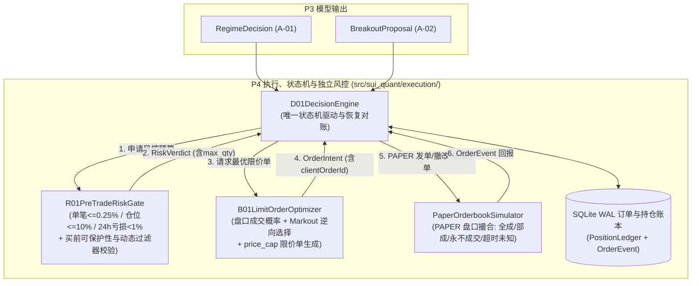

# P4-PLAN｜B-01 智能限价微观执行、D-01 决策状态机闭环与 R-01 独立风控硬闸门（仅 PAPER）

> **阶段编号**：P4｜**当前状态**：`READY_FOR_REVIEW`（等待审查批准后执行 P4 实现）  
> **前置已完成**：`MASTER-PLAN`、`P0`（契约、Ed25519 信任根与环境硬闸门）、`P1`（`F-02` 守护、`R-01` 独立风控服务、`S-01` 安全总管与外部探测）、`P2`（`F-01` 实时采集、质量守卫与 `E-01` 云-本地 `Parquet + DuckDB` 增量同步）、`P3`（`A-01` 五状态分类器与 `A-02` 三障碍校准突破模型）

---

## 01 任务理解与范围边界（引用设计文档章节）

- 依据总体设计方案 **§0.1（业务与环境边界）**、**§5（B-01 智能限价单与微观结构执行）**、**§7（D-01 唯一自主决策状态机）**、**§8（R-01 独立资金与订单风控）** 及 **§14.2（QA-03, QA-04, QA-05, QA-08）**：
  - **严格锁定 `PAPER` 模拟执行（§0.1, §16）**：P4 全链路仅在 `ExecutionMode.PAPER` / `ExecutionMode.RESEARCH` 下运行；严禁初始化或切换为 `LIVE`，严禁发送任何真实资金订单。
  - **唯一交易标的与模型隔离（§0.1, §7, §8.1）**：仅对币安现货 `SUIUSDT` 生成 `OrderIntent`；任何模型（`A-01` / `A-02` / `B-01`）不得直接下单，所有候选提案必须经 `D-01` 单一状态机入口提交 `R-01` 独立风控审查并取得 `RiskVerdict(allowed=True)`。
  - **B-01 盘口微观结构限价优化与逆向选择评估（§5）**：
    - 基于 `PartialOrderbookSnapshot`（前 10 档买卖盘口）评估档位报价候选 $\delta \in \{\text{best\_bid}, \text{mid}, \text{best\_ask}\}$ 的期望成交概率 $P(\text{fill} \mid \delta, \Delta t)$ 与成交后逆向选择 `markout(1s, 5s, 30s, 60s)`，输出受硬上限 `price_cap` 约束的 `OrderIntent`。
    - **缺口窗口禁入约束（QA-01 / P2 联动）**：校准 `B-01` 成交概率时强制调用 `StreamQualityGuard.is_window_valid_for_b01_calibration`，严禁使用带 `GAP_UNRECOVERABLE_FOR_FILL_CALIBRATION` 标记的断线/缺口盘口窗口。
    - **部分成交立即保护**：一旦买单发生部分成交（`PARTIALLY_FILLED`）或全部成交（`FILLED`），立即按已成交真实加权均价与扣费净可卖份额（`compute_post_fill_sellable_position`）挂设 `-1%` 止损保护单。
  - **D-01 交易与保护状态机 + 崩溃恢复对账（§7, QA-04, QA-05）**：
    - 实现从 `BOOT -> SYNCING -> READY_NO_POSITION -> SIGNAL_CANDIDATE -> RISK_CHECK -> ORDER_SUBMITTED -> ORDER_UNKNOWN | PARTIALLY_FILLED | FILLED -> PROTECTION_PENDING -> PROTECTED -> EXITING -> FLAT` 的完整驱动引擎与 SQLite WAL 持久化对账。
    - 当发生网络超时进入 `ORDER_UNKNOWN` 时，必须先按幂等 `clientOrderId` 查询订单状态并完成账本对账，绝不盲目重发买单。

---

## 02 仓库/运行环境现状（只读事实，明确哪些无法验证）

- **已验证事实（P0–P3）**：
  - [`src/sui_quant/contracts.py`](file:///D:/OBR-SUI/src/sui_quant/contracts.py) 已冻结 `RiskVerdict`、`OrderIntent`、`OrderEvent`、`PositionLedger`。
  - [`src/sui_quant/state_machine.py`](file:///D:/OBR-SUI/src/sui_quant/state_machine.py) 已定义 `TradingState` 合法转移矩阵与 `prioritize_startup_reconciliation`。
  - [`src/sui_quant/exchange_rules.py`](file:///D:/OBR-SUI/src/sui_quant/exchange_rules.py) 已实现动态过滤器新鲜度核验（`assert_fresh_for_execution`）、买前可保护性校验（`validate_pre_buy_protectability`）与扣费碎股向下取整计算（`compute_post_fill_sellable_position`）。
  - [`src/sui_quant/models/`](file:///D:/OBR-SUI/src/sui_quant/models) 已实现 `FeaturePipeline`、`A01RegimeClassifier` 与 `A02BreakoutCalibratedModel`，本地与云端已通过 38 项自动化测试。
- **当前仍处于 `PENDING` 的未完结项**：
  - `FI-10B` 日本服务器真实连续 72 小时墙钟运行观测（后台持续采样中，未满 72.0h 前严格保持 `PENDING`）。
  - 外部独立心跳公有云（Cloudflare Workers）生产部署与 Android 实网真机 FCM 推送（保持 `PENDING`）。
  - 币安现货私有账户费率与真实订单回报需待未来授权接入测试网/只读凭据，P4 在高保真 `PAPER` 盘口撮合与故障注入仿真器中完成验证。

---

## 03 方案及依赖图（含数据合同和关键失败模式）

### 关键失败模式与防护
1. **买单超时或网络闪断导致状态未知（`ORDER_UNKNOWN`）**：
   - 严禁直接重发新买单；`D01DecisionEngine` 强制先转入 `ORDER_UNKNOWN`，使用原幂等 `clientOrderId` 调用查单对账接口：若已部分/全部成交则立即转入 `PARTIALLY_FILLED / FILLED -> PROTECTION_PENDING` 挂设止损保护单；若确认未成交且已撤单方可回退至 `READY_NO_POSITION`。
2. **部分成交后剩余挂单与已成交份额保护冲突**：
   - 当限价买单在超时窗口内仅部分成交时，先撤销未成交买单余量，对已成交净份额调用 `compute_post_fill_sellable_position`（扣除手续费并按 `stepSize=0.1` 向下取整），若满足 `is_protectable=True` 立即挂设 `-1%` 保护单；若极端微额部分成交低于 `minQty (0.1 SUI)` 或 `minNotional (5.0 USDT)`，立即转入 `ENTRY_FROZEN` 并触发 `HIGH/CRITICAL` 告警。
3. **买单成交瞬间进程崩溃（`QA-05`）**：
   - 重启后 `BOOT -> SYNCING` 读取交易所/仿真器真实持仓与活跃委托单，若发现存在未受保护的 `SUIUSDT` 持仓，最高优先级转入 `PROTECTION_PENDING` 补挂 `-1%` 止损单，未完成保护前拒绝一切新信号。

---

## 04 待变更目录/文件清单（P4 范围）

- **新增代码**：
  - `src/sui_quant/execution/__init__.py`
  - `src/sui_quant/execution/b01_limit_executor.py`（`B-01` 盘口微观结构成交概率校准、`markout(1s, 5s, 30s, 60s)` 逆向选择计算、缺口窗口过滤与 `OrderIntent` 生成器）
  - `src/sui_quant/execution/r01_risk_evaluator.py`（`R-01` 完备交易前风控审查器：单笔 `<= 0.25%` 风险定仓、单笔 `<= 10%` 资金上限、24h 滚动亏损 `1%` 熔断、动态 `SymbolFilters` 新鲜度校验、买前可保护性校验与 `RiskVerdict` 签发）
  - `src/sui_quant/execution/paper_exchange.py`（`PAPER` 盘口撮合与故障注入仿真器：支持全额成交、部分成交、永不成交超时撤单、网络超时 `ORDER_UNKNOWN` 与保护单托管）
  - `src/sui_quant/execution/d01_engine.py`（`D-01` 自主决策状态机闭环、账本持久化、`ORDER_UNKNOWN` 幂等查单对账与崩溃重启优先补保护单）
- **新增测试**：
  - `tests/test_p4_b01_d01_r01_paper_execution.py`

---

## 05 逐步实现计划（依赖顺序与资源预算）

1. 实现 `r01_risk_evaluator.py`：精确实现单笔风险定仓公式 `max_qty = min(equity * 0.0025 / stop_distance, equity * 0.10 / entry_price)`、按 `stepSize=0.1` 向下取整、买前可保护性核验与 24h 滚动亏损熔断。
2. 实现 `b01_limit_executor.py`：实现盘口档位候选评分、成交概率与逆向选择 `markout(1s, 5s, 30s, 60s)` 计算、断线盘口缺口拒用校验及 `OrderIntent` 构建。
3. 实现 `paper_exchange.py` 与 `d01_engine.py`：打通 `READY_NO_POSITION -> SIGNAL_CANDIDATE -> RISK_CHECK -> ORDER_SUBMITTED -> PARTIALLY_FILLED / FILLED / ORDER_UNKNOWN -> PROTECTION_PENDING -> PROTECTED -> EXITING -> FLAT` 全链路闭环。
4. 编写并执行 `tests/test_p4_b01_d01_r01_paper_execution.py` 全量测试（覆盖 `QA-03`, `QA-04`, `QA-05`, `QA-08`）。
- **资源预算**：云端常驻内存增量 `<= 30 MiB`，单次 `D-01 + R-01 + B-01` 决策到生成 `OrderIntent` 进程内延迟 `P99 <= 20 ms`（优于 `150 ms` SLO）。

---

## 06 测试清单（QA-03 / QA-04 / QA-05 / QA-08 专项验证）

- `test_qa03_r01_position_sizing_filters_and_insufficient_balance`：验证单笔 `0.25%` 风险定仓、`10%` 仓位上限、`tickSize/stepSize/minNotional` 校验、买前可保护性校验及余额不足拒单。
- `test_qa04_b01_unfilled_timeout_partial_fill_and_order_unknown_reconciliation`：分别注入限价单永不成交超时撤单、部分成交撤余量并立即挂保护单、以及发单超时进入 `ORDER_UNKNOWN` 后按 `clientOrderId` 查单对账恢复。
- `test_qa05_crash_at_fill_moment_reconciles_and_restores_protection_first`：模拟买单成交瞬间进程崩溃（未挂出保护单），验证重启 `BOOT -> SYNCING` 自动对账发现裸仓并优先转入 `PROTECTION_PENDING -> PROTECTED`。
- `test_qa08_rolling_24h_loss_freeze_and_symbol_guard`：验证滚动 24h 亏损达到 `1.0%` 时 `R-01` 立即拒绝新开仓并转入 `ENTRY_FROZEN`，且任何 `BTCUSDT` 下单企图均被硬拦截。
- `test_p4_b01_markout_and_orderbook_gap_calibration_rejection`：验证 `B-01` 精确计算 `1s/5s/30s/60s` markout，且拒绝在含 `GAP_UNRECOVERABLE_FOR_FILL_CALIBRATION` 的盘口窗口上进行成交概率校准。

---

## 07 验收标准：可测量门槛与具体证据文件路径

- `pytest tests/test_p4_b01_d01_r01_paper_execution.py -v` 100% 通过。
- `D-01 + R-01 + B-01` 本地决策至生成 `OrderIntent` 延迟实测 `P99 <= 150 ms`。
- 真实资金订单数量严格为 `0`（仅 `PAPER` 模式）。

---

## 08 风险与备选方案

- 若限价买单发生极小额部分成交（扣除手续费后 `< 0.1 SUI` 或止损名义额 `< 5.0 USDT` 导致交易所拒绝挂保护单），`D-01` 立即撤除剩余买单、转入 `ENTRY_FROZEN` 并发出 `HIGH` 级告警记录，杜绝无感知裸仓运行。

---

## 09 未验证假设及阻塞项

- **对 P4 无阻塞**：P4 严格在 `PAPER` 模式下验证执行与风控闭环，不依赖真实资金账户 API Key。

---

## 10 等待审查的问题与结论

- 状态：`READY_FOR_REVIEW`。请在验收 P3 成果后审查本 P4 计划。
