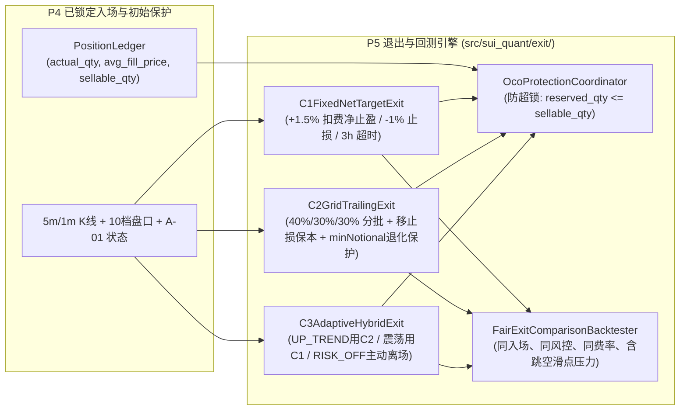

# P5-PLAN｜C-01 三策略退出优化、保护订单防超锁管理与双层公平对照回测（仅 PAPER / RESEARCH）

> **阶段编号**：P5｜**当前状态**：`READY_FOR_REVIEW`（仅提交正式实施计划，等待审查批准；**未获授权前绝不执行 P5 交易代码修改，严禁开启 LIVE 实盘**）  
> **前置已完成**：`MASTER-PLAN`、`P0`、`P1`、`P2`、`P3`（数学框架补证完毕，历史统计裁决 `NO_EDGE`）、`P4`（`B-01` 限价执行、`D-01` 状态机闭环与 `R-01` 独立风控最终否决，`55 passed`）。  
> **执行模式硬边界**：严格锁定 `ExecutionMode.PAPER` / `ExecutionMode.RESEARCH`，真实资金订单数恒等于 `0`。

---

## 01 任务理解与范围边界（引用设计文档章节）

依据总体设计方案 **§6（C-01 三种退出候选模型与同一止损规则）**、**§8.2（订单锁定与碎股防护）**、**§14（科学回测与验证规范）** 及 **§14.2（QA-06, QA-07, QA-13）**，P5 的核心任务是在**完全相同的入场信号、相同的 `-1%` 硬止损基线、相同的风控定仓与相同的手续费/滑点模型**下，实现并公平对照三种退出策略（`C1`、`C2`、`C3`），并确保止盈/止损组合订单绝不发生重复锁仓或微额死锁：

1. **统一硬止损基线（§6.1）**：
   无论采用 `C1`、`C2` 还是 `C3`，初始保护止损触发价严格锚定真实成交加权买入均价 $\bar{p}_{\text{fill}}$ 的 `-1.0%`：
   $$p_{\text{stop}} = \left\lfloor \frac{\bar{p}_{\text{fill}} \cdot (1 - 0.010)}{\text{tickSize}} \right\rfloor \cdot \text{tickSize}$$
   且显式建模极端向下跳空与盘口深度穿透滑点（验证 `QA-07`：当触发 `-1%` 止损时，实际成交亏损可能超过 `1%`，系统必须如实计量并纳入风控与回测）。
2. **三种退出候选策略数学定义（§6.2）**：
   - **策略 `C1`（固定扣费净收益 `+1.5%` 全额止盈基线）**：
     计算扣除双边手续费后恰好实现 `+1.50%` 净收益的目标限价卖单价格 $p_{\text{C1}}$（向上对齐 `tickSize`），达到时一次性卖出全部可卖持仓 $Q_{\text{sellable}}$；若 3 小时（36 根 5m K 线）未触及止盈或止损，按 `TIMEOUT` 规则平仓。
   - **策略 `C2`（上涨方向 3 档分批网格止盈 + 移动保本追踪）**：
     仅在盈利方向（`> avg_fill_price`）设置分批止盈档位（严禁下跌网格或亏损加仓）：
     - 第一档 $T_1$（净收益 `+1.0%`）：卖出 `40%` 份额，同时将剩余 `60%` 份额的止损保护单上移至保本线（覆盖双边手续费的 `breakeven_price`）；
     - 第二档 $T_2$（净收益 `+1.8%`）：卖出 `30%` 份额；
     - 第三档 $T_3$（剩余 `30%` 份额）：启用基于高水位回撤（Trailing Stop，回撤 `0.6%` 或 ATR 倍数）追踪止盈。
     - **名义额退化保护（Min-Notional Fallback）**：若总持仓较小导致分批切分后的任意子档位 `< minQty (0.1 SUI)` 或 `< minNotional * 1.05 (5.25 USDT)`，`C2` 自动退化为单档或双档合并卖出，严禁产生无法挂单的死锁残余仓位。
   - **策略 `C3`（基于 `A-01` 市场状态与盘口动量的自适应混合退出）**：
     - 当 `A-01` 处于强趋势 `UP_TREND` 且盘口买方失衡度 $\text{OBI}_5 > 0$ 时，切换为 `C2` 分批追踪模式以捕捉肥尾趋势；
     - 当 `A-01` 处于 `CONSOLIDATION` 时，采用 `C1` 固定 `+1.5%` 净止盈迅速落袋；
     - 当持仓期间 `A-01` 突变为 `DOWN_TREND / HIGH_VOLATILITY` 或触发 `BTCUSDT` 急跌警报时，无需等待 `-1%` 硬止损，立即触发主动防御平仓（Emergency Risk-Off Exit）。
3. **止盈/止损数量锁定与防超锁不变量（§6.3, QA-06）**：
   任一时刻所有在途卖单（含止损保护单与分批止盈限价单）锁定的总数量必须严格满足：
   $$\sum_{o \in \text{ActiveSellOrders}} q_{\text{locked}}(o) = \text{PositionLedger.reserved\_qty} \le Q_{\text{sellable}} \le \text{PositionLedger.actual\_qty}$$
   执行平仓或分批改单时，必须通过 OCO（One-Cancels-the-Other）或“先撤旧保护单释放锁定份额 $\rightarrow$ 校验可用份额 $\rightarrow$ 挂新单”的原子事务状态机，杜绝 `Insufficient balance` 拒单或裸仓误判。
4. **双层公平对照回测引擎（§14.1, QA-13）**：
   - 第一层（Bar-Level Pessimistic Backtest）：基于 5m/1m 已收盘 K 线，同 Bar 冲突严格悲观判 `STOP`；
   - 第二层（Orderbook-Replay Microstructure Backtest）：结合 `B-01` 盘口微观滑点、双边手续费与止损穿透压力滑点，输出 `C1 vs C2 vs C3` 的净期望收益、最大回撤、Sharpe/Sortino、胜率、盈亏比、尾部单笔最大亏损（CVaR 95%）及统计裁决（若无显著正期望，如实输出 `NO_EDGE`）。

---

## 02 仓库/运行环境现状（只读事实，明确哪些无法验证）

- **已就绪事实（P0–P4）**：
  - [`src/sui_quant/exchange_rules.py`](file:///D:/OBR-SUI/src/sui_quant/exchange_rules.py) 已实现 `compute_c1_net_target_sell_price`、`compute_stop_loss_trigger_price` 与 `compute_post_fill_sellable_position`。
  - [`src/sui_quant/execution/`](file:///D:/OBR-SUI/src/sui_quant/execution) 已实现 `PaperOrderbookSimulator`、`D01DecisionEngine`、`R01PreTradeRiskGate` 与 `B01LimitOrderOptimizer`。
  - [`evidence/p3_real_historical_audit_evidence.json`](file:///D:/OBR-SUI/evidence/p3_real_historical_audit_evidence.json) 已归档 60 天币安现货 `SUIUSDT` / `BTCUSDT` 真实历史数据。
- **持续追踪的 `PENDING` / `NO_EDGE` 事项**：
  - `P3` 真实历史数据独立样本外统计结论为 `NO_EDGE`。
  - `FI-10B` 日本东京服务器连续 72 小时真实墙钟观测保持 `PENDING`。
  - 外部独立心跳公有云（Cloudflare Workers）与 Android 真机 FCM 通知保持 `PENDING`。

---

## 03 方案及依赖图（含数据合同和关键失败模式）

### 关键失败模式与防护
1. **分批止盈后剩余仓位跌破 `minNotional (5.0 USDT)` 导致无法挂保护单**：
   `C2GridTrailingExit.plan_tranches()` 在拆分前预先验算每一档与剩余档位在 `-1%` 止损价下的名义价值；若拆分会导致任意剩余份额 `< 5.25 USDT`，自动将过小档位合并，直至退化为 `100%` 单笔 `C1` 模式。
2. **止盈单与止损单重复锁定同一批 `SUI` 触发余额不足拒单（`QA-06`）**：
   `OcoProtectionCoordinator` 强制维护单点账本锁 `reserved_qty`，在不支持原生 OCO 或需要改挂分批止盈时，严格按原子顺序先撤销旧保护单并校验 `free_sui >= next_order_qty`。
3. **极端快速跳水穿透 `-1%` 止损线导致触发限价单不成交（`QA-07`）**：
   当盘口买一价 `best_bid` 瞬间跳空跌穿止损限价时，`D-01 / C-01` 检测到保护单逾时未成交立即撤单并以激进可成交价格（含压力滑点）强制扫单平仓，绝不留裸仓过夜。

---

## 04 待变更目录/文件清单（获批进入 P5 后实施）

- **新增模块（`src/sui_quant/exit/`）**：
  - `src/sui_quant/exit/__init__.py`
  - `src/sui_quant/exit/c01_strategies.py`（实现 `C1FixedNetTargetExit`、`C2GridTrailingExit`、`C3AdaptiveHybridExit` 与 `OcoProtectionCoordinator`）
  - `src/sui_quant/exit/fair_backtester.py`（实现双层公平回测对照引擎、跳空滑点压力注入器与统计显著性裁决器）
- **新增测试（`tests/`）**：
  - `tests/test_p5_c01_exit_and_backtest.py`

---

## 05 逐步实现计划（依赖顺序与资源预算）

1. **Step 1**：实现 `OcoProtectionCoordinator` 与 `C1 / C2 / C3` 三种退出策略状态机，内置 `minNotional` 分批退化保护与防超锁校验（`QA-06`）。
2. **Step 2**：实现跳空闪崩、`-1%` 止损触发后实际亏损 `> 1%`、保护单拒单重试/激进平仓回退机制（`QA-07`）。
3. **Step 3**：实现 `FairExitComparisonBacktester`，在严格相同入场、相同风控定仓、相同手续费与压力滑点假设下对 `C1 / C2 / C3` 进行样本外对照回测（`QA-13`）。
4. **Step 4**：运行全量回归测试并输出 `evidence/p5_c01_exit_comparison_evidence.json`。
- **资源预算**：云端单次退出评估耗时 `<= 0.5 ms`，常驻内存增量 `<= 5 MiB`。

---

## 06 测试清单（QA-06 / QA-07 / QA-13 专项验证）

- `test_qa06_oco_and_tranche_quantity_locking_zero_over_reservation`：验证 `C1 / C2 / C3` 在全生命周期内 `reserved_qty <= actual_qty` 恒成立，分批成交后自动重算剩余保护单数量，零重复占用、零裸仓误判。
- `test_qa06_c2_small_position_min_notional_degradation_guard`：验证当总持仓名义额较小（如 `$12.00`）无法拆分为 3 个 `>= $5.25` 的子单时，`C2` 自动合并档位防止死锁。
- `test_qa07_gap_down_beyond_1pct_stop_slippage_and_order_rejection_fallback`：注入瞬间跳空 `-3.5%` 及保护单拒单异常，验证系统如实记录 `> 1%` 实际亏损并通过紧急平仓通道清零裸仓。
- `test_qa13_fair_c1_c2_c3_comparison_identical_entries_risk_and_fees`：验证 `C1`、`C2`、`C3` 在 100% 相同的入场时间序列、相同的 `R-01` 仓位与相同的双边费率下运行，且无统计优势时如实输出 `NO_EDGE`。

---

## 07 验收标准：可测量门槛与具体证据文件路径

- `pytest tests/test_p5_c01_exit_and_backtest.py -v` 100% 通过。
- `QA-06` 重复锁仓次数 `== 0`，裸仓遗留次数 `== 0`。
- 证据归档路径：`evidence/p5_c01_exit_comparison_evidence.json`。

---

## 08 风险与备选方案

- 若 `C2` 或 `C3` 在真实历史样本外回测中的净收益或风险调整收益（Sharpe / Calmar）未显著优于简单的 `C1` 基线，系统默认锁定最简、最稳健的 `C1` 作为唯一激活退出策略，遵循奥卡姆剃刀原则避免过拟合。

---

## 09 未验证假设及阻塞项

- **工程阻塞项**：无。
- **显式保持 `PENDING` / `NO_EDGE` 的事项**：
  1. 真实历史数据样本外策略统计优势尚未成立（`NO_EDGE`）。
  2. `FI-10B` 日本东京生产服务器连续 72 小时真实墙钟运行观测 `PENDING`。
  3. 外部独立心跳公有云（Cloudflare Workers）与 Android 真机 FCM 推送 `PENDING`。

---

## 10 等待审查的问题与结论

- **当前状态**：`READY_FOR_REVIEW`。
- 请确认是否批准按本计划进入 **P5（C-01 三策略退出优化、保护订单防超锁管理与双层公平对照回测）** 实施？
