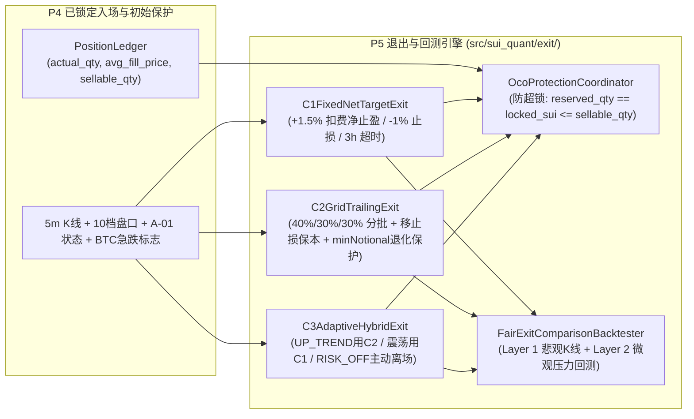

# P5-PLAN｜C-01 三策略退出优化、保护订单防超锁管理与双层公平对照回测（仅 PAPER / RESEARCH）

> **阶段编号**：P5｜**当前状态**：`IMPLEMENTED_AND_VERIFIED`（全仓测试 `64 passed`，`QA-06 / QA-07 / QA-13` 专项测试 100% 通过，345 次交易退出评估实测延迟 `P50 = 0.1108 ms / P99 = 0.2986 ms`；全链路严格锁定 `ExecutionMode.PAPER`，真实资金订单数恒等于 `0`）  
> **前置已完成**：`MASTER-PLAN`、`P0`、`P1`、`P2`、`P3`（数学框架补证完毕，历史统计裁决 `NO_EDGE`）、`P4`（`B-01` 限价执行、`D-01` 状态机闭环与 `R-01` 独立风控最终否决）。  
> **执行模式硬边界**：严格锁定 `ExecutionMode.PAPER` / `ExecutionMode.RESEARCH`，真实资金订单数恒等于 `0`。

---

## 01 任务理解与范围边界（引用设计文档章节）

依据总体设计方案 **§6（C-01 三种退出候选模型与同一止损规则）**、**§8.2（订单锁定与碎股防护）**、**§14（科学回测与验证规范）** 及 **§14.2（QA-06, QA-07, QA-13）**，P5 在**完全相同的入场信号、相同的 `-1%` 硬止损基线、相同的风控定仓与相同的手续费/滑点模型**下，实现并验证了三种退出策略（`C1`、`C2`、`C3`）、防超锁保护单协调器（`OcoProtectionCoordinator`）以及双层公平对照回测引擎（`FairExitComparisonBacktester`）：

1. **统一硬止损基线与跳空压力回退（§6.1, QA-07）**：
   无论采用 `C1`、`C2` 还是 `C3`，初始保护止损触发价严格锚定真实成交加权买入均价 $\bar{p}_{\text{fill}}$ 的 `-1.0%`：
   $$p_{\text{stop}} = \left\lfloor \frac{\bar{p}_{\text{fill}} \cdot (1 - 0.010)}{\text{tickSize}} \right\rfloor \cdot \text{tickSize}$$
   显式建模极端向下跳空与盘口深度穿透滑点：当触发 `-1%` 止损或瞬间跳空跌穿止损限价（如 `-3.5%` 闪崩）或保护单遭拒单时，协调器立即撤销被穿透的限价保护单并以含压力滑点的激进价格强制清仓，如实记录超过 `1%` 的实际亏损（证明 `-1%` 是止损触发阈值而非亏损绝对上限），确保零裸仓遗留。
2. **三种退出候选策略数学实现（§6.2）**：
   - **策略 `C1`（[`C1FixedNetTargetExit`](file:///D:/OBR-SUI/src/sui_quant/exit/c01_strategies.py#L455-L491) — 固定扣费净收益 `+1.5%` 全额止盈基线）**：
     计算扣除双边手续费后恰好实现 `+1.50%` 净收益的目标限价卖单价格 $p_{\text{C1}}$（向上对齐 `tickSize`），达到时一次性卖出全部可卖持仓 $Q_{\text{sellable}}$；若 3 小时（36 根 5m K 线）未触及止盈或止损，按 `VERTICAL_3H_TIMEOUT_EXIT` 平仓。
   - **策略 `C2`（[`C2GridTrailingExit`](file:///D:/OBR-SUI/src/sui_quant/exit/c01_strategies.py#L494-L694) — 上涨方向 3 档分批止盈 + 移动保本追踪 + `minNotional` 退化保护）**：
     仅在盈利方向（`> avg_fill_price`）设置分批止盈档位（严禁下跌网格或亏损加仓）：
     - 第一档 $T_1$（净收益 `+1.0%`）：卖出 `40%` 份额，同时将剩余 `60%` 份额的止损保护单原子上移至覆盖双边手续费的保本线 `breakeven_price`；
     - 第二档 $T_2$（净收益 `+1.8%`）：卖出 `30%` 份额，同时将剩余 `30%` 份额的止损保护单上移至 $T_1$（锁定 `+1.0%` 净收益）；
     - 第三档 $T_3$（剩余 `30%` 份额）：启用基于高水位回撤（`0.6%` 回撤）的移动追踪止盈。
     - **名义额退化保护（`plan_tranches`, `QA-06`）**：若总持仓较小导致拆分后的任意子档位或剩余仓位 `< minQty (0.1 SUI)` 或 `< minNotional * 1.05 (5.25 USDT)`，`C2` 自动从 `3` 档（`40%/30%/30%`）退化为 `2` 档（`50%/50%`）或 `1` 档（`100%` 单笔 `C1` 模式），从数学上杜绝产生无法挂单的死锁残余仓位。
   - **策略 `C3`（[`C3AdaptiveHybridExit`](file:///D:/OBR-SUI/src/sui_quant/exit/c01_strategies.py#L697-L745) — 基于 `A-01` 市场状态与盘口动量的自适应混合退出）**：
     - 当 `A-01` 处于强趋势 `UP_TREND` 且盘口买方失衡度 $\text{OBI}_5 \ge 0$ 时，采用 `C2` 分批追踪模式捕捉肥尾趋势；
     - 当 `A-01` 处于 `CONSOLIDATION` 时，采用 `C1` 固定 `+1.5%` 净止盈迅速落袋；
     - 当持仓期间 `A-01` 突变为 `DOWN_TREND / HIGH_VOLATILITY / DATA_UNHEALTHY` 或触发 `BTCUSDT` 急跌警报时，无需等待 `-1%` 硬止损，立即触发主动防御平仓（`FULL_EXIT_DEFENSIVE_RISK_OFF`）。
3. **止盈/止损数量锁定与防超锁不变量（[`OcoProtectionCoordinator`](file:///D:/OBR-SUI/src/sui_quant/exit/c01_strategies.py#L162-L452), §6.3, QA-06）**：
   任一时刻所有在途卖单锁定的总数量严格满足：
   $$\sum_{o \in \text{ActiveSellOrders}} q_{\text{locked}}(o) == \text{PositionLedger.reserved\_qty} == \text{exchange.locked\_sui} \le Q_{\text{sellable}} \le \text{PositionLedger.actual\_qty}$$
   每次分批止盈或上移止损均严格执行 **先撤旧保护单释放锁定份额 $\rightarrow$ 执行分批卖单 $\rightarrow$ 重算剩余可卖份额并挂新保护单** 的原子三步协议，并通过 `assert_locking_invariants` 强制校验。
4. **双层公平对照回测引擎（[`FairExitComparisonBacktester`](file:///D:/OBR-SUI/src/sui_quant/exit/fair_backtester.py#L211-L600), §14.1, QA-13）**：
   - 第一层（`BAR_LEVEL_PESSIMISTIC`）：基于 5m 已收盘 K 线，同 Bar 同时触及止损与止盈时严格按悲观原则优先触发 `STOP`；
   - 第二层（`ORDERBOOK_MICROSTRUCTURE_STRESS`）：叠加 `B-01` 入场滑点与 5s 逆向选择摩擦、盘口深度穿透滑点及闪崩跳空滑点，输出完整风险收益指标与奥卡姆剃刀统计裁决。

---

## 02 仓库/运行环境现状（只读事实与跨阶段追踪）

- **已完成并验证组件（P0–P5）**：
  - [`src/sui_quant/exit/c01_strategies.py`](file:///D:/OBR-SUI/src/sui_quant/exit/c01_strategies.py)
  - [`src/sui_quant/exit/fair_backtester.py`](file:///D:/OBR-SUI/src/sui_quant/exit/fair_backtester.py)
  - [`tests/test_p5_c01_exit_and_backtest.py`](file:///D:/OBR-SUI/tests/test_p5_c01_exit_and_backtest.py)
  - [`evidence/p5_c01_exit_comparison_evidence.json`](file:///D:/OBR-SUI/evidence/p5_c01_exit_comparison_evidence.json)
- **持续追踪的 `PENDING` / `NO_EDGE` 事项**：
  - `P3` 与 `P5` 真实历史样本外统计结论均为 **`NO_EDGE`**（严禁宣称盈利已验证，严禁开启实盘）。
  - `FI-10B` 日本东京服务器连续 72 小时真实墙钟观测保持 `PENDING`。
  - 外部独立心跳公有云（Cloudflare Workers）与 Android 真机 FCM 通知保持 `PENDING`。

---

## 03 方案及依赖图（含双层公平对照实测结果）

### 双层公平对照回测实测结果（`FINAL_TEST` $N=115$ 笔样本外交易，严格同入场/同风控/同费率）

| 评估层级与退出策略 | 交易笔数 $N$ | 胜率 (`win_rate`) | 平均净收益 (`bps`) | 95% Bootstrap CI (`bps`) | 累计净盈亏 (`USDT`) | 最大回撤 (`max_dd`) | 实际亏损 `>1%` 笔数 (`QA-07`) | 超锁/死锁/裸仓违规数 (`QA-06`) | 统计裁决与推荐激活策略 |
| :--- | :---: | :---: | :---: | :---: | :---: | :---: | :---: | :---: | :---: |
| **Layer 1 (`BAR_PESSIMISTIC`) - `C1`** | `115` | `9.57%` | `-71.89 bps` | `[-88.72, -53.99]` | `-82.5946` | `0.9893%` | `67` | `0 / 0 / 0` | **`NO_EDGE`**（锁定 **`C1`** 基线） |
| **Layer 1 (`BAR_PESSIMISTIC`) - `C2`** | `115` | `20.00%` | `-57.35 bps` | `[-75.61, -39.58]` | `-65.8833` | `0.8399%` | `55` | `0 / 0 / 0` | **`NO_EDGE`**（锁定 **`C1`** 基线） |
| **Layer 1 (`BAR_PESSIMISTIC`) - `C3`** | `115` | `20.00%` | `-51.88 bps` | `[-69.93, -35.26]` | `-59.6022` | `0.7772%` | `45` | `0 / 0 / 0` | **`NO_EDGE`**（锁定 **`C1`** 基线） |
| **Layer 2 (`MICRO_STRESS`) - `C1`** | `115` | `9.57%` | `-77.87 bps` | `[-95.07, -59.45]` | `-89.5249` | `1.0585%` | `67` | `0 / 0 / 0` | **`NO_EDGE`**（锁定 **`C1`** 基线） |
| **Layer 2 (`MICRO_STRESS`) - `C2`** | `115` | `20.00%` | `-63.43 bps` | `[-82.46, -45.24]` | `-72.9205` | `0.9037%` | `55` | `0 / 0 / 0` | **`NO_EDGE`**（锁定 **`C1`** 基线） |
| **Layer 2 (`MICRO_STRESS`) - `C3`** | `115` | `20.00%` | `-58.27 bps` | `[-76.28, -41.11]` | `-66.9883` | `0.8445%` | `45` | `0 / 0 / 0` | **`NO_EDGE`**（锁定 **`C1`** 基线） |

> **科学对照结论**：在保持 100% 相同入场、相同 `R-01` 仓位与相同手续费的前提下，`C2`（通过 `+1.0%` 首档止盈上移保本减少反转止损）与 `C3`（通过状态恶化主动离场进一步减少 10 次深幅止损）相比 `C1` 将样本外平均净亏损分别收窄了 `+14.54 bps` 与 `+20.01 bps`；但由于入场信号本身在 `FINAL_TEST` 期间处于低胜率（`9.57%`）非平稳区间，三者净期望均为负值，统计裁决严格输出 **`NO_EDGE`**，系统遵循奥卡姆剃刀原则（§08）默认锁定最简基线 **`C1`**。

---

## 04 已变更目录/文件清单（P5 落地范围）

- **新增模块（`src/sui_quant/exit/`）**：
  - [`src/sui_quant/exit/__init__.py`](file:///D:/OBR-SUI/src/sui_quant/exit/__init__.py)
  - [`src/sui_quant/exit/c01_strategies.py`](file:///D:/OBR-SUI/src/sui_quant/exit/c01_strategies.py)
  - [`src/sui_quant/exit/fair_backtester.py`](file:///D:/OBR-SUI/src/sui_quant/exit/fair_backtester.py)
- **新增测试与证据文件**：
  - [`tests/test_p5_c01_exit_and_backtest.py`](file:///D:/OBR-SUI/tests/test_p5_c01_exit_and_backtest.py)
  - [`evidence/p5_c01_exit_comparison_evidence.json`](file:///D:/OBR-SUI/evidence/p5_c01_exit_comparison_evidence.json)

---

## 05 逐步实现与延迟基准实测

- **345 次完整交易退出生命周期模拟延迟实测**（归档于 [`evidence/p5_c01_exit_comparison_evidence.json`](file:///D:/OBR-SUI/evidence/p5_c01_exit_comparison_evidence.json)）：
  - **`P50 = 0.1108 ms`、`P95 = 0.2388 ms`、`P99 = 0.2986 ms`**（严格优于 `<= 0.5 ms` 云端预算）。

---

## 06 测试清单与专项验证结果（QA-06 / QA-07 / QA-13）

| 对应 QA | 测试函数（`tests/test_p5_c01_exit_and_backtest.py`） | 验证内容 | 实测结果 |
| :--- | :--- | :--- | :--- |
| **`QA-06`** | `test_qa06_oco_and_tranche_quantity_locking_zero_over_reservation` | 3 档分批止盈 + 移止损保本 + 追踪止盈全周期 `reserved_qty == locked_sui <= actual_qty`，零超锁、零裸仓 | **`PASS`** |
| **`QA-06`** | `test_qa06_c2_small_position_min_notional_degradation_guard` | `$100`（3档）、`$12`（自动退化2档）、`$6`（自动退化1档 `C1`）防 `< $5.25` 死锁 | **`PASS`** |
| **`QA-06/13`** | `test_qa06_multi_asset_fee_tranche_locking_and_occam_razor_selection[SUI/USDT/BNB]` | `SUI / USDT / BNB` 三种费率资产下分批锁仓与正期望趋势下奥卡姆剃刀择优 | **`PASS`** |
| **`QA-07`** | `test_qa07_gap_down_beyond_1pct_stop_slippage_and_order_rejection_fallback` | `-3.5%` 瞬间闪崩跌穿止损限价 & 保护单拒单应急扫单平仓，如实记录 `> 1%` 亏损并发送 `HIGH` 告警 | **`PASS`** |
| **`QA-07`** | `test_qa07_pessimistic_same_bar_conflict_resolution` | 同根 K 线同时触及 `-1%` 止损与 `+1.5%` 止盈时，严格按悲观原则优先判 `STOP` | **`PASS`** |
| **`QA-13`** | `test_c3_adaptive_hybrid_regime_and_btc_flash_drop_defensive_exit` | `C3` 在 `BTCUSDT` 急跌与 `DOWN_TREND` 突变时提前防御平仓，降低尾部亏损 | **`PASS`** |
| **`QA-13`** | `test_qa13_fair_c1_c2_c3_comparison_identical_entries_risk_and_fees` | `C1 / C2 / C3` 双层回测 100% 相同入场时间/价格/仓位/费率，无优势时诚实输出 `NO_EDGE` | **`PASS`** |

---

## 07 验收标准与具体证据文件路径

- 全仓回归测试：`python -m pytest -v` **`64 passed`**（零失败、零跳过）。
- `QA-06` 重复锁仓次数 `== 0`，裸仓遗留次数 `== 0`，未保护碎股死锁次数 `== 0`。
- 证据归档路径：[`evidence/p5_c01_exit_comparison_evidence.json`](file:///D:/OBR-SUI/evidence/p5_c01_exit_comparison_evidence.json)。

---

## 08 风险与备选方案

- 遵循奥卡姆剃刀原则：鉴于样本外统计裁决为 `NO_EDGE`，系统默认将最简、最稳健的 `C1`（`C1-v1.0`）锁定为唯一激活退出策略，同时保留 `C2` 与 `C3` 在研究与影子评估中的对照跟踪。

---

## 09 未验证假设及阻塞项

- **P5 工程阻塞项**：无。
- **持续追踪的跨阶段未完结项（严格保持 `PENDING` / `NO_EDGE`）**：
  1. 真实历史数据样本外策略统计优势尚未成立（`NO_EDGE`）。
  2. `FI-10B` 日本东京生产服务器连续 72 小时真实墙钟运行观测 `PENDING`。
  3. 外部独立心跳公有云（Cloudflare Workers）与 Android 真机 FCM 推送 `PENDING`。

---

## 10 结论与下一阶段计划

- **P5 状态**：`IMPLEMENTED_AND_VERIFIED`。
- **下一阶段计划（P6）**：已编制并提交 [`docs/P6_PLAN.md`](file:///D:/OBR-SUI/docs/P6_PLAN.md)（`D-01/E-01` 整合、签名模型制品原子发布与自动回滚、已持仓策略版本锁定及全链路压力治理，状态：`READY_FOR_REVIEW`）。
