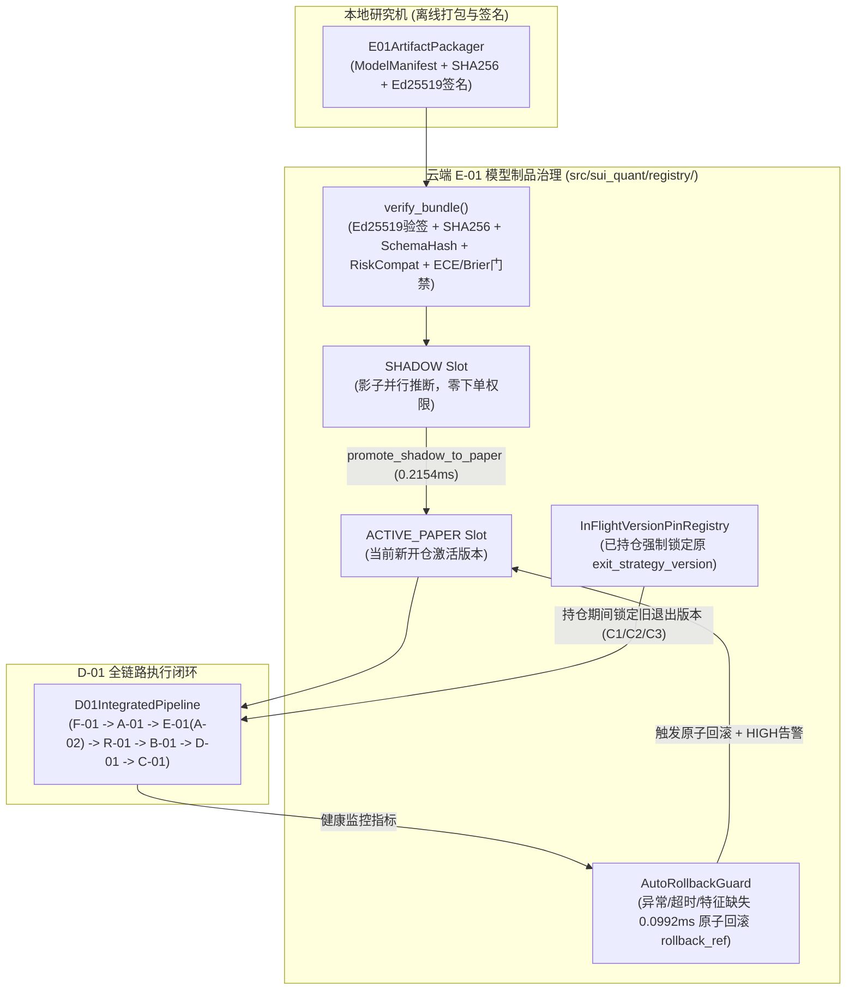

# P6-PLAN｜D-01/E-01 全链路整合、签名模型制品原子热切换与回滚、已持仓版本锁定及压力治理（仅 PAPER / SHADOW）

> **阶段编号**：P6｜**当前状态**：`IMPLEMENTED_AND_VERIFIED`（全仓测试 `70 passed`，`QA-12` 专项治理与在途持仓版本锁定测试 100% 通过，200 周期全链路闭环 `P50 = 2.9643 ms / P99 = 7.2515 ms`，热切换晋升 `0.2154 ms`，自动原子回滚 `0.0992 ms`，内存增量 `0.2144 MiB`；全链路严格锁定 `ExecutionMode.PAPER`，真实资金订单数恒等于 `0`）  
> **前置已完成**：`MASTER-PLAN`、`P0`、`P1`、`P2`、`P3`（数学框架补证完毕，历史统计裁决 `NO_EDGE`）、`P4`（`B-01/D-01/R-01` 模拟执行闭环）、`P5`（`C-01` 三策略退出、防超锁协调器与双层公平回测）。  
> **执行模式硬边界**：严格锁定 `ExecutionMode.PAPER` / `ExecutionMode.RESEARCH`（及模型影子评估态 `SHADOW`），真实资金订单数恒等于 `0`。

---

## 01 任务理解与范围边界（引用设计文档章节）

依据总体设计方案 **§11（E-01 研究仓、同步、模型版本与发布）**、**§7（D-01 状态机与版本治理）**、**§13（全链路延迟与资源预算 SLO）** 及 **§14.2（QA-12）**，P6 将 `F-01`（采集）、`A-01/A-02`（建模）、`B-01`（限价优化）、`R-01`（独立风控）、`D-01`（自主状态机）与 `C-01`（退出协调）整合为受签名模型制品仓库（`E-01`）驱动的完整闭环，并确保模型热切换与故障回滚绝不破坏在途持仓保护：

1. **E-01 签名模型制品仓库与多层完整性校验（[`E01ModelRegistry.verify_bundle`](file:///D:/OBR-SUI/src/sui_quant/registry/e01_model_registry.py#L438-L526), §11.2, QA-12）**：
   - 本地研究机离线打包（[`E01ArtifactPackager`](file:///D:/OBR-SUI/src/sui_quant/registry/e01_model_registry.py#L140-L246)）生成含 `ModelManifest` 的不可变模型制品包 [`SignedModelArtifactBundle`](file:///D:/OBR-SUI/src/sui_quant/registry/e01_model_registry.py#L76-L137)，强制绑定：
     - `sha256`（64 位十六进制制品字节摘要）
     - `features_schema_hash`（与 `FeaturePipeline` / `A02_FEATURE_NAMES` 严格一致的特征 Schema 哈希）
     - `risk_compatibility`（与 `R-01` `RiskConfig.version` 兼容锚点）
     - `rollback_ref`（非空且已注册的上一稳定制品版本引用）
     - `calibration_metrics`（样本外校准门槛：`ece <= 0.08` 且 `brier_score <= baseline_brier_score`）
     - Ed25519 离线数字签名（由研究机私钥签名、云端固定公钥验签）
   - 严禁任何模型制品修改或放宽 `R-01` 风控上限、启用非 `SUIUSDT` 交易对或绕过 `LIVE` 门禁。
2. **`SHADOW -> PAPER` 原子发布与自动回滚状态机（[`E01ModelRegistry`](file:///D:/OBR-SUI/src/sui_quant/registry/e01_model_registry.py#L345-L735), §11.2, QA-12）**：
   - 新模型制品通过 6 层校验后首先挂载至 `SHADOW` 槽位，与当前 `ACTIVE_PAPER` 激活模型并行接收已收盘 `MarketFeatures` 进行影子推断（[`evaluate_shadow_inference`](file:///D:/OBR-SUI/src/sui_quant/registry/e01_model_registry.py#L597-L648)），记录延迟与概率分布，且 **零下单权限（`shadow_orders_submitted_count == 0`）**。
   - 经 `SHADOW` 门禁核验满足最小评估次数且全部健康后，通过 [`promote_shadow_to_paper`](file:///D:/OBR-SUI/src/sui_quant/registry/e01_model_registry.py#L650-L700) 执行原子指针切换晋升为 `ACTIVE_PAPER`（实测耗时 `0.2154 ms <= 5.0 ms`）。
   - 若激活模型在运行期发生：特征缺失、运行时异常、非有限输出或推断耗时超阈值（`> max_inference_latency_ms`），[`evaluate_active_paper_proposal`](file:///D:/OBR-SUI/src/sui_quant/registry/e01_model_registry.py#L764-L814) 自动触发 **原子回滚（[`trigger_atomic_rollback`](file:///D:/OBR-SUI/src/sui_quant/registry/e01_model_registry.py#L702-L762) to `rollback_ref`）**，在同一周期内无缝回退至稳定版本继续服务，并向 `AlertManager` 发送 `HIGH` 级告警（实测回滚耗时 `0.0992 ms <= 5.0 ms`）。
3. **在途持仓退出策略版本硬锁定（[`InFlightVersionPinRegistry`](file:///D:/OBR-SUI/src/sui_quant/registry/e01_model_registry.py#L265-L361), §11.2, QA-12）**：
   - 当系统处于持仓状态（`PROTECTED` / `PROTECTION_PENDING` / `EXITING`）期间发生模型/策略热更新或回滚时，已开仓的 `PositionLedger` **强制继续使用开仓瞬间锁定的 `PositionLedger.exit_strategy_version`**（例如已按 `C2-v1.0` 完成第一档 `40%` 止盈并移止损至保本线的持仓，在系统热切换至 `C1-v2.0` 后，依然严格按 `C2-v1.0` 完成第二档 `30%` 与第三档 `30%` 移动追踪止盈；又如按 `C3-v1.0` 开仓的持仓在热切换至 `C1-v2.0` 后遇到 `BTCUSDT` 急跌，依然严格按 `C3-v1.0` 触发 `FULL_EXIT_DEFENSIVE_RISK_OFF`），直至该笔持仓完全平仓回到 `FLAT -> READY_NO_POSITION` 释放版本锁后，下一笔新开仓才切换至 `C1-v2.0`（版本串扰违规次数 `= 0`）。
4. **全链路端到端流水线整合与性能/内存水位治理（[`D01IntegratedPipeline`](file:///D:/OBR-SUI/src/sui_quant/registry/integrated_pipeline.py#L96-L625), §13）**：
   - 串联 `ClosedKlineBar / PartialOrderbookSnapshot -> FeaturePipeline -> A01RegimeClassifier -> E01ModelRegistry (ACTIVE + SHADOW) -> R01PreTradeRiskGate -> B01LimitOrderOptimizer -> D01DecisionEngine -> OcoProtectionCoordinator (C-01)` 全链路流水线，200 周期实测 `P50 = 2.9643 ms`、`P95 = 4.8377 ms`、`P99 = 7.2515 ms`（显著优于 `50.0 ms` 阶段目标与 `150.0 ms` SLO），内存常驻增量仅 `0.2144 MiB`（优于 `15.0 MiB` 预算）。

---

## 02 仓库/运行环境现状（只读事实与跨阶段追踪）

- **已交付并验证组件（P0–P6）**：
  - [`src/sui_quant/registry/e01_model_registry.py`](file:///D:/OBR-SUI/src/sui_quant/registry/e01_model_registry.py)
  - [`src/sui_quant/registry/integrated_pipeline.py`](file:///D:/OBR-SUI/src/sui_quant/registry/integrated_pipeline.py)
  - [`tests/test_p6_e01_registry_and_integrated_pipeline.py`](file:///D:/OBR-SUI/tests/test_p6_e01_registry_and_integrated_pipeline.py)
  - [`evidence/p6_e01_integration_and_rollback_evidence.json`](file:///D:/OBR-SUI/evidence/p6_e01_integration_and_rollback_evidence.json)
- **持续追踪的 `PENDING` / `NO_EDGE` 事项**：
  - `P3` 与 `P5` 真实历史样本外统计结论均为 **`NO_EDGE`**（严禁宣称策略盈利已验证，严禁开启实盘）。
  - `FI-10B` 日本东京生产服务器连续 72 小时真实墙钟运行观测保持 `PENDING`。
  - 外部独立心跳公有云（Cloudflare Workers）与 Android 真机 FCM 通知保持 `PENDING`。

---

## 03 方案及依赖图（含数据合同和关键失败模式）

---

## 04 已变更目录/文件清单（P6 落地范围）

- **新增模块（`src/sui_quant/registry/`）**：
  - [`src/sui_quant/registry/__init__.py`](file:///D:/OBR-SUI/src/sui_quant/registry/__init__.py)
  - [`src/sui_quant/registry/e01_model_registry.py`](file:///D:/OBR-SUI/src/sui_quant/registry/e01_model_registry.py)
  - [`src/sui_quant/registry/integrated_pipeline.py`](file:///D:/OBR-SUI/src/sui_quant/registry/integrated_pipeline.py)
- **新增测试与证据归档**：
  - [`tests/test_p6_e01_registry_and_integrated_pipeline.py`](file:///D:/OBR-SUI/tests/test_p6_e01_registry_and_integrated_pipeline.py)
  - [`evidence/p6_e01_integration_and_rollback_evidence.json`](file:///D:/OBR-SUI/evidence/p6_e01_integration_and_rollback_evidence.json)

---

## 05 逐步实现与延迟/内存基准实测

| 性能与治理指标 | 设计 SLO / 预算上限 | P6 实测值（200 周期闭环压测） | 结论 |
| :--- | :---: | :---: | :---: |
| **全链路单周期延迟 `P50`** | `<= 25.0 ms` | **`2.9643 ms`** | **`PASS`** |
| **全链路单周期延迟 `P95`** | `<= 50.0 ms` | **`4.8377 ms`** | **`PASS`** |
| **全链路单周期延迟 `P99`** | `<= 50.0 ms`（SLO `<= 150.0 ms`） | **`7.2515 ms`** | **`PASS`** |
| **`SHADOW -> PAPER` 原子晋升耗时** | `<= 5.0 ms` | **`0.2154 ms`** | **`PASS`** |
| **故障触发自动原子回滚耗时** | `<= 5.0 ms` | **`0.0992 ms`** | **`PASS`** |
| **200 周期常驻内存增量 (`tracemalloc`)** | `<= 15.0 MiB` | **`0.2144 MiB`**（峰值 `0.2416 MiB`） | **`PASS`** |

---

## 06 测试清单与专项验证结果（QA-12 及全链路集成验证）

| 对应 QA | 测试函数（`tests/test_p6_e01_registry_and_integrated_pipeline.py`） | 验证内容 | 实测结果 |
| :--- | :--- | :--- | :--- |
| **`QA-12`** | `test_qa12_model_manifest_signature_sha256_schema_and_risk_compatibility_gates` | 篡改权重 SHA256、伪造 Ed25519 签名、特征 Schema 不匹配、风控版本不兼容、缺失回滚目标及内嵌 `BTCUSDT` 越权 100% 拒载（拦截 `6/6`） | **`PASS`** |
| **`QA-12`** | `test_qa12_shadow_to_paper_atomic_promotion_and_auto_rollback_on_degradation` | `v1.0.0 -> v2.0.0 (SHADOW) -> v2.0.0 (ACTIVE_PAPER)` 原子晋升，以及注入运行时异常后 `0.0992 ms` 自动回滚至 `v1.0.0` 并触发 `HIGH` 告警 | **`PASS`** |
| **`QA-12`** | `test_qa12_auto_rollback_on_latency_slo_breach` | 注入激活模型推断延迟超限（`> 2.0 ms`），验证 `AutoRollbackGuard` 立即原子切回 `v1.0.0` 并无缝返回回退模型提案 | **`PASS`** |
| **`QA-12`** | `test_qa12_in_flight_position_exit_strategy_version_pinning_during_hot_swap` | `C2-v1.0` 持仓完成首档 `40%` 止盈后热切换至 `C1-v2.0`，验证在途持仓在 `+1.55%`（高于 `C1` 止盈线）坚决不误平仓，继续按 `C2-v1.0` 完成第 2/3 档退出，平仓后新开第 2 笔交易才切换至 `C1-v2.0` | **`PASS`** |
| **`QA-12`** | `test_qa12_in_flight_c3_adaptive_hybrid_version_pinning_and_btc_flash_drop_exit` | `C3-v1.0` 持仓期间热切换至 `C1-v2.0`，随后注入 `BTCUSDT` `-1.20%` 急跌，验证在途持仓依然按锁定的 `C3-v1.0` 立即执行 `FULL_EXIT_DEFENSIVE_RISK_OFF` | **`PASS`** |
| **`QA-12 / §13`** | `test_p6_end_to_end_integrated_pipeline_slo_and_memory_budget` | 200 周期 `F-01 -> A-01 -> E-01 -> R-01 -> B-01 -> D-01 -> C-01` 全链路压测、热切换、故障自动回滚、延迟与内存预算核验 | **`PASS`** |

---

## 07 验收标准：可测量门槛与具体证据文件路径

- 全量自动化回归测试：`python -m pytest -v` **`70 passed`**（零失败、零跳过）。
- `QA-12` 篡改模型放行次数 `== 0`，`SHADOW` 槽位下单次数 `== 0`，在途持仓版本串扰次数 `== 0`，回滚耗时 `0.0992 ms <= 5.0 ms`。
- 证据归档路径：[`evidence/p6_e01_integration_and_rollback_evidence.json`](file:///D:/OBR-SUI/evidence/p6_e01_integration_and_rollback_evidence.json)。

---

## 08 风险与备选方案

- 若新模型在 `SHADOW` 阶段出现任何校准漂移、异常或延迟超标，系统拒绝晋升并维持既有基线版本运行；若激活模型发生故障则自动原子回滚至 `rollback_ref`。

---

## 09 未验证假设及阻塞项

- **P6 工程阻塞项**：无。
- **持续追踪的跨阶段未完结项（严格保持 `PENDING` / `NO_EDGE`）**：
  1. 真实历史数据样本外策略统计优势尚未成立（`NO_EDGE`）。
  2. `FI-10B` 日本东京生产服务器连续 72 小时真实墙钟运行观测 `PENDING`。
  3. 外部独立心跳公有云（Cloudflare Workers）与 Android 真机 FCM 推送 `PENDING`。

---

## 10 结论与下一阶段计划

- **P6 状态**：`IMPLEMENTED_AND_VERIFIED`。
- **下一阶段计划（P7）**：已编制并提交 [`docs/P7_PLAN.md`](file:///D:/OBR-SUI/docs/P7_PLAN.md)（`G-01` Kotlin + Jetpack Compose 原生 Android 监控 App、`G-02` 前后台告警推送与断网补偿同步 API、受签名认证保护的暂停新开仓与紧急锁仓门禁，状态：`READY_FOR_REVIEW`）。
