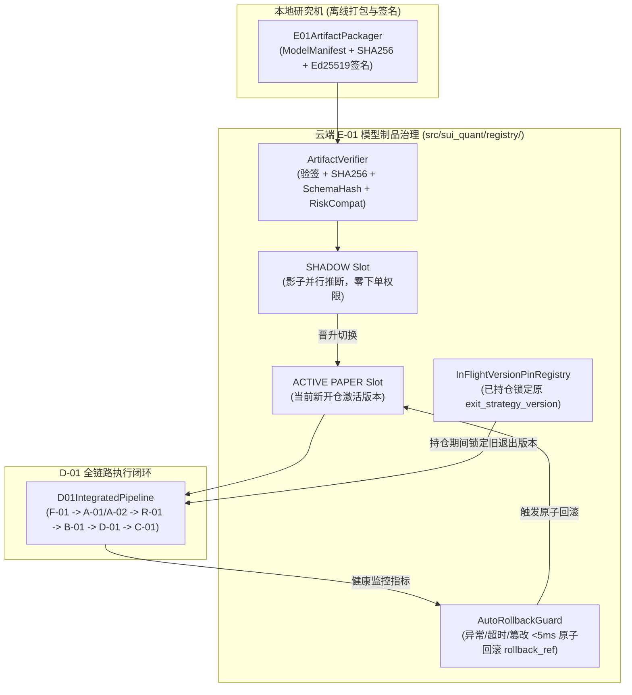

# P6-PLAN｜D-01/E-01 全链路整合、签名模型制品原子热切换与回滚、已持仓版本锁定及压力治理（仅 PAPER / SHADOW）

> **阶段编号**：P6｜**当前状态**：`READY_FOR_REVIEW`（仅提交正式实施计划，等待审查批准；**未获授权前绝不执行 P6 代码修改，严禁开启 LIVE 实盘**）  
> **前置已完成**：`MASTER-PLAN`、`P0`、`P1`、`P2`、`P3`（数学框架补证完毕，历史统计裁决 `NO_EDGE`）、`P4`（`B-01/D-01/R-01` 模拟执行闭环）、`P5`（`C-01` 三策略退出、防超锁协调器与双层公平回测，`64 passed`）。  
> **执行模式硬边界**：严格锁定 `ExecutionMode.PAPER` / `ExecutionMode.RESEARCH`（及模型影子评估态 `SHADOW`），真实资金订单数恒等于 `0`。

---

## 01 任务理解与范围边界（引用设计文档章节）

依据总体设计方案 **§11（E-01 研究仓、同步、模型版本与发布）**、**§7（D-01 状态机与版本治理）**、**§13（全链路延迟与资源预算 SLO）** 及 **§14.2（QA-12）**，P6 的核心任务是将 `F-01`（采集）、`A-01/A-02`（建模）、`B-01`（限价优化）、`R-01`（独立风控）、`D-01`（自主状态机）与 `C-01`（退出协调）整合为受签名模型制品仓库（`E-01`）驱动的完整闭环，并确保模型热切换与故障回滚绝不破坏在途持仓保护：

1. **E-01 签名模型制品仓库与多层完整性校验（§11.2）**：
   - 本地研究机离线打包生成含 `ModelManifest` 的不可变模型制品包，强制绑定：
     - `sha256`（64 位十六进制制品摘要）
     - `features_schema_hash`（与 `FeaturePipeline` 严格一致的特征 Schema 哈希）
     - `risk_compatibility`（与 `R-01` `RiskConfig.version` 兼容锚点）
     - `rollback_ref`（非空上一稳定制品版本引用）
     - Ed25519 离线数字签名（复用并扩展 P0 不可覆盖公钥锚点机制）
   - 严禁任何模型制品修改或放宽 `R-01` 风控上限、启用非 `SUIUSDT` 交易对或绕过 `LIVE` 门禁。
2. **`SHADOW -> PAPER` 原子发布与自动回滚状态机（§11.2, QA-12）**：
   - 新模型制品通过校验后首先挂载至 `SHADOW` 槽位（与当前 `PAPER` 激活模型并行接收 `MarketFeatures` 进行影子推断，记录延迟与概率分布，但不触发 `D-01` 下单）。
   - 经 `SHADOW` 门禁核验无异常后，通过原子指针切换晋升为 `PAPER` 激活模型。
   - 若激活模型在运行期发生：特征 Schema 不匹配、推断耗时超阈值、输出 `NaN`/非有限 `Decimal` 或连续异常，`E-01` 自动触发 **原子回滚（Atomic Rollback to `rollback_ref`）** 并向 `AlertManager` 发送 `HIGH` 级告警。
3. **在途持仓退出策略版本硬锁定（In-Flight Position Exit Version Pinning, §11.2, QA-12）**：
   - 当系统处于持仓状态（`PROTECTED` / `PROTECTION_PENDING` / `EXITING`）期间发生模型/策略热更新或回滚时，已开仓的 `PositionLedger` **强制继续使用开仓瞬间写入的 `PositionLedger.exit_strategy_version`**（例如已按 `C2-v1.0` 分批挂单的持仓继续按 `C2-v1.0` 完成剩余档位与保护单管理），直至该笔持仓完全平仓回到 `FLAT -> READY_NO_POSITION` 后，下一笔新开仓才切换至新版本退出策略。
4. **全链路端到端流水线整合与性能/内存水位治理（§13）**：
   - 串联 `ClosedKlineBar / PartialOrderbookSnapshot -> FeaturePipeline -> A01RegimeClassifier -> A02BreakoutCalibratedModel -> R01PreTradeRiskGate -> B01LimitOrderOptimizer -> D01DecisionEngine -> OcoProtectionCoordinator (C-01)` 全链路流水线，验证端到端 `P99 <= 150 ms` SLO 与内存常驻预算。

---

## 02 仓库/运行环境现状（只读事实，明确哪些无法验证）

- **已就绪事实（P0–P5）**：
  - [`src/sui_quant/contracts.py`](file:///D:/OBR-SUI/src/sui_quant/contracts.py) 已定义冻结的 `ModelManifest` 契约。
  - [`src/sui_quant/models/`](file:///D:/OBR-SUI/src/sui_quant/models)、[`src/sui_quant/execution/`](file:///D:/OBR-SUI/src/sui_quant/execution)、[`src/sui_quant/exit/`](file:///D:/OBR-SUI/src/sui_quant/exit) 已全部完成并通过 `64 passed` 自动化测试。
- **持续追踪的 `PENDING` / `NO_EDGE` 事项**：
  - `P3` 与 `P5` 真实历史样本外统计结论均为 `NO_EDGE`。
  - `FI-10B` 日本东京生产服务器连续 72 小时真实墙钟运行观测保持 `PENDING`。
  - 外部独立心跳公有云（Cloudflare Workers）与 Android 真机 FCM 通知保持 `PENDING`。

---

## 03 方案及依赖图（含数据合同和关键失败模式）

### 关键失败模式与防护
1. **模型热更新时在途持仓的退出规则发生突变导致保护单/分批单数量错乱（`QA-12`）**：
   `InFlightVersionPinRegistry` 将每个版本对应的退出策略实例保留在不可变版本池中；只要 `active_position_ledger is not None`，退出协调器严格按 `ledger.exit_strategy_version` 路由，新版本仅对后续新入场生效。
2. **损坏、被篡改或特征 Schema 不兼容的模型包被加载上线（`QA-12`）**：
   `E01ModelRegistry.register_and_verify()` 在加载阶段依次核验 Ed25519 签名、制品字节 `sha256`、`features_schema_hash` 与 `risk_compatibility`，任一不匹配立即拒绝加载并保持原稳定版本不变。
3. **新模型上线后推断报错或延迟劣化**：
   `AutoRollbackGuard` 监控激活模型的每次推断；一旦捕获运行时异常、非有限输出或超时，立即在同一事件循环周期内原子切回 `manifest.rollback_ref` 并触发 `HIGH` 告警。

---

## 04 待变更目录/文件清单（获批进入 P6 后实施）

- **新增模块（`src/sui_quant/registry/`）**：
  - `src/sui_quant/registry/__init__.py`
  - `src/sui_quant/registry/e01_model_registry.py`（实现 `E01ModelRegistry`、Ed25519 模型制品签名与验签、`SHADOW -> PAPER` 原子切换、`AutoRollbackGuard` 与 `InFlightVersionPinRegistry`）
  - `src/sui_quant/registry/integrated_pipeline.py`（实现 `D01IntegratedPipeline` 全链路端到端编排器与延迟/内存遥测）
- **新增测试（`tests/`）**：
  - `tests/test_p6_e01_registry_and_integrated_pipeline.py`

---

## 05 逐步实现计划（依赖顺序与资源预算）

1. **Step 1**：实现 `E01ModelRegistry`，支持 `ModelManifest` + 模型参数序列化、SHA-256 校验、Ed25519 签名核验、`features_schema_hash` 与 `risk_compatibility` 强制门禁。
2. **Step 2**：实现 `SHADOW -> PAPER` 原子晋升、故障自动回滚（`rollback_ref`）及在途持仓退出策略版本锁定器（`QA-12`）。
3. **Step 3**：实现 `D01IntegratedPipeline`，将 `F-01 -> A-01 -> A-02 -> R-01 -> B-01 -> D-01 -> C-01` 串联为端到端闭环，并执行多周期回归与压力基准测试。
4. **Step 4**：运行全量测试并输出 `evidence/p6_e01_integration_and_rollback_evidence.json`。
- **资源预算**：模型热切换/回滚耗时 `<= 5.0 ms`，全链路单周期决策 `P99 <= 50.0 ms`（优于 `150 ms` SLO），内存占用增量 `<= 15 MiB`。

---

## 06 测试清单（QA-12 及全链路集成验证）

- `test_qa12_model_manifest_signature_sha256_schema_and_risk_compatibility_gates`：验证篡改模型权重、伪造签名、`features_schema_hash` 不匹配或试图修改风控兼容版本时 100% 拒载。
- `test_qa12_shadow_to_paper_atomic_promotion_and_auto_rollback_on_degradation`：验证 `v1.0 -> v2.0 (SHADOW) -> v2.0 (PAPER)` 晋升，以及注入 `v2.0` 运行时故障/超时后自动原子回滚至 `v1.0` 并触发 `HIGH` 告警。
- `test_qa12_in_flight_position_exit_strategy_version_pinning_during_hot_swap`：验证在 `v1.0 (C2)` 持仓且已完成首档 `40%` 止盈期间，将系统热切换至 `v2.0 (C1)`，在途持仓依然严格按 `C2-v1.0` 完成剩余 `60%` 仓位管理，平仓后下一笔新交易才启用 `C1-v2.0`。
- `test_p6_end_to_end_integrated_pipeline_slo_and_memory_budget`：验证从 K 线收盘 + 10 档盘口输入到 `D-01/C-01` 全周期闭环的端到端延迟与零实盘隔离。

---

## 07 验收标准：可测量门槛与具体证据文件路径

- `pytest tests/test_p6_e01_registry_and_integrated_pipeline.py -v` 100% 通过。
- `QA-12` 篡改模型放行次数 `== 0`，在途持仓版本串扰次数 `== 0`，回滚耗时 `<= 5.0 ms`。
- 证据归档路径：`evidence/p6_e01_integration_and_rollback_evidence.json`。

---

## 08 风险与备选方案

- 若新模型在 `SHADOW` 阶段出现任何校准漂移或特征缺失，系统拒绝晋升并维持既有基线版本运行；若回滚目标版本亦不可用，自动切入 `ENTRY_FROZEN` 阻断新开仓，仅保留既有持仓 `-1%` 止损保护通道。

---

## 09 未验证假设及阻塞项

- **工程阻塞项**：无。
- **显式保持 `PENDING` / `NO_EDGE` 的事项**：
  1. 真实历史数据样本外策略统计优势尚未成立（`NO_EDGE`）。
  2. `FI-10B` 日本东京生产服务器连续 72 小时真实墙钟运行观测 `PENDING`。
  3. 外部独立心跳公有云（Cloudflare Workers）与 Android 真机 FCM 推送 `PENDING`。

---

## 10 等待审查的问题与结论

- **当前状态**：`READY_FOR_REVIEW`。
- 请确认是否批准按本计划进入 **P6（D-01/E-01 全链路整合、签名模型制品原子热切换与回滚、已持仓版本锁定及压力治理）** 实施？
