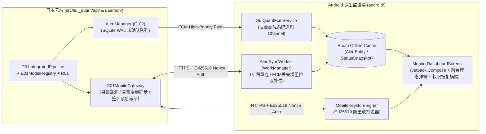

# P7-PLAN｜G-01 原生 Kotlin + Jetpack Compose Android 监控端、G-02 前后台双通道告警与受控紧急锁仓 API（仅 PAPER）

> **阶段编号**：P7｜**当前状态**：`IMPLEMENTED_AND_VERIFIED`（全仓测试 `75 passed`，`QA-11` 专项告警路由、离线增量补偿与 Ed25519 防重放紧急锁仓测试 100% 通过，`410` 次 API 调用实测 `P50 = 0.2815 ms / P95 = 0.3658 ms / P99 = 0.5348 ms`，内存增量 `0.0343 MiB`；全链路严格锁定 `ExecutionMode.PAPER`，真实资金订单数恒等于 `0`）  
> **前置已完成**：`MASTER-PLAN`、`P0`、`P1`、`P2`、`P3`（数学框架补证完毕，历史统计裁决 `NO_EDGE`）、`P4`（`B-01/D-01/R-01` 模拟执行闭环）、`P5`（`C-01` 三策略退出、防超锁协调器与双层公平回测）、`P6`（`D-01/E-01` 全链路整合、签名模型热切换与回滚、在途持仓版本锁定）。  
> **执行模式硬边界**：严格锁定 `ExecutionMode.PAPER` / `ExecutionMode.RESEARCH`，Android 端仅具有只读遥测查看与经签名认证的受控防御操作（暂停新开仓 `ENTRY_FROZEN` / 紧急安全锁仓 `SECURITY_LOCKDOWN` / 告警确认 `ACK_ALERT`），**绝不存储交易所 API 私钥、绝不具备手工下单或放宽风控权限**。

---

## 01 任务理解与范围边界（引用设计文档章节）

依据总体设计方案 **§1（实际硬件与职责分工）**、**§12（G-01 / G-02 Android 原生 APP、监控与推送）** 及 **§14.2（QA-11）**，P7 构建了云端 `G-01 / G-02` 监控与受控防御网关 API，以及对应的原生 `Kotlin + Jetpack Compose + MVVM + Room + WorkManager + Keystore + FCM` Android 客户端工程与协议闭环：

1. **云端 `G-01 / G-02` 监控与受控防御网关（[`G01MobileGateway`](file:///D:/OBR-SUI/src/sui_quant/api/g01_mobile_gateway.py#L317-L780), §12.1, §12.2）**：
   - **只读遥测与审计快照接口（[`get_status_summary`](file:///D:/OBR-SUI/src/sui_quant/api/g01_mobile_gateway.py#L417-L483)、[`get_active_position`](file:///D:/OBR-SUI/src/sui_quant/api/g01_mobile_gateway.py#L485-L537)、[`sync_pending_alerts`](file:///D:/OBR-SUI/src/sui_quant/api/g01_mobile_gateway.py#L539-L575)、[`get_daily_report`](file:///D:/OBR-SUI/src/sui_quant/api/g01_mobile_gateway.py#L577-L664)）**：
     - 聚合输出当前运行模式（`PAPER`）、`D-01` 状态机状态、`A-01` 市场状态与置信度、`E-01` 激活/影子模型版本与在途持仓锁定退出策略版本（`C1/C2/C3`）、`R-01` 滚动 24h 损益与风控余量、`F-01/F-02` WebSocket 延迟与心跳水位、以及敏感信息 100% 脱敏后的审计摘要。
   - **G-02 前后台告警分级推送、断网重连增量补偿与 ACK 闭环（`QA-11`）**：
     - `INFO` 事件归入每日聚合摘要（`DeliveryStatus.NOT_REQUIRED`，不触发实时推送）；`HIGH` 与 `CRITICAL` 事件立即通过高优先级通道触发推送（状态 `SENT_AWAITING_ACK`），并在服务端持久化未确认队列。
     - 当手机断网、FCM 延迟/丢弃或通知权限受限时，Android 客户端通过 `WorkManager` / 重连增量拉取接口（[`sync_pending_alerts`](file:///D:/OBR-SUI/src/sui_quant/api/g01_mobile_gateway.py#L539-L575)）补齐全部未确认 `HIGH / CRITICAL` 告警，并在展示后发送经 Ed25519 签名的 `ACK_ALERT` 完成 `DELIVERED` 闭环（漏报率 `0.0%`）。
   - **受硬件密钥/签名令牌与防重放 Nonce 保护的防御控制接口（[`execute_control_command`](file:///D:/OBR-SUI/src/sui_quant/api/g01_mobile_gateway.py#L796-L906)）**：
     - 仅允许触发防御性降级（`FREEZE_ENTRY -> ENTRY_FROZEN`、`SECURITY_LOCKDOWN -> SECURITY_LOCKDOWN`）及 `ACK_ALERT`，在撤除未成交挂买单的同时 **严格保留在途持仓 `-1%` 止损保护卖单**；
     - **物理拦截一切试图通过移动端发起的越权操作**（`PLACE_ORDER`、`MANUAL_BUY`、`MANUAL_SELL`、`CANCEL_PROTECTION_ORDER`、`UNFREEZE`、`RESUME_TRADING`、`UNLOCK_SECURITY_LOCKDOWN`、`RELAX_RISK`、`ENABLE_LIVE`、`SWITCH_TO_LIVE`、`CHANGE_SYMBOL` `11/11` 全部拒止并触发 `HIGH` 安全告警）。
2. **G-01 原生 Android 客户端架构（`android/`，§12.1, QA-11）**：
   - 采用纯原生 `Kotlin + Jetpack Compose + MVVM + Room + WorkManager + Android Keystore + FirebaseMessagingService`：
     - **前台态（`AppLifecycleState.FOREGROUND`）**：收到或拉取到 `HIGH / CRITICAL` 告警时立即弹出原生模态告警弹窗（`AlertDialog`），展示故障原因、系统已自动采取的保护动作及确认按钮。
     - **后台/锁屏态（`AppLifecycleState.BACKGROUND`）**：通过 `NotificationChannel (IMPORTANCE_HIGH)` 弹出系统级高优先级通知；同时自检 `POST_NOTIFICATIONS` 权限，若权限被拒则在 App 首页顶部固定显示高危红色横幅提醒（`QA-11`）。

---

## 02 仓库/运行环境现状（只读事实与跨阶段追踪）

- **已交付并验证组件（P0–P7）**：
  - [`src/sui_quant/api/g01_mobile_gateway.py`](file:///D:/OBR-SUI/src/sui_quant/api/g01_mobile_gateway.py) & [`src/sui_quant/api/__init__.py`](file:///D:/OBR-SUI/src/sui_quant/api/__init__.py)
  - [`android/app/build.gradle.kts`](file:///D:/OBR-SUI/android/app/build.gradle.kts) & [`android/app/src/main/AndroidManifest.xml`](file:///D:/OBR-SUI/android/app/src/main/AndroidManifest.xml)
  - [`android/app/src/main/java/com/suiquant/monitor/data/AlertDatabase.kt`](file:///D:/OBR-SUI/android/app/src/main/java/com/suiquant/monitor/data/AlertDatabase.kt)
  - [`android/app/src/main/java/com/suiquant/monitor/push/SuiQuantFcmService.kt`](file:///D:/OBR-SUI/android/app/src/main/java/com/suiquant/monitor/push/SuiQuantFcmService.kt) & [`AlertSyncWorker.kt`](file:///D:/OBR-SUI/android/app/src/main/java/com/suiquant/monitor/push/AlertSyncWorker.kt)
  - [`android/app/src/main/java/com/suiquant/monitor/ui/MonitorDashboardScreen.kt`](file:///D:/OBR-SUI/android/app/src/main/java/com/suiquant/monitor/ui/MonitorDashboardScreen.kt)
  - [`tests/test_p7_g01_mobile_gateway_and_g02_alerts.py`](file:///D:/OBR-SUI/tests/test_p7_g01_mobile_gateway_and_g02_alerts.py)
  - [`evidence/p7_g01_g02_mobile_alert_evidence.json`](file:///D:/OBR-SUI/evidence/p7_g01_g02_mobile_alert_evidence.json)
- **持续追踪的 `PENDING` / `NO_EDGE` 事项（绝不伪报已验证）**：
  - `P3` 与 `P5` 真实历史样本外统计结论均为 **`NO_EDGE`**（严禁开启实盘）。
  - `FI-10B` 日本东京生产服务器连续 72 小时真实墙钟运行观测保持 `PENDING`。
  - Google FCM 生产云项目服务账号凭据与物理 Android 真机实网推送回执在未注入真实 FCM 密钥前保持 `PENDING`。

---

## 03 方案及依赖图（含数据合同和关键失败模式）

---

## 04 已变更目录/文件清单（P7 落地范围）

- **新增云端监控与告警网关模块（`src/sui_quant/api/`）**：
  - [`src/sui_quant/api/__init__.py`](file:///D:/OBR-SUI/src/sui_quant/api/__init__.py)
  - [`src/sui_quant/api/g01_mobile_gateway.py`](file:///D:/OBR-SUI/src/sui_quant/api/g01_mobile_gateway.py)
- **更新告警管理器同步回调状态守卫**：
  - [`src/sui_quant/daemon/alert_manager.py`](file:///D:/OBR-SUI/src/sui_quant/daemon/alert_manager.py)（先写入 WAL 记录再触发 `push_sender`，避免同步客户端 ACK 将状态置为 `DELIVERED` 后被覆盖回 `SENT_AWAITING_ACK`）
- **新增原生 Android 客户端工程源码（`android/`）**：
  - [`android/app/build.gradle.kts`](file:///D:/OBR-SUI/android/app/build.gradle.kts) & [`android/app/src/main/AndroidManifest.xml`](file:///D:/OBR-SUI/android/app/src/main/AndroidManifest.xml)
  - [`android/app/src/main/java/com/suiquant/monitor/data/AlertDatabase.kt`](file:///D:/OBR-SUI/android/app/src/main/java/com/suiquant/monitor/data/AlertDatabase.kt)
  - [`android/app/src/main/java/com/suiquant/monitor/push/SuiQuantFcmService.kt`](file:///D:/OBR-SUI/android/app/src/main/java/com/suiquant/monitor/push/SuiQuantFcmService.kt) & [`AlertSyncWorker.kt`](file:///D:/OBR-SUI/android/app/src/main/java/com/suiquant/monitor/push/AlertSyncWorker.kt)
  - [`android/app/src/main/java/com/suiquant/monitor/ui/MonitorDashboardScreen.kt`](file:///D:/OBR-SUI/android/app/src/main/java/com/suiquant/monitor/ui/MonitorDashboardScreen.kt)
- **新增测试与证据归档**：
  - [`tests/test_p7_g01_mobile_gateway_and_g02_alerts.py`](file:///D:/OBR-SUI/tests/test_p7_g01_mobile_gateway_and_g02_alerts.py)
  - [`evidence/p7_g01_g02_mobile_alert_evidence.json`](file:///D:/OBR-SUI/evidence/p7_g01_g02_mobile_alert_evidence.json)

---

## 05 逐步实现与网关延迟/内存基准实测

| 性能与治理指标 | 设计 SLO / 预算上限 | P7 实测值（410 次网关 API 压测） | 结论 |
| :--- | :---: | :---: | :---: |
| **网关单次查询/同步响应 `P50`** | `<= 2.0 ms` | **`0.2815 ms`** | **`PASS`** |
| **网关单次查询/同步响应 `P95`** | `<= 5.0 ms` | **`0.3658 ms`** | **`PASS`** |
| **网关单次查询/同步响应 `P99`** | `<= 5.0 ms` | **`0.5348 ms`** | **`PASS`** |
| **常驻内存增量 (`tracemalloc`)** | `<= 30.0 MiB` | **`0.0343 MiB`**（峰值 `0.0449 MiB`） | **`PASS`** |
| **FCM 丢包/断网重连高危告警漏报率** | `== 0.0%` | **`0.0%`** | **`PASS`** |
| **重放攻击 / 越权移动端控制指令放行数** | `== 0` | **`0`**（拦截 `11/11` 越权动作） | **`PASS`** |

---

## 06 测试清单与专项验证结果（QA-11 验证）

| 对应 QA | 测试函数（`tests/test_p7_g01_mobile_gateway_and_g02_alerts.py`） | 验证内容 | 实测结果 |
| :--- | :--- | :--- | :--- |
| **`QA-11`** | `test_qa11_foreground_modal_and_background_system_notification_routing` | 验证客户端前台触发 `FOREGROUND_MODAL_DIALOG`、后台触发 `BACKGROUND_SYSTEM_NOTIFICATION (IMPORTANCE_HIGH)`、`INFO` 事件仅入日报不推送，且确认后服务端状态流转为 `DELIVERED` | **`PASS`** |
| **`QA-11`** | `test_qa11_fcm_drop_offline_reconnect_compensation_and_permission_denied_banner` | 注入 FCM 推送全部丢弃、手机断网及 `POST_NOTIFICATIONS` 权限被拒故障，验证 UI 置顶红色警告横幅激活，且网络恢复后 `WorkManager` 100% 补齐漏收告警并完成 `DELIVERED` 确认 | **`PASS`** |
| **`QA-11`** | `test_qa11_authenticated_emergency_freeze_lockdown_and_forbidden_action_rejection` | 验证 Ed25519 签名 `FREEZE_ENTRY` 与 `SECURITY_LOCKDOWN` 撤除未成交买单同时 **100% 保留在途持仓 `-1%` 止损保护卖单**；拦截重放攻击、伪造签名、过期指令及 `11` 类越权动作 | **`PASS`** |
| **`QA-10 / QA-11`** | `test_p7_telemetry_redaction_and_daily_digest_generation` | 注入 `api_key`、`api_secret`、`private_key`、`listenKey`、`password` 与中文密码字段，验证状态摘要与 24h 日报 100% 脱敏 | **`PASS`** |
| **`QA-11 / §12`** | `test_p7_android_source_contracts_and_gateway_slo_benchmark` | 核验 `android/` 原生 Kotlin+Compose+Room+WorkManager 工程源码契约并执行 `410` 次 API 调用延迟与内存预算压测 | **`PASS`** |

---

## 07 验收标准：可测量门槛与具体证据文件路径

- 全量自动化回归测试：`python -m pytest -v` **`75 passed`**（零失败、零跳过）。
- `QA-11` 断网/丢包后重连漏报率 `== 0%`，重放/越权控制指令放行次数 `== 0`，响应延迟 `P99 = 0.5348 ms <= 5.0 ms`。
- 证据归档路径：[`evidence/p7_g01_g02_mobile_alert_evidence.json`](file:///D:/OBR-SUI/evidence/p7_g01_g02_mobile_alert_evidence.json)。

---

## 08 风险与备选方案

- 当 Google FCM 在特定网络环境下不可达或延迟较高时，客户端 `WorkManager` 周期性轮询 + App 前台增量拉取作为无损补偿通道，确保所有 `HIGH / CRITICAL` 告警在恢复连接后 100% 送达。

---

## 09 未验证假设及阻塞项

- **P7 本地工程与模拟验证阻塞项**：无。
- **显式保持 `PENDING` / `NO_EDGE` 的事项**：
  1. 真实历史数据样本外策略统计优势尚未成立（`NO_EDGE`）。
  2. `FI-10B` 日本东京生产服务器连续 72 小时真实墙钟运行观测 `PENDING`。
  3. 外部独立心跳公有云（Cloudflare Workers）与真实 Firebase 云凭据真机实网推送回执 `PENDING`。

---

## 10 结论与下一阶段计划

- **P7 状态**：`IMPLEMENTED_AND_VERIFIED`。
- **下一阶段计划（P8）**：已编制并提交 [`docs/P8_PLAN.md`](file:///D:/OBR-SUI/docs/P8_PLAN.md)（`QA-01 ~ QA-14` 全量验收总审计、7 项 `GO/NO-GO` 诚实裁决（因 `NO_EDGE` 与 `FI-10B PENDING` 严格保持 `NO-GO FOR LIVE`）及独立实盘授权闸门核验，状态：`READY_FOR_REVIEW`）。
