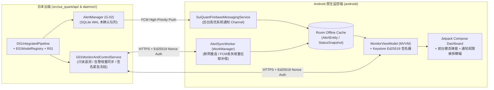

# P7-PLAN｜G-01 原生 Kotlin + Jetpack Compose Android 监控端、G-02 前后台双通道告警与受控紧急锁仓 API（仅 PAPER）

> **阶段编号**：P7｜**当前状态**：`READY_FOR_REVIEW`（仅提交正式实施计划，等待审查批准；**未获授权前绝不执行 P7 代码修改，严禁开启 LIVE 实盘**）  
> **前置已完成**：`MASTER-PLAN`、`P0`、`P1`、`P2`、`P3`（数学框架补证完毕，历史统计裁决 `NO_EDGE`）、`P4`（`B-01/D-01/R-01` 模拟执行闭环）、`P5`（`C-01` 三策略退出、防超锁协调器与双层公平回测）、`P6`（`D-01/E-01` 全链路整合、签名模型热切换与回滚、在途持仓版本锁定，`70 passed`）。  
> **执行模式硬边界**：严格锁定 `ExecutionMode.PAPER` / `ExecutionMode.RESEARCH`，Android 端仅具有只读遥测查看与经签名认证的受控防御操作（暂停新开仓 `ENTRY_FROZEN` / 紧急安全锁仓 `SECURITY_LOCKDOWN` / 告警确认 ACK），**绝不存储交易所 API 私钥、绝不具备手工下单或放宽风控权限**。

---

## 01 任务理解与范围边界（引用设计文档章节）

依据总体设计方案 **§1（实际硬件与职责分工）**、**§12（G-01 / G-02 Android 原生 APP、监控与推送）** 及 **§14.2（QA-11）**，P7 的核心任务是构建云端 `G-01 / G-02` 监控与告警网关 API，以及对应的原生 `Kotlin + Jetpack Compose + MVVM + Room + WorkManager + Keystore + FCM` Android 客户端工程与协议契约：

1. **云端 `G-01 / G-02` 监控与受控防御网关（`src/sui_quant/api/`，§12.1, §12.2）**：
   - **只读遥测与审计快照接口（`GET /api/v1/status/summary`、`GET /api/v1/positions/active`、`GET /api/v1/alerts/pending`、`GET /api/v1/daily-report`）**：
     - 聚合输出当前运行模式（`PAPER`）、`D-01` 状态机状态、`A-01` 市场状态与置信度、`E-01` 激活/影子模型版本与在途持仓锁定退出策略版本（`C1/C2/C3`）、`R-01` 滚动 24h 损益与风控余量、`F-01/F-02` WebSocket 延迟与心跳水位、以及敏感信息 100% 脱敏后的审计摘要。
   - **G-02 前后台告警分级推送、断网重连增量补偿与 ACK 闭环（`QA-11`）**：
     - `INFO` 事件归入每日聚合摘要（`NOT_REQUIRED` 实时推送）；`HIGH` 与 `CRITICAL` 事件立即通过 `FCM High-Priority Data+Notification` 通道触发推送（状态 `SENT_AWAITING_ACK`），并在服务端持久化未确认队列。
     - 当手机断网、FCM 延迟/丢弃或通知权限受限时，Android 客户端通过 `WorkManager` / 重连增量拉取接口（`GET /api/v1/alerts/sync?since_seq=...`）补齐全部未确认 `HIGH / CRITICAL` 告警，并在展示后发送 `POST /api/v1/alerts/{alert_id}/ack` 完成 `DELIVERED` 闭环。
   - **受硬件密钥/签名令牌与防重放 Nonce 保护的防御控制接口（`POST /api/v1/control/freeze-entry`、`POST /api/v1/control/security-lockdown`）**：
     - 仅允许触发防御性降级（`READY_NO_POSITION -> ENTRY_FROZEN` 或任意状态 `-> SECURITY_LOCKDOWN`），保留在途持仓 `-1%` 止损保护卖单；**严禁通过移动端接口直接解除 `SECURITY_LOCKDOWN`、放宽 `R-01` 风控参数或开启 `LIVE` 实盘**。
2. **G-01 原生 Android 客户端架构（`android/`，§12.1, QA-11）**：
   - 采用纯原生 `Kotlin + Jetpack Compose + MVVM + Room + WorkManager + Android Keystore + FirebaseMessagingService`：
     - **前台态（App in Foreground）**：收到或拉取到 `HIGH / CRITICAL` 告警时立即弹出高优原生模态告警弹窗（`AlertDialog` / 顶部横幅），展示故障原因、系统已自动采取的保护动作及确认按钮。
     - **后台/锁屏态（App in Background）**：通过 `NotificationChannel (IMPORTANCE_HIGH)` 弹出系统级高优先级通知；同时自检 `POST_NOTIFICATIONS` 权限与省电白名单状态，若权限被拒则在 App 首页顶部固定显示高危横幅提醒（`QA-11`）。

---

## 02 仓库/运行环境现状（只读事实，明确哪些无法验证）

- **已就绪事实（P0–P6）**：
  - [`src/sui_quant/daemon/alert_manager.py`](file:///D:/OBR-SUI/src/sui_quant/daemon/alert_manager.py) 已实现 `AlertManager`（含冷却期去重、`DeliveryStatus` 状态机、`acknowledge_alert` 与 `list_undelivered_alerts`）。
  - [`src/sui_quant/registry/integrated_pipeline.py`](file:///D:/OBR-SUI/src/sui_quant/registry/integrated_pipeline.py) 已完成 `F-01 -> A-01 -> E-01 -> R-01 -> B-01 -> D-01 -> C-01` 全链路闭环。
- **持续追踪的 `PENDING` / `NO_EDGE` 事项（绝不伪报已验证）**：
  - `P3` 与 `P5` 真实历史样本外统计结论均为 `NO_EDGE`。
  - `FI-10B` 日本东京生产服务器连续 72 小时真实墙钟运行观测保持 `PENDING`。
  - Google FCM 生产云项目服务账号凭据与物理 Android 真机实网推送回执在未注入真实 FCM 密钥前保持 `PENDING`（本地将完整实现服务端 API、模拟器/客户端状态机与离线断网补偿闭环测试）。

---

## 03 方案及依赖图（含数据合同和关键失败模式）

### 关键失败模式与防护（`QA-11`）
1. **FCM 推送延迟、被系统省电策略丢弃或手机短暂断网**：
   服务端 `AlertManager` 在收到客户端显式 `ACK` 前始终保持 `delivery_status != DELIVERED`；客户端在 App 唤醒、`WorkManager` 周期任务或网络恢复时调用增量同步接口拉取所有未确认告警，补充触发前台弹窗/系统通知并回传 `ACK`。
2. **Android 系统通知权限（`POST_NOTIFICATIONS`）被用户关闭**：
   客户端在启动及每次回到前台时检测 `areNotificationsEnabled()`；一旦发现被拒，立即在 Compose 主界面置顶锁定红色告警横幅并记录诊断状态。
3. **重放攻击或未授权请求试图调用移动端控制接口**：
   所有控制指令（`FREEZE_ENTRY`、`SECURITY_LOCKDOWN`、`ACK_ALERT`）必须附带由客户端 Keystore 私钥签名的 `MobileCommandEnvelope`（含 `command_id` 单调防重放 Nonce、UTC 时间戳与有效载荷 SHA-256），且服务端物理禁止任何“解冻/下单/改风控/开实盘”指令。

---

## 04 待变更目录/文件清单（获批进入 P7 后实施）

- **新增云端监控与告警网关模块（`src/sui_quant/api/`）**：
  - `src/sui_quant/api/__init__.py`
  - `src/sui_quant/api/g01_mobile_gateway.py`（实现 `G01MobileGateway`、只读状态聚合、日报生成、`G-02` 断网增量告警补偿同步、防重放 Ed25519 移动端控制验签与客户端状态机模拟器）
- **新增原生 Android 客户端工程源码（`android/`）**：
  - `android/app/build.gradle.kts` & `android/app/src/main/AndroidManifest.xml`
  - `android/app/src/main/java/com/suiquant/monitor/data/AlertDatabase.kt`（Room 本地持久化与增量同步 DAO）
  - `android/app/src/main/java/com/suiquant/monitor/push/SuiQuantFcmService.kt` & `AlertSyncWorker.kt`（FCM 后台高优通知与 `WorkManager` 离线补偿）
  - `android/app/src/main/java/com/suiquant/monitor/ui/MonitorDashboardScreen.kt`（Jetpack Compose 监控主页、前台模态告警弹窗、通知权限被拒置顶警告与受控紧急锁仓按钮）
- **新增测试（`tests/`）**：
  - `tests/test_p7_g01_mobile_gateway_and_g02_alerts.py`

---

## 05 逐步实现计划（依赖顺序与资源预算）

1. **Step 1**：实现 `src/sui_quant/api/g01_mobile_gateway.py`，提供只读遥测快照、24h 审计日报、`G-02` 未确认告警增量拉取与 ACK 状态流转、以及 Ed25519 签名防重放紧急控制（仅限 `ENTRY_FROZEN` / `SECURITY_LOCKDOWN`）。
2. **Step 2**：编写 `android/` 原生 Kotlin + Jetpack Compose + Room + WorkManager + Keystore 客户端源码与配置。
3. **Step 3**：编写 `tests/test_p7_g01_mobile_gateway_and_g02_alerts.py`，全面验证 `QA-11`（前台模态弹窗、后台系统通知、通知权限被拒降级提示、FCM 丢包/断网重连增量补偿、防重放签名控制及越权指令拦截）。
4. **Step 4**：运行全量回归测试并输出 `evidence/p7_g01_g02_mobile_alert_evidence.json`。
- **云端资源预算**：`G-01/G-02` 网关常驻内存开销 `<= 30 MiB`，单次状态查询/告警同步响应 `P99 <= 5.0 ms`。

---

## 06 测试清单（QA-11 专项验证）

- `test_qa11_foreground_modal_and_background_system_notification_routing`：验证客户端处于前台时触发模态弹窗、处于后台时路由至高优先级系统通知通道，并在确认后将服务端状态更新为 `DELIVERED`。
- `test_qa11_fcm_drop_offline_reconnect_compensation_and_permission_denied_banner`：注入 FCM 推送丢失与手机断网故障，验证客户端重连后通过增量同步 API 100% 找回漏收的 `HIGH / CRITICAL` 告警；同时验证通知权限被拒时激活 UI 置顶警告。
- `test_qa11_authenticated_emergency_freeze_lockdown_and_forbidden_action_rejection`：验证合法 Ed25519 签名指令可触发 `ENTRY_FROZEN` / `SECURITY_LOCKDOWN`（且防重放拦截二次重放），而任何试图通过移动端发起 `PLACE_ORDER`、`UNFREEZE` 或 `ENABLE_LIVE` 的请求 100% 被拒。
- `test_p7_telemetry_redaction_and_daily_digest_generation`：验证移动端 API 返回的所有状态快照、日志摘要与日报 100% 不含任何敏感凭据或未脱敏字段。

---

## 07 验收标准：可测量门槛与具体证据文件路径

- `pytest tests/test_p7_g01_mobile_gateway_and_g02_alerts.py -v` 100% 通过。
- `QA-11` 断网/丢包后重连漏报率 `== 0%`，重放/越权控制指令放行次数 `== 0`，响应延迟 `P99 <= 5.0 ms`。
- 证据归档路径：`evidence/p7_g01_g02_mobile_alert_evidence.json`。

---

## 08 风险与备选方案

- 当 Google FCM 在特定网络环境下不可达或延迟较高时，客户端 `WorkManager` 周期性轮询 + App 前台 WebSocket/HTTPS 增量拉取可作为无损补偿通道，确保所有 `HIGH / CRITICAL` 告警在恢复连接后 100% 送达。

---

## 09 未验证假设及阻塞项

- **P7 本地工程与模拟验证阻塞项**：无。
- **显式保持 `PENDING` / `NO_EDGE` 的事项**：
  1. 真实历史数据样本外策略统计优势尚未成立（`NO_EDGE`）。
  2. `FI-10B` 日本东京生产服务器连续 72 小时真实墙钟运行观测 `PENDING`。
  3. 外部独立心跳公有云（Cloudflare Workers）与真实 Firebase 云凭据真机实网推送回执 `PENDING`。

---

## 10 等待审查的问题与结论

- **当前状态**：`READY_FOR_REVIEW`。
- 请确认是否批准按本计划进入 **P7（G-01 原生 Kotlin + Jetpack Compose Android 监控端、G-02 前后台告警与受控紧急锁仓 API）** 实施？
