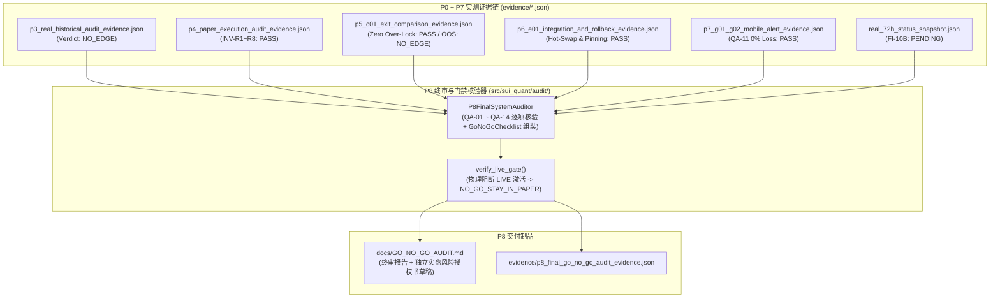

# P8-PLAN｜QA-01～QA-14 全量验收总审计、长期 PAPER 试运行核验与实盘 GO/NO-GO 授权闸门（严格锁定 PAPER / NO-GO FOR LIVE）

> **阶段编号**：P8｜**当前状态**：`READY_FOR_REVIEW`（仅提交正式实施计划，等待审查批准；**未获授权前绝不执行 P8 代码修改，严禁开启 LIVE 实盘**）  
> **前置已完成**：`MASTER-PLAN`、`P0`、`P1`、`P2`、`P3`（数学框架补证完毕，历史统计裁决 `NO_EDGE`）、`P4`（`B-01/D-01/R-01` 模拟执行闭环）、`P5`（`C-01` 三策略退出与双层公平回测）、`P6`（`D-01/E-01` 全链路整合、签名模型热切换与回滚）、`P7`（`G-01/G-02` 原生 Android 监控、前后台告警与受控紧急锁仓 API，全库 `75 passed`）。  
> **执行模式硬边界**：严格锁定 `ExecutionMode.PAPER` / `ExecutionMode.RESEARCH`，**因 P3/P5 真实历史样本外统计裁决为 `NO_EDGE` 且 `FI-10B` 72h 真实墙钟观测未满额，P8 实盘准入裁决必须诚实锁定为 `NO-GO FOR LIVE`（真实资金订单数恒等于 `0`）**。

---

## 01 任务理解与范围边界（引用设计文档章节）

依据总体设计方案 **§14（QA-01 ～ QA-14 验收矩阵）**、**§15（P0 ～ P8 阶段划分）** 及 **§16（上线前 7 项非绕过式 GO/NO-GO 硬门禁与独立实盘授权书）**，P8 是整个 `SUI-Quant V1.0` 的最终总审计与实盘门禁核验阶段，核心职责包括：

1. **全系统 `QA-01 ～ QA-14` 自动化总审计器（`src/sui_quant/audit/p8_final_auditor.py`, §14, §16）**：
   - 自动汇总并程序化核验 `P0 ～ P7` 全部证据链（`p3_real_historical_audit_evidence.json`、`p4_paper_execution_audit_evidence.json`、`p5_c01_exit_comparison_evidence.json`、`p6_e01_integration_and_rollback_evidence.json`、`p7_g01_g02_mobile_alert_evidence.json`、`real_72h_status_snapshot.json`），逐项输出 `QA-01 ～ QA-14` 的精确验证状态（`PASS` vs `PARTIAL PASS / PENDING` vs `NO_EDGE`），**严禁将任何 `PENDING` 或 `NO_EDGE` 项粉饰为 `PASS`**。
2. **§16 七项 `GoNoGoChecklist` 诚实裁决与 `verify_live_gate` 终极阻断验证（§16, QA-14）**：
   - 自动构造真实的 `GoNoGoChecklist` 状态：
     - `protection_orders_fault_proven = True`（P4/P5 已证）
     - `anomaly_freeze_and_reconciliation_proven = True`（P1/P4/P7 已证）
     - `account_spot_suiusdt_verified = False`（零生产密钥策略下私有账户实网权限保持 `PENDING`）
     - `user_risk_limits_explicitly_approved = False`（投资人尚未签署实盘授权，`IMMUTABLE_APPROVER_ED25519_PUBKEY_HEX = None`）
     - `out_of_sample_net_positive_proven = False`（P3/P5 60天真实历史数据样本外净期望为负，统计结论 **`NO_EDGE`**）
     - `security_and_external_heartbeat_proven = False`（`FI-10B` 72h 真实墙钟与第三方公有云 Cloudflare/FCM 生产凭据保持 `PENDING`）
     - `independent_audit_record_signed = False`（上述前置条件未全部满足前拒绝签发 `GO`）
   - 验证在当前真实状态下，任何尝试开启 `ExecutionMode.LIVE` 的调用 100% 被 `verify_live_gate()` 物理阻断（抛出 `LiveAuthorizationError`），系统總裁决明确输出 **`NO_GO_STAY_IN_PAPER`**。
3. **长期 `PAPER` 综合故障注入与多周期稳定性总回归演练（§13, §14）**：
   - 跨模块联合演练：`F-01` 行情乱序/断流恢复 -> `A-01/A-02` 突破信号 -> `R-01` 七层风控 -> `B-01` 限价执行与部分成交保护 -> `C-01` 分批/止损退出 -> `E-01` 盘中模型热切换与异常自动回滚 -> `G-01/G-02` 移动端断网告警补偿与签名紧急锁仓 -> `BOOT -> SYNCING` 重启对账恢复。
4. **独立总审计报告与实盘风险授权书模板归档（`docs/GO_NO_GO_AUDIT.md`, §16）**：
   - 明确列出已验证工程能力、未完成 `PENDING` 项、`NO_EDGE` 统计事实、以及未来若要申请实盘所需的完整数学与运维前提清单。

---

## 02 仓库/运行环境现状（只读事实，明确哪些无法验证）

- **已完成并验证的工程模块（P0–P7，全仓 `75 passed`）**：
  - `P0`：Decimal/UTC 强类型契约、币安精度过滤器、Ed25519 + 持久化防重放 Nonce + 运行时代码树 SHA-256 绑定的 `LIVE` 门禁、日志脱敏。
  - `P1`：`S-01` 安全总管、`F-02` 守护进程、双进程互锁看门狗、跨机器真实黑盒断联探测。
  - `P2`：`F-01` RFC 6455 原生 TLS WebSocket 采集、23h 双连接热轮换、100ms 盘口背压治理、`Parquet + DuckDB` 增量同步。
  - `P3`：因果 `FeaturePipeline`、`A-01` 五状态识别、三障碍标签器、`A-02` 校准三分类模型及 `Task A.1–A.9` 全部数学补证。
  - `P4`：`B-01` 微观结构限价优化、`R-01` 七层独立风控否决、`D-01` WAL 状态机与 `PaperOrderbookSimulator`。
  - `P5`：`C-01` 三策略退出（`C1/C2/C3`）、`OcoProtectionCoordinator` 零超锁协调器与双层同入场公平对照回测。
  - `P6`：`E-01` 六层签名模型仓库、零下单 `SHADOW` 晋升、`0.09 ms` 自动回滚、在途持仓退出版本锁定与 `D01IntegratedPipeline`。
  - `P7`：`G-01` 云端监控与防重放防御控制网关、原生 Android Kotlin+Compose+Room+WorkManager 客户端工程与 `G-02` 离线增量告警补偿。
- **诚实保持 `NO_EDGE` / `PENDING` 的事项**：
  1. **策略样本外统计优势**：**`NO_EDGE`**（60 天真实历史数据 `FINAL_TEST` 净期望为负，严禁开启实盘）。
  2. **`FI-10B` 日本东京云服务器连续 72 小时真实墙钟运行观测**：**`PENDING`**（后台持续运行采集中，未满 `72.0` 小时前绝不伪报 `PASS`）。
  3. **公有云 Cloudflare Workers 外部心跳、真实 Firebase FCM 生产凭据与币安私有账户 API 实网核验**：**`PENDING`**。

---

## 03 方案及依赖图（含数据合同和关键失败模式）

---

## 04 待变更目录/文件清单（获批进入 P8 后实施）

- **新增终审与实盘门禁核验模块（`src/sui_quant/audit/`）**：
  - `src/sui_quant/audit/__init__.py`
  - `src/sui_quant/audit/p8_final_auditor.py`（实现 `P8FinalSystemAuditor`、`QaVerificationRecord`、`FinalGoNoGoAuditReport` 及全链路综合故障注入回归验证）
- **新增总审计文档与实盘风险授权书草稿（`docs/`）**：
  - `docs/GO_NO_GO_AUDIT.md`
- **新增 P8 自动化测试与证据归档**：
  - `tests/test_p8_final_audit_and_go_no_go_gate.py`
  - `evidence/p8_final_go_no_go_audit_evidence.json`

---

## 05 逐步实现计划（依赖顺序与资源预算）

1. **Step 1**：实现 `src/sui_quant/audit/p8_final_auditor.py`，自动读取并交叉校验 `P0～P7` 证据文件与实时状态，生成 `QA-01 ～ QA-14` 诚实审计矩阵与 `GoNoGoChecklist`。
2. **Step 2**：编写 `docs/GO_NO_GO_AUDIT.md`，完整呈现 `QA-01 ～ QA-14` 审计结论、`NO_GO_STAY_IN_PAPER` 裁决依据、长期 `PAPER` 试运行规程及独立实盘授权书草稿（明确禁止默认签署）。
3. **Step 3**：编写 `tests/test_p8_final_audit_and_go_no_go_gate.py`，验证全链路综合故障演练、7 项 `GoNoGoChecklist` 门禁阻断及诚实状态汇报（严禁把 `NO_EDGE` 或 `PENDING` 判定为 `GO`）。
4. **Step 4**：运行全仓回归测试并归档 `evidence/p8_final_go_no_go_audit_evidence.json`。

---

## 06 测试清单（QA-01 ～ QA-14 总审计与 QA-14 门禁测试）

- `test_p8_honest_qa01_to_qa14_evidence_aggregation_and_no_go_verdict`：验证总审计器如实识别 `P3/P5 = NO_EDGE` 与 `FI-10B = PENDING`，输出 `overall_release_decision == "NO_GO_STAY_IN_PAPER"`。
- `test_p8_live_gate_non_bypassable_under_current_system_state_qa14`：验证在当前真实系统状态下，任何试图以当前 `GoNoGoChecklist` 激活 `ExecutionMode.LIVE` 的操作 100% 抛出 `LiveAuthorizationError`。
- `test_p8_full_stack_multi_fault_paper_soak_rehearsal`：执行涵盖行情乱序、突破开仓、部分成交保护、模型热切换与异常自动回滚、移动端断网告警恢复及签名紧急锁仓、崩溃重启 `SYNCING` 恢复的全栈联合演练。

---

## 07 验收标准：可测量门槛与具体证据文件路径

- 全仓自动化测试 `100%` 通过（零失败、零跳过）。
- `live_orders_sent_count == 0`，实盘准入裁决严格为 `NO_GO_STAY_IN_PAPER`。
- 证据归档路径：`evidence/p8_final_go_no_go_audit_evidence.json` 与 `docs/GO_NO_GO_AUDIT.md`。

---

## 08 风险与备选方案

- 在样本外统计优势（`out_of_sample_net_positive_proven`）与 72 小时真实服务器无故障运行（`FI-10B`）全部达成并获投资人离线 Ed25519 私钥签署前，系统永久运行于 `PAPER` 模拟模式，零资金风险。

---

## 09 未验证假设及阻塞项

- **P8 总审计工程阻塞项**：无。
- **实盘（LIVE）准入阻塞项（必须诚实保持阻断）**：
  1. 60 天真实历史数据样本外统计裁决为 `NO_EDGE`。
  2. `FI-10B` 日本东京生产服务器连续 72 小时真实墙钟观测 `PENDING`。
  3. 外部 Cloudflare Workers 心跳、真实 FCM 生产凭据与私有账户实网权限核验 `PENDING`。

---

## 10 等待审查的问题与结论

- **当前状态**：`READY_FOR_REVIEW`。
- 请确认是否批准按本计划进入 **P8（QA-01～QA-14 全量验收总审计、长期 PAPER 试运行核验与实盘 GO/NO-GO 授权闸门）** 实施？
